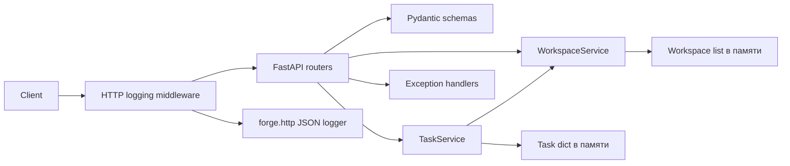

# Forge: архитектура Week 1

## Overview

Forge задуман как agentic workspace для технических задач над Git-репозиториями. Сейчас реализован FastAPI backend: health, создание и список Workspace, создание и получение Task, единый формат ожидаемых ошибок, HTTP JSON-логи и тесты. Репозитории и агенты backend пока не обрабатывает.

## Architecture

Это modular monolith: одно приложение с границами API, схем, сервисов и инфраструктурного кода. Сервисы не импортируют FastAPI.



Pydantic отвечает за HTTP-контракты, сервисы создают доменные dataclass и управляют коллекциями. Handlers преобразуют предусмотренные исключения; middleware добавляет корреляционный ID и пишет лог.

## Repository Structure

```text
README.md, backlog.md, .gitignore
docs/ARCHITECTURE.md, LEARNING_GUIDE.md, adr/ADR-001.md
backend/pyproject.toml
backend/app/main.py
backend/app/api/{health,workspaces,tasks,errors,error_handlers}.py
backend/app/schemas/{health,workspace,task,error}.py
backend/app/services/{workspaces,tasks}.py
backend/app/core/{logging,request_logging}.py
backend/tests/{test_health,test_workspaces,test_tasks,test_errors,test_logging}.py
```

Пакеты `app`, `api`, `schemas`, `services`, `core` имеют `__init__.py`. `pyproject.toml` объявляет Python 3.11+, FastAPI и Uvicorn; pytest и HTTPX входят в dev extra.

## HTTP API

| Method/path | Назначение | Request | Успех | Ожидаемые ошибки |
|---|---|---|---|---|
| GET `/health` | Проверка процесса | нет | 200 `HealthResponse` | 405 при неподдерживаемом методе |
| POST `/workspaces` | Создать Workspace | `WorkspaceCreate`: `name` после trim 1–100 | 201 `WorkspaceResponse`: UUID `id`, `name` | 422 `VALIDATION_ERROR` |
| GET `/workspaces` | Список Workspace | нет | 200 список `WorkspaceResponse`, сначала `[]` | 405 при неподдерживаемом методе |
| POST `/tasks` | Создать намерение для Workspace | `TaskCreate`: UUID `workspace_id`, `goal` 1–500, `acceptance_criteria` 1–10 строк по 1–300 после trim | 201 `TaskResponse`: UUID `id`, `workspace_id`, `goal`, список criteria | 422 `VALIDATION_ERROR`; 404 `WORKSPACE_NOT_FOUND` |
| GET `/tasks/{task_id}` | Получить Task | UUID в path | 200 `TaskResponse` | 422 `VALIDATION_ERROR`; 404 `TASK_NOT_FOUND` |

Воспроизводимый пример: запустите Uvicorn по инструкции README и выполните блок целиком в другом терминале. Все запросы идут к одному процессу; после его перезапуска ID исчезнут. Скрипт использует только стандартную библиотеку Python и передаёт ID из ответов в следующие запросы.

```bash
python3 - <<'PY'
import json
from urllib.request import Request, urlopen

base = "http://127.0.0.1:8000"

def request(method, path, data=None):
    body = json.dumps(data).encode("utf-8") if data is not None else None
    req = Request(base + path, data=body, method=method)
    if body is not None:
        req.add_header("Content-Type", "application/json")
    with urlopen(req) as response:
        result = json.load(response)
        print(method, path, response.status, result)
        return result

request("GET", "/health")
workspace = request("POST", "/workspaces", {"name": "Demo"})
workspaces = request("GET", "/workspaces")
assert workspace in workspaces
task = request("POST", "/tasks", {
    "workspace_id": workspace["id"],
    "goal": "Build API",
    "acceptance_criteria": ["Tests pass"],
})
assert request("GET", "/tasks/" + task["id"]) == task
PY
```

Неизвестный маршрут: 404 `NOT_FOUND`; неверный метод: 405 `METHOD_NOT_ALLOWED` с `Allow`. Обработанные HTTPException других статусов используют `HTTP_ERROR`, исходные заголовки передаются дальше. Ошибки имеют форму `{"error":{"code":"...","message":"...","details":[]}}`; для 422 детали содержат только безопасные `field` и `message`. Swagger UI доступен на `/docs`.

## Request Lifecycle

Client → HTTP middleware → FastAPI routing → Pydantic validation и `Depends` → API handler → service → response → лог middleware. Validation errors преобразуются в 422 централизованным handler. API преобразует отсутствие Workspace/Task в `ApiError`; его handler создаёт ErrorResponse. Starlette HTTPException обрабатывается отдельно. Неожиданное исключение не превращается в этот контракт: middleware пишет 500 и пробрасывает его.

## Dependencies and State

`create_app()` регистрирует handlers и middleware, создаёт один `WorkspaceService` и передаёт его в `TaskService`; оба хранятся в `app.state`. `Depends(get_workspace_service)` и `Depends(get_task_service)` получают экземпляры через `Request`. Новый экземпляр приложения получает отдельное состояние. Данные исчезают при перезапуске и не разделяются между процессами или workers. Список Workspace и словарь Task не являются persistent storage.

## Logging

`configure_http_logger()` устанавливает один именованный handler для `forge.http`, без `basicConfig` root logger. `JsonFormatter` создаёт строку JSON. Middleware генерирует UUID, игнорирует входящий `X-Request-ID`, возвращает свой ID для обработанных ответов и измеряет `duration_ms` через `perf_counter`. `route` — шаблон или `unmatched`; в собственный лог не включаются body, cookies, authorization, query и сырой URL. При неожиданном исключении в `finally` записывается 500, исключение продолжает распространяться. Стандартные Uvicorn access logs независимы и требуют отдельной проверки конфиденциальности.

## Testing

Из `backend`: `python3 -m venv .venv`, активировать окружение, `python -m pip install -e ".[dev]"`, затем `python -m pytest -q`. `TestClient` вызывает ASGI приложение внутри процесса без реальной сети. Fixtures `client` создают новый `create_app()`; `workspace_id` подготавливает Workspace; `captured_logs` временно подключает handler. `test_health`, `test_workspaces`, `test_tasks`, `test_errors`, `test_logging` проверяют контракты, валидацию, изоляцию, заголовки и логирование. Тесты не доказывают сохранность после рестарта, поведение нескольких процессов, реальную сеть, безопасность Uvicorn access logs или производительность.

## Current Limitations

Persistence, agent runtime, AgentRun, tools, permissions и approvals, sandbox, durable workflows, independent agent verification и Apple client отсутствуют. Нет выполнения Task, а in-memory storage предназначен для текущего прототипа. Неожиданные ошибки не имеют специального ErrorResponse handler.

## Architecture Decisions

См. [ADR-001](adr/ADR-001.md) и [backlog](../backlog.md).
