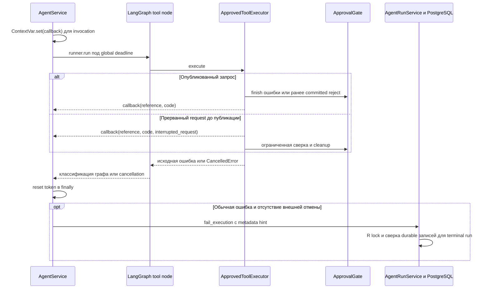
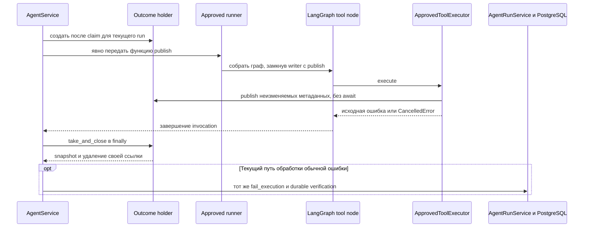

# Forge R2-01 — State Ownership & Explicit Outcome

Исследование на `c109e1ef2f3bf50c3c58b1eab728ee2006f99232`. Локальные `HEAD`, `origin/main` и удалённый `refs/heads/main` совпали. HEAD включает R1A (#46) и R1B (#47). Рассмотрены R0-03, R0-06 и R0-07 из [архитектурного аудита](ARCHITECTURE_REVIEW_WEEK4.md). [ADR-001](adr/ADR-001.md) и [ADR-002](adr/ADR-002.md) остаются основанием для границ. LangGraph исполняет граф за `AgentRunner`. PostgreSQL хранит бизнес-состояние и аудит.

**Решение R2-01.** KEEP текущий протокол и ContextVar на baseline. ADOPT в R2-02 явные операции на уже открытой транзакции после согласования границы ownership. Вариант B прошёл SPIKE и является кандидатом на ADOPT в R2-03 при прохождении реальных PostgreSQL-регрессий. DEFER вариант C как единственный канал передачи метаданных при отмене. Терминальные статусы сохраняются в обеих предлагаемых итерациях.

## 1. Импорты и вызывающие цепочки

Прямые импорты сверены по AST восьми файлов. В таблице приведены зависимости, определяющие исследуемые границы. Вызовы через интерфейсы и переданные объекты сверены в телах методов.

| Модуль | Прямые зависимости и фактические вызовы |
| --- | --- |
| [`services/agent_service.py`](../backend/app/services/agent_service.py#L6-L16) | Импортирует `AgentRunner`, `AgentRunService`, `ActiveRunRegistry` и sink из `agent_runs`. Через протокол вызывает `runner.run(request)`. Claim, result, failure, usage и явная отмена используют отдельные сессии. |
| [`services/agent_runs.py`](../backend/app/services/agent_runs.py#L9-L50) | Импортирует domain-переходы, репозитории AgentRun, Task, ToolCall, Approval и AgentEvent, контракты approval и audit. Проверяет outcome через PostgreSQL и не вызывает gate или граф. |
| [`services/approval_gate.py`](../backend/app/services/approval_gate.py#L10-L41) | Импортирует `AgentRunService`, `ToolCallService`, `PendingApprovals`, domain ToolCall и репозитории. Использует одну сессию для связанных переходов. |
| [`services/tool_calls.py`](../backend/app/services/tool_calls.py#L10-L27) | Импортирует domain ToolCall, репозитории AgentRun, Task, ToolCall и AgentEvent, audit codec. Самостоятельный audit работает без `ApprovalGate`. |
| [`services/approved_tool_executor.py`](../backend/app/services/approved_tool_executor.py#L1-L28) | Импортирует sink, gate, `PendingApprovals`, `ToolExecutor` и bounded cleanup из `tool_calls`. Вызывает gate до и после handler. |
| [`services/active_runs.py`](../backend/app/services/active_runs.py#L1-L49) | Использует локальные `asyncio.Task`. Связи с репозиториями нет. На один run может зарегистрироваться несколько попыток, но только победитель DB claim может начать runner. |
| [`services/approved_repository_agent_runner.py`](../backend/app/services/approved_repository_agent_runner.py#L78-L112) | Проверяет run/Task/workspace в короткой сессии, собирает trusted `PermissionContext`, auditor и writer, передаёт их в `create_approved_repository_graph`, затем вызывает `LangGraphAgentRunner`. Один instance привязан к одному run и loop. |
| [`agent_runtime/approved_repository_graph.py`](../backend/app/agent_runtime/approved_repository_graph.py#L40-L70) | Узел замыкает переданные executor и context, выбирает read или `apply_patch`. Преобразует `ToolExecutionError` и `ToolCallAuditError` в `AgentGraphError`, добавляет `ToolMessage` только после успеха. [`LangGraphAgentRunner.run`](../backend/app/agent_runtime/langgraph_runner.py#L13-L23) классифицирует обычное исключение, оставляет исходный `AgentGraphError` как cause и пропускает `CancelledError`. |

У `AgentService` и `ApprovedToolExecutor` есть прямая зависимость от модуля persistence use-case через приватные `_ApprovalTerminalFailure` и `_approval_failure_sink`. `AgentEventRepository` также импортирует константы типов событий из модулей failure и usage codec. Для R2 важна возможность сохранить запись события в текущей сессии. Перенос этих констант в spike не требуется. [`AgentRunService.fail_execution`](../backend/app/services/agent_runs.py#L176-L249) · [`AgentEventRepository`](../backend/app/repositories/agent_events.py#L1-L9)

## 2. Ownership и транзакции

В таблицах **R** — row lock AgentRun, **T** — ToolCall, **A** — Approval. Сессия держит блокировки до commit/rollback. INSERT новой дочерней строки происходит под R, существующей дочерней строки для `FOR UPDATE` на этом этапе ещё нет. Проверки допустимости применяются под блокировкой до изменения ORM-строк. [Run lock](../backend/app/repositories/agent_runs.py#L17-L25) · [ToolCall lock](../backend/app/repositories/tool_calls.py#L27-L34) · [Approval lock](../backend/app/repositories/approvals.py#L41-L43)

### AgentRun

Исследуемая цепочка начинается с уже записанного `queued` run. В интеграционном fixture его вставляет подготовка сценария и коммитит до запуска `AgentService`. [Создание в fixture](../backend/tests/test_repository_agent_integration.py#L112-L120)

| Переход | Инициатор и проверка | Блокировки и владелец транзакции | AgentEvent | Получатель |
| --- | --- | --- | --- | --- |
| `queued → running` | `AgentService.execute_run` → `AgentRunService.claim_for_execution` проверяет `queued` и читает snapshot Task | R, `AgentRunService` | `agent_run_status_changed` | `AgentService` получает `AgentRunRequest` после commit, затем runner ([код](../backend/app/services/agent_runs.py#L100-L120)). |
| `running → waiting_approval` | `ApprovedToolExecutor` → `ApprovalGate.request`. Проверки точного reserved binding, workspace, deadline и отсутствия активного Approval | R, `ApprovalGate` через транзакционную обёртку ToolCallService | В одной фазе `tool_call_proposed`, `approval_requested`, смена статуса run | Waiter и trusted preview получают опубликованный slot после commit/close ([код](../backend/app/services/approval_gate.py#L56-L76)). |
| `waiting_approval → running` | Approved executor → `ApprovalGate.claim`. Published APPROVE, актуальные состояния, точное committed решение, binding и deadline | R → T → A, `ApprovalGate` | Смена статуса run и `tool_call_started` | Writer продолжает только после commit/close и дополнительных проверок cancellation, deadline и binding ([claim](../backend/app/services/approval_gate.py#L127-L150), [вызов handler](../backend/app/services/approved_tool_executor.py#L100-L119)). |
| `running → verifying`, `running → failed` с final result | `AgentService` → `complete_execution`. Ready result даёт `verifying`, blocked result даёт `failed`. Учитываются состояние и отсутствие прежнего результата | R, `AgentRunService` | `agent_result_recorded` и смена статуса. Blocked result идёт через эту фазу | Вызывающий `execute_run` получает результат после commit ([код](../backend/app/services/agent_runs.py#L143-L164)). |
| `running → failed` по ошибке исполнения | `AgentService` классифицирует ошибку. `fail_execution` проверяет состояние, отсутствие final result и историю failure | R, `AgentRunService` | `agent_execution_failed` и смена статуса | Вызывающий `execute_run` получает исключение. Чтение failure идёт из события ([код](../backend/app/services/agent_service.py#L92-L107), [persistence](../backend/app/services/agent_runs.py#L166-L205)). |
| `waiting_approval → failed` при reject. `waiting_approval/running → failed/cancelled` при ошибке approved tool | `ApprovalGate.decide`, `finish` либо `_reconcile_unpublished_request` проверяют точное состояние и binding. Cleanup неопубликованного запроса меняет run только из `waiting_approval`. Код `cancelled` ведёт в `cancelled`, другие ошибки в `failed` | R → T → A, `ApprovalGate` | ToolCall, Approval и смена статуса run в транзакции gate. Возможный `agent_execution_failed` записывает AgentRunService позже | Decision caller получает завершение своей операции, waiter просыпается после commit при решении. Ошибка продолжается к runner/service ([cleanup и decision](../backend/app/services/approval_gate.py#L78-L125), [finish](../backend/app/services/approval_gate.py#L152-L174)). |
| `queued/running/waiting_approval/verifying → cancelled` по команде | `AgentService.cancel_run` → `AgentRunService.cancel_execution`. Domain map и актуальный статус. Повтор отменённого run идемпотентен | R, `AgentRunService`. Сигнал после подтверждённого commit | Смена статуса один раз | Caller получает завершение команды. Отдельная execution task получает локальный сигнал через общий registry, если он доступен ([cancel](../backend/app/services/agent_runs.py#L130-L141), [signal](../backend/app/services/agent_service.py#L130-L142)). |
| Поддерживаемые прямые переходы | Внутренний `transition_status` проверяет enum, expected и domain map. Допустимы в том числе `queued → failed` и `verifying → failed`. Эти два ребра отсутствуют в обычном pipeline выше. `verifying → succeeded` есть в domain map и блокируется до независимого verification. Для `→ verifying` нужен записанный ready result | R, `AgentRunService` | Смена статуса при успешном переходе | Внутренний caller. Из terminal статусов выходов нет ([domain](../backend/app/domain/transitions.py#L15-L33), [прямой метод](../backend/app/services/agent_runs.py#L83-L98), [guard](../backend/app/services/agent_runs.py#L290-L304)). |

После terminal outcome самого gate, `AgentRunService.fail_execution` может учесть уже завершённую фазу. Он берёт R и проверяет run ID, `apply_patch@1`, состояние ToolCall, ID и состояние Approval, точный `approval_requested` и **единственный** релевантный `tool_call_finished` с ожидаемыми статусом и кодом. Другие затрагиваемые writers также сериализуются под R, поэтому проверка читает дочерние строки без дополнительных T/A. Подтверждение сохраняет существующий статус. У подтверждённого `failed` можно дописать отсутствующий `agent_execution_failed`, у `cancelled` событие failure не пишется. Учёт usage имеет собственную короткую транзакцию под R и не меняет статус. [Failure и verification](../backend/app/services/agent_runs.py#L176-L249) · [usage](../backend/app/services/agent_runs.py#L251-L282)

### ToolCall и Approval

| Объект и переход | Инициатор и проверка | Блокировки и commit/rollback | AgentEvent | Получатель |
| --- | --- | --- | --- | --- |
| ToolCall `∅ → proposed`, обычный audit | `AuditedToolExecutor` → `ToolCallService.propose`. Trusted context, совпадающий workspace и running run | R, отдельная фаза `ToolCallService` | `tool_call_proposed` | Executor получает ticket после транзакции ([код](../backend/app/services/tool_calls.py#L52-L68)). |
| ToolCall `proposed → running`, обычный audit | `AuditedToolExecutor` → `start`. Run всё ещё running, ticket и переход допустимы | R → T, `ToolCallService` | `tool_call_started` | Executor допускает handler после commit ([код](../backend/app/services/tool_calls.py#L97-L110), [guards](../backend/app/services/tool_calls.py#L153-L174)). |
| ToolCall `proposed → denied/failed`, `running → succeeded/failed`, обычный audit | `AuditedToolExecutor` → `finish`. Валидные ticket, переход и audit; R1A reconciliation — только подтверждённый `proposed` с точным audit и без start/finish. Terminal run не препятствует финализации наблюдённого tool outcome | R → T, `ToolCallService` | `tool_call_finished` | Executor возвращает выход или поднимает ошибку, в reconciliation остаётся исходное прерывание ([проверка R1A](../backend/app/services/tool_calls.py#L63-L95), [обычные пути](../backend/app/services/audited_tool_executor.py)). |
| ToolCall `∅ → proposed` и Approval `∅ → pending` | `ApprovedToolExecutor` → `ApprovalGate.request`. Точный reserved slot, running run, binding, deadline, отсутствие активного Approval | R, `ApprovalGate` | `tool_call_proposed` и `approval_requested` вместе с run transition | Trusted preview и waiter получают опубликованную операцию после транзакции ([код](../backend/app/services/approval_gate.py#L56-L76)). |
| Approval `pending → approved`; при reject `pending → rejected` и ToolCall `proposed → denied` | Trusted caller → runner `_decide` → `ApprovalGate.decide`. Published slot, точная ссылка, workspace, binding, deadline, ожидаемое состояние | R → T → A, `ApprovalGate` | `approval_decided`, при reject также `tool_call_finished` и смена статуса run | Decision caller получает завершение операции, waiter — решение после транзакции ([runner](../backend/app/services/approved_repository_agent_runner.py#L65-L76), [gate](../backend/app/services/approval_gate.py#L102-L125)). |
| ToolCall `proposed → running` после approve | `ApprovalGate.claim` проверяет published APPROVE, точное persisted событие, состояния и deadline | R → T → A, `ApprovalGate` | `tool_call_started` вместе со сменой статуса run | Только победивший claimant может перейти к handler. Следующий claim уже не увидит `waiting_approval/proposed` ([код](../backend/app/services/approval_gate.py#L127-L150)). |
| ToolCall `running → succeeded`; по ошибке `proposed/running → failed`, при необходимости Approval `pending → rejected` | `ApprovalGate.finish` проверяет slot, persisted request и актуальное состояние. Успех требует running и approved, ошибочный повтор над terminal call ничего не меняет. R1A до publish требует доказанный `proposed` и точный незавершённый Approval | R → T → A, `ApprovalGate` | `tool_call_finished`, при закрытии pending — `approval_decided` с кодом, при необходимости смена статуса run | Writer получает завершение аудита; ошибка может передать метаданные в `AgentService`. Повтор не открывает terminal записи ([finish](../backend/app/services/approval_gate.py#L152-L204), [R1A](../backend/app/services/approval_gate.py#L78-L100)). |

Владелец **границы фазы** — вызывающий use-case. `ApprovalGate` организует фазу, `ToolCallService._transaction` сейчас технически открывает сессию, выполняет commit, rollback при `BaseException`, закрывает её и нормализует ошибки audit. `AgentEventRepository.append` выполняет flush и выделяет sequence отдельным `MAX(sequence)+1` после получения R в READ COMMITTED. Повторное получение уже удерживаемого R использует ту же сессию. Репозиторий оставляет commit вызывающему. Waiter, модель, filesystem handler и финальный результат лежат за границами этой транзакции. [Транзакционная обёртка](../backend/app/services/tool_calls.py#L112-L137) · [event append](../backend/app/repositories/agent_events.py#L38-L77)

### Приватные связи и cancellation

- `ApprovalGate` использует `ToolCallService._transaction`, `_lock_run`, `_lock_proposed_call`, `_append` и `AgentRunService(session)._transition_locked`. При этом `ApprovalGate._change_call` самостоятельно валидирует ToolCall, меняет ORM-строку и делегирует событие. Замена этих вызовов публичными `start/finish/transition_status` сейчас открыла бы вторую транзакцию или преждевременно сделала commit. [Gate](../backend/app/services/approval_gate.py#L56-L100) · [мутация и события](../backend/app/services/approval_gate.py#L147-L204)
- `ApprovedToolExecutor` вызывает `ApprovalGate._reconcile_unpublished_request`, `ApprovalGate._check_binding` и `ToolExecutor._invoke_handler`. Последний получает зарегистрированный handler, связанный с immutable source evidence, только после claim. Runner также использует `ApprovedToolExecutor._pending_preview` для локального trusted интерфейса. Эти связи отделены от R0-06 по ответственности и не требуют переработки в R2-02. [Исполнение](../backend/app/services/approved_tool_executor.py#L74-L127) · [preview](../backend/app/services/approved_repository_agent_runner.py#L65-L76)
- R0-03. `ActiveRunRegistry` даёт одноразовый локальный сигнал текущей execution task в runner-фазе. Вне неё ставится флаг, который `AgentService` проверяет на границах. DB-отмена сериализуется с claim/result/failure независимо от registry. Два экземпляра `AgentService` с default registry не делят сигнал; в одном процессе для разделённых execute/cancel нужен один явный экземпляр registry. Самостоятельный `Task.cancel()` выходит как `CancelledError` и не вызывает `cancel_run`. [ActiveRuns](../backend/app/services/active_runs.py#L7-L49) · [AgentService](../backend/app/services/agent_service.py#L26-L28) · [PG-тест](../backend/tests/test_agent_service_integration.py#L468-L492)

## 3. Канал outcome

### A. Текущий ContextVar



`AgentService` пишет последнее значение из callback при совпадении run ID, без политики для дубликатов. Reset восстанавливает родительское связывание. Копия контекста, сделанная внутри invocation, может сохранить callable. Это свойство механизма, SPIKE не установил, что production оставляет такую копию после выполнения. Код R1A публикует `interrupted_request` **до** cleanup, поскольку outcome commit ещё не известен. Если durable-проверка не сходится и failure persistence возвращает ошибку, R1A сохраняет исходную ошибку с note. [Scope и failure handling](../backend/app/services/agent_service.py#L57-L128) · [R1A emission](../backend/app/services/approved_tool_executor.py#L78-L90) · [обычная emission](../backend/app/services/approved_tool_executor.py#L129-L148)

`PendingApprovals` и outcome имеют разный lifetime и цель. Slot держит точный `PendingOperation` и trusted context по identity, публикуется после request, просыпается после committed решения, удаляется в `execute.finally`. Runner очищает `_active` в собственном `finally`. Outcome должен пережить эти два cleanup до обработки ошибки владельцем invocation. Слот, ссылка и outcome не дают полномочий открыть запись или повторить write. [PendingApprovals](../backend/app/services/pending_approvals.py#L28-L113) · [runner cleanup](../backend/app/services/approved_repository_agent_runner.py#L101-L112)

### B. Per-invocation holder



Владелец holder — одна invocation `AgentService.execute_run` после успешного claim. Writer получает только `publish`. Метаданные содержат `ApprovalReference`, код и признак `interrupted_request`, без patch, ORM-объектов, сессии, task или model history. Scope записи — текущий loop, run и точная операция. Предлагаемая политика проверяет ожидаемую identity операции, принимает точный повтор идемпотентно, при конфликте убирает конфликтующие метаданные из допустимого evidence. Публикация после закрытия или от чужой операции не меняет состояние. Это работа с метаданными и она не запускает повторный write. При конфликте сохраняется первичная ошибка, а SQL-подтверждение по такому outcome недоступно. Форму диагностики и способ привязки к ожидаемому `ApprovalReference` нужно согласовать.

Явная передача возможна через внутренний callable вызова approved runner с параметрами `request, publish` в точке композиции. Текущий публичный протокол `AgentRunner.run(request)` для остальных runners остаётся прежним. Approved runner уже создаёт writer по invocation и передаёт его замыканием в граф, поэтому состояние LangGraph и payload сообщений не меняются. Сохранить оба исходных момента публикации, отмену и порядок cleanup из A. Не использовать поиск последней ошибки по run как замену точной корреляции. [Композиция runner](../backend/app/services/approved_repository_agent_runner.py#L78-L112) · [узел графа](../backend/app/agent_runtime/approved_repository_graph.py#L40-L70) · [SQL-сверка](../backend/app/services/agent_runs.py#L207-L249)

### Сравнение

| Вариант | Свойства | Failure mode и решение |
| --- | --- | --- |
| A. ContextVar callback + durable verification | Работающий канал A, проходит текущий PG protocol. Graph signatures остаются простыми | Неявный DI и lifetime, запись заменяется последующей, reset не отзывает копии контекста. **KEEP** на baseline. |
| B. Явный holder + та же durable verification | Независим от цепочки исключений. Владелец закрывает scope, а writer имеет только операцию записи | Требует явного wiring и согласованного поведения дубликатов/конфликтов. Поздний сигнал нельзя использовать после закрытия. **SPIKE** пройден, **ADOPT** после R2-02 и будущих regression gates. |
| C. Typed exception + durable verification | Может донести точную ссылку в обычном error path, если каждый слой сохраняет её в контракте | Typed tool error теряет метаданные на текущей границе `AgentGraphError`. Замена `CancelledError` в прямом await меняет внешний contract и превращение deadline в `TimeoutError`. PostgreSQL может проверить известную точную ссылку, но вариант C не обеспечивает её доставку вызывающему при cancellation. **DEFER** как единый транспорт. |

## 4. SPIKE и наблюдаемое поведение

Изолированный скрипт `/private/tmp/forge-r2-01.NOHMYE/outcome_spike.py`, Python 3.13.0, LangGraph 1.2.21. Импорты разрешились к `/Users/dev/Desktop/myFirstForge-week4/backend`. Синтетические UUID и модель, без сети, PostgreSQL или доступа к репозиторию пользователя из скрипта. Отдельный прогон PG ниже проверяет реальный baseline. Отмена доставлялась реальным `Task.cancel()`, deadline — пересозданием срока реального `asyncio.Timeout` через `reschedule(loop.time())` после `asyncio.Event` от дочерней задачи. В LangGraph уровень таймера подменён только точкой создания в экспериментальном процессе, семантика таймера осталась `asyncio`.

| Прогон | Внешняя отмена | Deadline | Контроль обычной ошибки |
| --- | --- | --- | --- |
| Чистый asyncio, A и B | Child опубликовал результат при обработке отмены, родитель увидел `CancelledError` | Child опубликовал результат, родитель получил `TimeoutError` с cause `CancelledError` | — |
| Чистый asyncio, C | Metadata в `TypedOutcome`, заменившем `CancelledError` | Metadata в `TypedOutcome`, `TimeoutError` не возник | — |
| Forge LangGraph, A | `CancelledError`, child вызвал реальный `_finish_error`, `_fail` не вызывался | `execution_deadline_exceeded` с cause `TimeoutError`, одна передача metadata в `_fail` | `graph_execution_failed` и metadata в `_fail` |
| Forge LangGraph, B | `CancelledError`, outcome доступен в holder экспериментального владельца, `_fail` не вызывался | `execution_deadline_exceeded` с cause `TimeoutError`, outcome в holder | `graph_execution_failed`, outcome в holder |
| Forge LangGraph, C | `CancelledError`, typed payload не вышел в наблюдаемой цепочке `__cause__` | `execution_deadline_exceeded` с цепочкой `AgentRunnerError(graph_execution_failed) → AgentGraphError`, без typed payload в `__cause__` | `graph_execution_failed` с cause `AgentGraphError`, без typed payload в `__cause__` |

Прошли 6 вариантов чистого asyncio, 9 вариантов compiled graph и проверки lifetime. В каждой тройке графы выполнялись параллельно, child task отличалась от родителя и завершилась до проверки outcome, ни один сценарий не дошёл до записи успешного результата. В A/B совпали identity опубликованных evidence и их run. В B проверены отказ чужому run, идемпотентность точного повтора, инвалидирование конфликтующей записи, запрет поздней публикации и освобождение ссылки в holder через weakref на контрольном объекте. В A сохранённый `copy_context()` позволил повторно вызвать callback после reset в исходном контексте.

LangGraph уровень использовал настоящие `create_approved_repository_graph`, `LangGraphAgentRunner` и `AgentService.execute_run`, подкладывая test doubles для writer, gate и persistence. Для A вызов настоящего `ApprovedToolExecutor._finish_error` наблюдался через callback, который передавал значение исходному sink. B проверял прохождение по этой топологии, `AgentService` в этом прогоне не подключён к holder и `_fail` **не получил B**. Прототип B связывает holder с run. Проверка первой публикации по ожидаемому ID конкретной операции остаётся задачей R2-03. Фазы R1A, SQL matching, rollback, notify и состояние сессии покрыты существующим baseline с A. SPIKE не подтверждает B с PostgreSQL, поведение при двойной отмене, гибели процесса или произвольно долго блокирующем/подавляющем cancellation handler. Сам timeout остаётся кооперативным.

## 5. Failure semantics текущего baseline

| Причина | Что видит caller | AgentRun / ToolCall / Approval и гарантия |
| --- | --- | --- |
| Явный `cancel_run` | Вызывающий получает завершение команды после commit. Активный локальный execute получает `CancelledError` при доставке сигнала | Run `cancelled` со сменой статуса один раз. При работающем cleanup gate завершает открытый ToolCall как `failed` с кодом `cancelled`. Pending Approval становится `rejected`, ранее decided сохраняется. Это отдельная транзакция в execution task. [Сигнал](../backend/app/services/agent_service.py#L130-L142) · [PG wait](../backend/tests/test_approved_repository_integration.py#L364-L398) |
| Внешний `Task.cancel()` | `CancelledError` | Общий путь сам не переводит run в terminal. Существующий PG-тест сохраняет `running` при простой coroutine cancellation. Approved cleanup может одновременно записать собственный terminal outcome под R. [PG test](../backend/tests/test_agent_service_integration.py#L468-L492) · [Gate](../backend/app/services/approval_gate.py#L152-L174) |
| Global deadline | Когда внешней cancellation нет, `AgentRunnerError(execution_deadline_exceeded)`. R1B проверяет и реальный таймер, и монотонное время после возврата/ошибки | Обычный `running` → `failed` с одним failure event. При прерванном waiter/подтверждённом R1A cleanup gate может уже закрыть run как `cancelled`, call как `failed/cancelled`, pending Approval как `rejected`; durable match сохраняет `cancelled` без agent failure event. Если reject уже committed, сохраняются `failed/denied/rejected`, в одном agent failure event будет deadline, в tool audit — `approval_rejected`. [Deadline](../backend/app/services/agent_service.py#L144-L157) · [сверка](../backend/app/services/agent_runs.py#L194-L249) · [PG race](../backend/tests/test_approved_repository_integration.py#L403-L428) |
| Approval rejection | `graph_execution_failed` с причиной графа `approval_rejected` | Gate атомарно фиксирует `failed/denied/rejected`. При подтверждении failure persistence добавляет одно `agent_execution_failed`. Handler не вызывается. [PG rejection](../backend/tests/test_approved_repository_integration.py#L136-L190) |
| Approval timeout | `graph_execution_failed` с причиной `approval_timeout` | Обычно `failed/failed/rejected` с `approval_timeout` в audit. При durable approve, например между commit и доставкой сигнала, gate не переписывает decided Approval. `finish` закрывает только pending. [Wait](../backend/app/services/approved_tool_executor.py#L91-L110) · [PG wait](../backend/tests/test_approved_repository_integration.py#L364-L398) |
| Наблюдаемый partial side effect | Обычно `graph_execution_failed` с причиной `patch_partial_apply` | `failed/failed/approved` при успешном audit. Наблюдаемая файловая мутация остаётся. ToolExecutor сохраняет partial при истекшем **tool** deadline, но проверяет outstanding external cancel первой. Global deadline остаётся отдельным правилом `AgentService`. [ToolExecutor](../backend/app/tools/executor.py#L110-L133) · [PG write failure](../backend/tests/test_approved_repository_integration.py#L624-L664) |
| Audit persistence failure | Обычно `graph_execution_failed` с причиной `audit_persistence_failed`. R1A сохраняет исходное прерывание при неуспешном reconciliation | Rollback request убирает записи ToolCall/Approval. Rollback claim блокирует вызов handler, error finish может записать `failed/failed/approved`. При rollback final audit после мутации в PG-тесте остаются `failed/running/approved` и изменённый файл. Если не удаётся сверить и завершить уже committed request, возможен `waiting_approval` без slot. [PG фазы](../backend/tests/test_approved_repository_integration.py#L577-L621) · [R1A cleanup failure](../backend/tests/test_proposal_interruption_integration.py#L325-L368) |

Различие `failed/cancelled` на global deadline зависит от фазы и durable outcome gate. Например, чистый deadline классифицируется как ошибка исполнения, а deadline во время ожидания approval может отменить уже подтверждённую операцию, завершив run как `cancelled`. Приведение к одному статусу меняет доменный контракт и историю событий.

## 6. R2-02 и R2-03

| Этап | Предлагаемый минимум | Regression gate |
| --- | --- | --- |
| **R2-02** · ADOPT после согласования границы | В `agent_runs.py` выделить именованную transaction-local операцию transition с уже заблокированной строкой и переданной `AsyncSession`. Она меняет статус, проверяет expected и verification/result guards, пишет событие. В `tool_calls.py` выделить аналогичную transition/audit операцию, общий guard parent/workspace, точную проверку committed proposal и существующую обёртку audit-транзакции как явно компонуемые функции. `approval_gate.py` вызывает их в своей фазе, оставляет собственными проверки связи Approval с ToolCall, решение, admission и publish/notify. Самостоятельные use-cases используют те же функции со своими транзакциями. Сохранить фазовые preconditions, duration guard, нормализацию ошибок и фактическое await commit/rollback/close. | PG `test_agent_event_append_integration.py`, `test_tool_call_integration.py`, `test_approval_integration.py`, `test_proposal_interruption_integration.py`. Критичны contention и sequence, exact persisted request, claim один раз, отсутствие handler после cancel, R1A до/после commit, terminal no-op, каждый rollback из `test_postgres_approved_graph_persistence_failure_never_fabricates_success`. Unit `test_tool_call_service.py`, `test_approval_gate.py`. |
| **R2-03** · SPIKE → условный ADOPT | `agent_service.py`, `approved_repository_agent_runner.py`, `approved_tool_executor.py`, `agent_runs.py` и небольшой внутренний контракт при необходимости. Владелец создаёт/закрывает scope, approved runner и writer получают явный publish, durable matching остаётся в `AgentRunService`. Узел графа сохраняет маршрут и классификацию, approved composition явно связывает registry для совместных execute/cancel при необходимости. | PG `test_agent_service_integration.py`, `test_approved_repository_integration.py`, `test_proposal_interruption_integration.py`, `test_approval_integration.py`, `test_repository_agent_integration.py`. Обязательны rejection, три варианта wait, гонка committed reject с deadline, cleanup failure и verification через независимую сессию. Добавить реальные graph+PG проверки для B с двумя параллельными approved runs, forged/foreign и stale metadata, replay/conflict, cleanup lifetime, точным metadata-only transcript. Unit `test_agent_cancellation.py`, `test_agent_service_deadline.py`, `test_pending_approvals.py`, `test_approved_repository_graph.py`, `test_tool_executor.py`. |

Обязательные инварианты R2-02: R → T → A для существующих строк, один commit на фазу, атомарные AgentEvent, guard от выхода из terminal и одноразовый переход к handler. Ни transaction-local операция, ни репозиторий не начинают свои транзакции посередине gate. Достаточно общего кода для конкретных переходов. Универсальный Unit of Work дал бы дополнительную поверхность для ошибок lifetime без найденного потребителя. Схема и миграция данных для предложенных изменений не требуются. Основной риск — случайно перенести commit, сместить момент publish/notify или перепутать обычный и terminal failure. PostgreSQL обязателен для этих проверок. [Текущие guards](../backend/app/services/approval_gate.py#L127-L204) · [append](../backend/app/repositories/agent_events.py#L47-L77)

Примеры точных существующих gate-тестов. Пути указаны от `backend`. Тест rejection также проверяет отказ поддельному `approval_id` при `fail_execution` и идемпотентную сверку с настоящим reference.

- `tests/test_tool_call_integration.py::test_postgres_concurrent_audit_writers_wait_on_parent_lock_and_preserve_sequence`
- `tests/test_approval_integration.py::test_postgres_approval_claim_checks_exact_persisted_request_metadata`
- `tests/test_approval_integration.py::test_postgres_cancellation_after_claim_commit_never_invokes_handler`
- `tests/test_approval_integration.py::test_postgres_approval_reports_partial_apply_without_retry_or_reuse`
- `tests/test_proposal_interruption_integration.py::test_postgres_interrupted_committed_proposal_is_finalized`
- `tests/test_proposal_interruption_integration.py::test_postgres_concurrent_cancel_and_repeated_cleanup_finalize_once`
- `tests/test_proposal_interruption_integration.py::test_postgres_cleanup_failure_keeps_original_deadline_and_drops_slot`
- `tests/test_proposal_interruption_integration.py::test_postgres_lost_commit_acknowledgment_is_reconciled`
- `tests/test_approved_repository_integration.py::test_postgres_approved_graph_rejection_preserves_original_failure`
- `tests/test_approved_repository_integration.py::test_postgres_approved_graph_wait_ends_without_write[global-deadline]`
- `tests/test_approved_repository_integration.py::test_postgres_approved_graph_deadline_preserves_already_committed_rejection`
- `tests/test_approved_repository_integration.py::test_postgres_approved_graph_persistence_failure_never_fabricates_success[final-audit]`
- `tests/test_agent_service_integration.py::test_agent_service_propagates_coroutine_cancellation_without_transition`
- `tests/test_agent_service_integration.py::test_agent_service_persists_single_deadline_failure_for_late_exception`
- `tests/test_agent_service_deadline.py::test_agent_service_deadline_preserves_external_cancellation`

## 7. Верификация baseline

AST-проверка использовала `ast.parse` и `ast.ImportFrom` по восьми путям из таблицы, цепочки сверены через `rg -n` и `nl -ba`. Дополнительно прочитаны [`pending_approvals.py`](../backend/app/services/pending_approvals.py), [`approval_contracts.py`](../backend/app/services/approval_contracts.py), [`audited_tool_executor.py`](../backend/app/services/audited_tool_executor.py), [`agent_runner.py`](../backend/app/services/agent_runner.py), [`agent_failure.py`](../backend/app/services/agent_failure.py), [`langgraph_runner.py`](../backend/app/agent_runtime/langgraph_runner.py), [`error_classification.py`](../backend/app/agent_runtime/error_classification.py), [`executor.py`](../backend/app/tools/executor.py), [`transitions.py`](../backend/app/domain/transitions.py), [`tool_call_transitions.py`](../backend/app/domain/tool_call_transitions.py) и четыре репозитория из раздела 2. Наблюдения о поведении графа проверены живым запуском, а не выводились только из списка импортов.

Команды для существующего локального venv, пригодные для zsh. Скрипт и его вывод временны и находятся вне Git.

```zsh
cd /Users/dev/Desktop/myFirstForge-week4
git rev-parse HEAD origin/main
git ls-remote --exit-code origin refs/heads/main

env -i PATH="/Users/dev/Desktop/forge/backend/.venv/bin:$PATH" \
  PYTHONPATH="$PWD/backend" PYTHONDONTWRITEBYTECODE=1 \
  LANGSMITH_TRACING=false LANGSMITH_TRACING_V2=false \
  python /private/tmp/forge-r2-01.NOHMYE/outcome_spike.py

cd /Users/dev/Desktop/myFirstForge-week4/backend
env -i PATH="/Users/dev/Desktop/forge/backend/.venv/bin:$PATH" \
  PYTHONDONTWRITEBYTECODE=1 python -m pytest -q -p no:cacheprovider \
  tests/test_agent_cancellation.py tests/test_agent_service_deadline.py \
  tests/test_pending_approvals.py tests/test_approval_gate.py \
  tests/test_tool_call_service.py tests/test_approved_repository_graph.py
```

Целевой прогон дал **95 passed**. PostgreSQL 17.11, READ COMMITTED, Alembic `1d972cc34fbe`, выделенная БД `forge_task06_week4_audit_4d6f653603` на loopback. Перед прогоном проверены фактическая БД, isolation level, версия сервера и revision. Использован существующий файл окружения без вывода credentials. Семь opt-in файлов запускались последовательно.

```zsh
(
  set -e
  cd /Users/dev/Desktop/myFirstForge-week4/backend
  source /private/tmp/forge-step06-db.xEfbZs/postgres.env
  [[ "$POSTGRES_HOST" == "127.0.0.1" && "$POSTGRES_PORT" == "55237" &&
     "$POSTGRES_DB" == "forge_task06_week4_audit_4d6f653603" ]]
  export FORGE_TASK06_TEST_DB="$POSTGRES_DB"
  export FORGE_TOOL_CALL_TEST_DB="$POSTGRES_DB"
  export FORGE_APPROVAL_TEST_DB="$POSTGRES_DB"
  export FORGE_REPOSITORY_AGENT_TEST_DB="$POSTGRES_DB"
  export PYTHONDONTWRITEBYTECODE=1
  for module in agent_service agent_event_append tool_call approval repository_agent \
                approved_repository proposal_interruption
  do
    /Users/dev/Desktop/forge/backend/.venv/bin/python \
      -m pytest -q -p no:cacheprovider "tests/test_${module}_integration.py"
  done
)
```

| PG suite | Passed |
| --- | ---: |
| [`test_agent_service_integration.py`](../backend/tests/test_agent_service_integration.py) | 86 |
| [`test_agent_event_append_integration.py`](../backend/tests/test_agent_event_append_integration.py) | 15 |
| [`test_tool_call_integration.py`](../backend/tests/test_tool_call_integration.py) | 26 |
| [`test_approval_integration.py`](../backend/tests/test_approval_integration.py) | 33 |
| [`test_repository_agent_integration.py`](../backend/tests/test_repository_agent_integration.py) | 5 |
| [`test_approved_repository_integration.py`](../backend/tests/test_approved_repository_integration.py) | 16 |
| [`test_proposal_interruption_integration.py`](../backend/tests/test_proposal_interruption_integration.py) | 13 |
| **Всего** | **194** |

Итоговые pytest summaries не сообщали о failures, skips или warnings. Полный backend-suite в рамках R2-01 не запускался. Проверка объёма diff учитывает новый untracked файл через `git diff --no-index --check -- /dev/null docs/ARCHITECTURE_R2_STATE_OWNERSHIP.md` в дополнение к `git diff --check`.

## 8. Решения владельца

1. Подтвердить ownership R2-02. Gate владеет транзакциями связанных approval фаз. `AgentRunService` владеет общей политикой run и durable подтверждением уже записанного outcome. `ToolCallService` владеет самостоятельными audit use-cases. Для узкого внутреннего API достаточно согласования в рамках R2, существующие ADR сохраняются.
2. Согласовать внутреннюю точку явной передачи publish, точную identity операции, поведение одинаковой/конфликтующей записи и выбор диагностики конфликта в R2-03. Для R0-03 подтвердить локальную композицию с одним `ActiveRunRegistry` для разделённых вызовов execute/cancel. Межпроцессная отмена требует отдельного дизайна.
3. Если нужно унифицировать `failed/cancelled` при global deadline, изменить приоритет cancellation/partial side effect или добавить восстановление после потери in-process slot, принять отдельное решение о поведении с regression gates. Durable recovery и изменение терминального контракта лежат за пределами этого SPIKE.

R2-01 завершён как исследование. R2-02 и R2-03 остаются предложениями.
