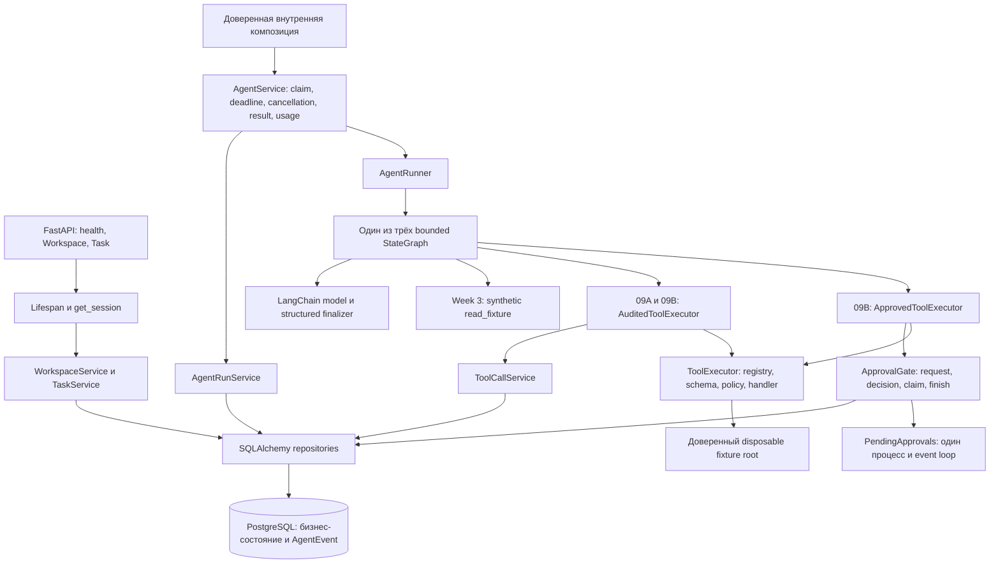

# Forge R0 — архитектурный аудит backend за Weeks 1–4

Дата проверки — 17 ноября 2026. Рабочая ветка `docs/forge-architecture-review`. Исходный `HEAD`, локальный `origin/main` и live `refs/heads/main` совпали на `d6ae644c5851dcadb41c9460df85b668fc2e194e`. Рабочая копия на входе была чистой. GitHub подтвердил, что это merge commit [PR #44](https://github.com/eva-tarasov/myFirstForge/pull/44).

## Выводы

- **P1.** После подтверждённого commit заявки прерывание на выходе из SQLAlchemy-сессии оставляет ToolCall в `proposed`. Для approved write при глобальном дедлайне также остаются `waiting_approval` и `pending`, а `StaleAgentRunStatusError` заслоняет дедлайн. Сценарии подтверждены на PostgreSQL.
- **P2.** Найдены расхождения в классификации просроченной ошибки runner, доставке отмены между экземплярами `AgentService` и валидации прямого входа `TaskService`. Дополнительный долг касается ownership транзакций approvals, передачи причины отказа, повторяющейся сборки runners и границ файловой системы.
- В проверенных fixture-сценариях P0 не выявлен. Сохраняются основания для [ADR-001](adr/ADR-001.md) и [ADR-002](adr/ADR-002.md): модульный монолит, bounded `StateGraph` за `AgentRunner`, бизнес-состояние в PostgreSQL. Для изменения движка или выделения сервиса доказательств нет.

**Приоритеты.** P0 означает нарушение ключевой границы безопасности или риск необратимой потери данных на поддерживаемом пути. P1 означает воспроизводимое расхождение жизненного цикла или потерю управляемости запуском. P2 охватывает ограниченные дефекты и долг, для устранения которых важен контекст следующего этапа. **ADOPT** означает предложение к реализации в обозначенном шаге, **KEEP** — сохранить проверенную границу, **DEFER** — отложить до зависимости или решения владельца, **SPIKE** — проверить альтернативу на ограниченном эксперименте.

## 1. Фактическая архитектура

`create_app()` отвечает за lifespan engine и подключает только health, Workspace и Task. При передаче внешнего engine его жизненным циклом управляет передавшая сторона. `get_session()` закрывает request session, сервисы выполняют commit и rollback, repositories выполняют SQL. `POST /tasks` сохраняет Task, затем возвращает HTTP-результат. Подготовка AgentRun и вызов `AgentService.execute_run()` осуществляются отдельно. Три текущих сценария соединены с приложением через внутреннюю композицию. Пути запуска, отмены и решения approval в HTTP отсутствуют. [create_app и lifespan](../backend/app/main.py#L15-L39) · [get_session](../backend/app/api/dependencies.py#L7-L9) · [Task route](../backend/app/api/tasks.py#L15-L38) · [Workspace route](../backend/app/api/workspaces.py#L13-L27) · [AgentService](../backend/app/services/agent_service.py#L57-L125)

### Фактические зависимости

Статический анализ AST 98 файлов Python под `backend/app` дала 285 уникальных явных внутренних рёбер между модулями. Включены imports внутри методов, учтены imports подмодулей через `__init__`. Граф отражает синтаксические зависимости. Порядок вызовов, DI и динамическая активация сверены вручную по коду и интеграционным тестам. Единственная многоэлементная компонента сильной связности на уровне модулей — `core.logging ↔ services.agent_observability`.

| Откуда | Куда по явным импортам | Архитектурное следствие |
|---|---|---|
| `main` | `api`, `core`, `db` | Корень HTTP-композиции. Обход рёбер из `main` не достигает `agent_runtime` |
| `api` | `repositories`, `schemas`, `services` | HTTP зависимости собирают сервис и repositories из одной сессии. FastAPI импортируется из `api`, `main` и HTTP middleware в `core` |
| `services` | `agent_runtime`, `core`, `db`, `domain`, `permissions`, `repositories`, `tools` | Основной application слой управляет транзакциями. Два repository runner здесь же связывают SQLAlchemy, ChatOpenAI, граф и factory инструментов |
| `agent_runtime` | `core`, `domain`, `permissions`, `services`, `tools` | Runtime опирается на application контракты результатов, ошибок, usage и tool execution. `AgentService` импортирует `AgentRunner` и остаётся независимым от LangGraph и SDK модели |
| `domain` | — | Статусы, dataclass и карты переходов не создают инфраструктурных зависимостей |
| `repositories` | `db`, `domain` и `services` | Обратное ребро создаёт `AgentEventRepository`: константы закодированных failure/usage events |
| `db` | `core`, `domain` | Engine из Settings, ORM/FK/constraints из контрактов состояний. Транзакционная семантика реализована выше |
| `tools` | `domain`, `permissions` | `ToolExecutor` не импортирует PostgreSQL, LangGraph и application services |
| `permissions` | `domain`, `tools` | `PermissionPolicy` потребляет `ToolSpec`. Двусторонняя зависимость пакетов проходит через разные модули и цикла между этими модулями не образует |
| `core` | `services` | `AgentJsonFormatter.format()` лениво загружает валидатор полей из `agent_observability`, который импортирует настройку logger |

Точки для проверки спорных рёбер. [AgentRunner Protocol](../backend/app/services/agent_runner.py#L8-L23) · [repository runners](../backend/app/services/repository_agent_runner.py#L37-L74) · [approved runner](../backend/app/services/approved_repository_agent_runner.py#L38-L112) · [AgentEventRepository imports](../backend/app/repositories/agent_events.py#L1-L9) · [formatter](../backend/app/core/logging.py#L37-L49) · [observer imports](../backend/app/services/agent_observability.py#L12-L16)

### Три графа и исполнение инструментов

| Путь | Исследовательские вызовы / tools / финализация | Допуск и выход |
|---|---|---|
| Week 3 `create_agent_graph` | 2 / 1 / 1 | `read_fixture` — синтетический LangChain tool. Единственный путь, добавляющий `FixtureObservation` |
| 09A `create_repository_graph` | 2 / 1 / 1 | Четыре read-only ToolSpec. `AuditedToolExecutor` проводит proposal, admission и finish. ToolMessage несёт ограниченный JSON |
| 09B `create_approved_repository_graph` | 3 / 2 / 1 | Те же read tools и `apply_patch`. Запись проходит через `ApprovedToolExecutor`. После одной попытки записи граф завершает tool-часть. Поддерживается один patch без предварительного чтения |

`_compile_agent_graph()` собирает общий цикл initialize → model → tool или finalize. Графы разделяют проверку model response, уникальность message ID с `add_messages`, structured finalization и счётчики. Recursion limit 16 задаёт `run_agent_graph()`, checkpointer отключён. 09B дополнительно проверяет повторный model tool-call ID. Model tool-call ID нужен для корреляции сообщений. UUID ToolCall создаётся на стороне backend, поэтому безопасный audit сохраняет свою идентичность отдельно. [Общий граф и раннер](../backend/app/agent_runtime/agent_graph.py#L89-L225) · [09A](../backend/app/agent_runtime/repository_graph.py#L41-L98) · [09B](../backend/app/agent_runtime/approved_repository_graph.py#L24-L70) · [Контракты для модели](../backend/app/agent_runtime/repository_tool_schemas.py#L13-L51)

- `ToolRegistry` перевалидирует `ToolSpec`, хранит неизменяемый каталог и разрешает имя и версию. Discovery отдаёт схемы и метаданные. `ToolExecutor` валидирует аргументы, exact context binding и policy, затем допускает обычным входом только read-only. Он проверяет async handler, deadline, внешний cancellation и выходную схему. `before_handler` служит границей подтверждённого допуска для audit.
- `AuditedToolExecutor` предлагает ToolCall для известного инструмента до запуска admission. Ошибки до handler различаются по коду и terminal status, результат выдаётся после finish. `ApprovedToolExecutor` допускает только проверенный шаблон `apply_patch` с exact bound handler/writer и scopes на все пути. Gate сохраняет решение до пробуждения, повторно проверяет durable binding при claim и закрывает транзакцию до handler. Запись минует публичный read-only путь `execute()` через внутренний `_invoke_handler()` только после этого claim.
- До публикации записи `PendingApprovals` slot зарезервирован. Preview скрыт от модели, patch исключён из repr. `ApprovalReference` сверяется вместе с идентичностью `PermissionContext` и действующим slot. В 09B handle привязан к одному run ID и loop. После завершения ссылки на активный executor и slot очищаются. Хранение fingerprint и UUID даёт проверяемую связь с заявкой, но публичная идентификация пользователя потребует своего контракта.

[ToolRegistry](../backend/app/tools/registry.py#L33-L112) · [ToolExecutor](../backend/app/tools/executor.py#L36-L144) · [AuditedToolExecutor](../backend/app/services/audited_tool_executor.py#L21-L81) · [ApprovedToolExecutor](../backend/app/services/approved_tool_executor.py#L55-L138) · [Прикладная проверка patch](../backend/app/services/approval_contracts.py#L116-L143) · [PendingApprovals](../backend/app/services/pending_approvals.py#L18-L113)

## 2. Матрица ответственности за состояния и транзакции

| Сущность / операция | Владелец правил и записи | Блокировка, commit, инвариант |
|---|---|---|
| Workspace create/list | `WorkspaceService` и `WorkspaceRepository` | Сервис коммитит create, HTTP закрывает request session |
| Task create/replay/status | `TaskService` + `validate_task_transition()`, `TaskRepository` для SQL | Create коммитит после lookup workspace и idempotency resolution. Status проверяется под Task `FOR UPDATE`. `Task.succeeded` блокируется без независимой verification. Запуск AgentRun сам по себе Task status не меняет |
| AgentRun claim | `AgentRunService.claim_for_execution()` по команде `AgentService` | Под lock AgentRun читает связанный Task, сохраняет `queued → running` и событие в одном commit. Runner вызывается после закрытия сессии |
| AgentRun result/failure | `AgentRunService.complete_execution()/fail_execution()` | Под тем же lock сохраняется результат и переход, либо событие ошибки. `ready_for_verification` даёт `verifying`, `blocked` даёт `failed` с результатом. `succeeded` требует отдельного verifier |
| AgentRun cancel и deadlines | `AgentService.cancel_run()` инициирует SQL-отмену через `AgentRunService`, затем `ActiveRunRegistry` сигналит локальной task | `cancelled` сначала коммитится под parent lock. `_run_with_deadline()` ограничивает runner, claim и сохранение результата/usage имеют отдельные границы. Терминальный переход повторно не открывает run |
| Read ToolCall | Правила `validate_tool_call_transition()`, атомарные записи `ToolCallService` по команде `AuditedToolExecutor` | Proposal, running admission и finish — отдельные короткие транзакции. Сначала lock AgentRun, далее ToolCall. Finish может сохранить наблюдённый outcome при уже отменённом родителе |
| Approval / write ToolCall / фазы родителя | `ApprovalGate.request()/decide()/claim()/finish()` координирует один use case и использует таблицы `AgentRun`, `ToolCall`, `Approval` и `AgentEvent` и общие проверки переходов | Порядок lock AgentRun → ToolCall → Approval. Request пишет `waiting_approval`, decision пишет `approved`/`rejected`, claim коммитит `running` для родителя и ToolCall, finish фиксирует tool outcome. Намерение, допуск и эффект на диске наблюдаются на разных границах |
| AgentEvent | Сервисы определяют смысл payload, `AgentEventRepository.append()` выделяет sequence и добавляет строку | Parent `FOR UPDATE`, flush и отдельный `MAX(sequence)+1` при `READ COMMITTED`. Коммит принадлежит вызывающему сервису. Unique constraint защищает пару run/sequence |
| Model usage/cost | `UsageCollector` в runtime, `AgentService` и `AgentRunService.record_usage()` | Событие записывается в отдельной транзакции после результата, ошибки или отмены. Повтор идентичного документа идемпотентен, конфликт отклоняется |

[TaskService](../backend/app/services/tasks.py#L38-L102) · [Task transitions](../backend/app/domain/task_transitions.py#L1-L33) · [AgentRun transitions](../backend/app/domain/transitions.py#L15-L33) · [AgentRunService](../backend/app/services/agent_runs.py#L99-L203) · [Usage](../backend/app/services/agent_runs.py#L250-L281) · [ToolCall transitions](../backend/app/domain/tool_call_transitions.py#L15-L30) · [ToolCallService](../backend/app/services/tool_calls.py#L41-L143) · [ApprovalGate](../backend/app/services/approval_gate.py#L56-L204) · [AgentEvent sequence](../backend/app/repositories/agent_events.py#L47-L77) · [SQL constraints](../backend/app/db/models/execution.py#L18-L85)

## 3. Подтверждённые недостатки

### R0-01 · P1 · ADOPT — прерывание после commit proposal теряет завершение операции

**Тип и участок.** Дефект control flow. `ToolCallService._transaction()` ждёт `session.close()` после commit. `ApprovalGate.request()` публикует slot только после выхода из этой транзакции, а `ApprovedToolExecutor.execute()` начинает обработку отмены внутри следующего `try`. На read-only пути `AuditedToolExecutor.execute()` получает ticket от `propose()` до своего `try`. [Транзакция](../backend/app/services/tool_calls.py#L41-L49) · [commit и close](../backend/app/services/tool_calls.py#L67-L91) · [request и publish](../backend/app/services/approval_gate.py#L56-L76) · [write execute](../backend/app/services/approved_tool_executor.py#L74-L117) · [read execute](../backend/app/services/audited_tool_executor.py#L41-L66)

**Сценарий и evidence.** На выделенной PostgreSQL остановил возврат существующего `await session.close()` после реального close. Сессию помечал по записи `approval_requested` или `tool_call_proposed`. Независимая сессия увидела commit до прерывания. Для явной отмены использован `AgentService.cancel_run()`, для дедлайна — реальный `asyncio.Timeout` с управляемым срабатыванием. В каждом случае coroutine завершилась и fixture остался неизменным. Это fault injection на точной асинхронной границе, без оценки её частоты под обычной нагрузкой.

| Путь | Прерывание | Исключение на выходе | Строки после завершения | `tool_call_finished` |
|---|---|---|---|---:|
| 09B apply_patch | `cancel_run()` | `CancelledError` | run `cancelled`, call `proposed`, approval `pending` | 0 |
| 09B apply_patch | общий дедлайн | `StaleAgentRunStatusError`, cause `execution_deadline_exceeded` | run `waiting_approval`, call `proposed`, approval `pending` | 0 |
| Audited read | `cancel_run()` | `CancelledError` | run `cancelled`, call `proposed` | 0 |
| Audited read | общий дедлайн | `AgentRunnerError(execution_deadline_exceeded)` | run `failed`, call `proposed` | 0 |

**Последствия.** В строках остаётся активная фаза без живого slot или ticket у исполнителя. Оператор видит ожидание, которое нельзя продолжить. При поздней отмене не хватает terminal audit, а write deadline перестаёт быть верхнеуровневой причиной ошибки. Сам handler в проверенных сценариях не выполнялся.

**Минимум.** Удерживать точную идентичность proposal до первой операции сохранения. Для write она уже есть у `PendingOperation`. При прерывании до publish отдельной короткой транзакцией под parent lock сверять durable request и терминализировать только совпавший proposal. Отсутствующая строка означает rollback или отсутствие commit. Для аудируемого чтения передать ticket через явную границу владения proposal, чтобы можно было проверить тот же read call. Вернуть исходную отмену или deadline. Эту обработку ограничить текущим живым invocation и сохранить запрет допуска без publish.

**Альтернативы.** Точечный callback после подтверждённого commit упростит передачу ticket, но случай неопределённого ответа commit всё равно потребует чтения из PostgreSQL. `shield()` вокруг всей операции ухудшит соблюдение cancellation и не даст recovery при смерти процесса. Делать commit и publish одной логической нефейлящей операцией в памяти недостаточно для двух разных ресурсов.

**ADR и миграция.** Отдельный ADR для локального завершения proposal не нужен. Миграция схемы не требуется, риск средний из-за порядка закрытия сессии и двойной отмены. Регрессионные проверки — PostgreSQL fault injection после commit до publish и до возврата read ticket, pre-commit rollback, обычный published timeout, две отмены, отсутствие handler и дублирующего finish. ADR понадобится для восстановления таких операций после остановки процесса.

### R0-02 · P2 · ADOPT — просроченное исключение runner обходит проверку монотонного дедлайна

**Тип и участок.** Дефект классификации. `AgentService._run_with_deadline()` проверяет `loop.time()` после успешного возврата. В `except TimeoutError` учитывается только `timeout.expired()`. Обычное исключение проходит мимо проверки времени. ToolExecutor уже отличает позднее исключение, внутренний timeout, внешнюю отмену и наблюдённый partial effect. [Глобальный deadline](../backend/app/services/agent_service.py#L141-L154) · [Deadline инструмента](../backend/app/tools/executor.py#L95-L144)

**Сценарий и evidence.** Изолированный runner в памяти при лимите 1 с сдвигал монотонные часы на 2 с без await и выбрасывал ошибку. В R0 `RuntimeError` сохранил `execution_failed`, внутренний `TimeoutError` — `runner_timeout`, а `AgentRunnerError(provider_timeout)` — `provider_timeout`. Во всех трёх случаях вышел исходный экземпляр исключения. Существующие тесты отдельно покрывают поздний возврат до timer callback и внутренний timeout до дедлайна. [Тесты дедлайна AgentService](../backend/tests/test_agent_service_deadline.py#L80-L206) · [Аналогичная проверка ToolExecutor](../backend/tests/test_tool_executor.py#L420-L485)

**Минимум и trade-off.** Добавить проверку времени после выхода из timeout scope на пути обычного исключения. Сохранить внутреннюю причину в безопасной цепочке и приоритет внешнего `CancelledError`. Истёкший глобальный deadline относится к верхнему уровню операции, а зафиксированный partial effect остаётся отдельным durable outcome. Альтернатива — оставить первичную ошибку и кодировать нарушение SLA отдельным полем, но это меняет failure contract. В той же серии проверить настройку двух часов. Defaults `execution_timeout_seconds=60` и `wait_seconds=60` отсчитываются с разных фаз, поэтому для запуска с обоими defaults общий deadline наступает раньше полного окна approval. Настраивать owner-facing лимиты явно, приоритет менять только отдельным решением. [Defaults AgentService](../backend/app/services/agent_service.py#L20-L39) · [Defaults runner](../backend/app/services/approved_repository_agent_runner.py#L41-L56) · [Старт ожидания](../backend/app/services/approved_tool_executor.py#L69-L85)

**ADR и миграция.** Для исправления формы проверки ADR не нужен. Риск средний для совместимости прежних кодов на пограничных случаях. Регрессионные проверки — позднее возвращённое значение и исключение до callback, inner timeout до срока, настоящий таймер, concurrent external cancel, обе последовательности дедлайнов approvals, доказанный partial effect. Изменение публичной семантики сроков потребуется согласовать отдельно перед API.

### R0-03 · P2 · ADOPT — локальный сигнал отмены зависит от неявного DI registry

**Тип и участок.** Долг композиции с воспроизводимым пограничным отказом. `AgentService.__init__()` по умолчанию создаёт собственный `ActiveRunRegistry`. `cancel_run()` пишет БД, затем сигналит только этому registry. `ActiveRunRegistry.request_cancel()` не находит задачи в другом экземпляре, даже в том же loop. Тест подтверждает раздельные defaults и явно общий вариант. [Сборка сервиса](../backend/app/services/agent_service.py#L31-L55) · [Отмена](../backend/app/services/agent_service.py#L127-L139) · [Registry](../backend/app/services/active_runs.py#L20-L49) · [Изоляция и общий registry](../backend/tests/test_agent_cancellation.py#L140-L145)

**Сценарий и evidence.** Один сервис дошёл до опубликованного approval. Второй экземпляр с тем же factory вызвал `cancel_run()`. БД показала `cancelled`, но первый waiter остался жив и preview доступен. После принудительного срабатывания approval timeout первый вызов завершился `StaleAgentRunStatusError` с cause `graph_execution_failed`, durable ToolCall стал `failed`, Approval — `rejected`. Fixture остался прежним. Parent lock продолжает ограждать claim. Локальная задержка и неверный внешний outcome воспроизводятся без нескольких процессов.

**Минимум и trade-off.** Для будущей точки композиции запуска, статуса и отмены передавать общий loop-local registry явно. Сохранить отдельные короткие DB sessions и статус-guards. Альтернатива — один app-scoped сервис для всех run, но текущий approved runner намеренно создаётся на конкретный run, поэтому общий registry проще общего runner. Межпроцессовую доставку не имитировать глобальным словарём.

**ADR и миграция.** Для явного DI внутри одного процесса ADR не нужен. Риск низкий внутри процесса, средний при ошибочном переносе обещаний на несколько workers. Регрессионные проверки — две service-фасады с общим registry, две независимые workspace bindings, cancel после commit и cleanup, отсутствие сигнала при rollback, решение под parent lock. Семантика публичного cancel и доставка между процессами требуют согласования.

### R0-04 · P2 · ADOPT — инварианты TaskCreate остаются только на HTTP-входе

**Тип и участок.** Дефект прямого application-входа, известная тема BL-01. `TaskCreate` требует непустые критерии после trim и максимум 300 символов каждый. `TaskService.create_task()` строит dataclass и trim делает только при idempotency key. У `TaskModel` ограничение массива проверяет cardinality, элементы хранятся как `Text`. [HTTP schema](../backend/app/schemas/task.py#L5-L20) · [Application create](../backend/app/services/tasks.py#L46-L74) · [Домен](../backend/app/domain/task.py#L16-L22) · [Модель](../backend/app/db/models/task.py#L12-L31) · [BL-01](../backlog.md#L5-L9)

**Сценарий и evidence.** В R0 Pydantic отклонил синтетический вход с пробельным критерием и критерием длиной 301. Прямой `TaskService.create_task()` сохранил оба значения. Новая PostgreSQL-сессия прочитала длины `(1, 301)` и пробельный первый элемент. Тестовая строка удалена по UUID в teardown. Неоднородные Task доступны внутреннему runner, а будущий verifier получил бы критерий без проверяемого содержания.

**Минимум и trade-off.** Ввести один чистый нормализатор/валидатор application-входа для create и replay, который не зависит от FastAPI. Сохранить текущий HTTP status/error shape. Можно добавить DB CHECK/другой формат criteria, но сначала нужен аудит исторических данных и контракт на миграцию. На этапе R0 для нового прямого входа достаточно application-границы.

**ADR и миграция.** Для согласования нынешних входов ADR не нужен. Низкий риск для валидного HTTP-трафика, средний для внутренних вызывающих и ранее записанных данных. Регрессионные проверки — прямой вход с/без idempotency key, HTTP 422, concurrent replay и conflict, исторический Task читается. Нормализацию старых строк и неизменяемый fingerprint при редактировании Task вынести отдельно. [Idempotency и READ COMMITTED](../backend/app/repositories/tasks.py#L24-L40) · [BL-07 и BL-09](../backlog.md#L42-L61)

### R0-05 · P2 · ADOPT — WorkspaceService пропускает явный rollback при отмене

**Тип и участок.** Дефект cleanup при прямой композиции. `WorkspaceService.create_workspace()` ловит `Exception`, `TaskService.create_task()` ловит `BaseException` и выполняет rollback. `CancelledError` идёт мимо первого обработчика. HTTP dependency закрывает сессию, поэтому стандартная HTTP-композиция имеет собственный cleanup. [WorkspaceService](../backend/app/services/workspaces.py#L14-L22) · [TaskService](../backend/app/services/tasks.py#L60-L74) · [request session](../backend/app/api/dependencies.py#L7-L9)

**Сценарий и evidence.** Инъекция `CancelledError` в `commit()` с mock-сессией дала 0 вызовов rollback для WorkspaceService и 1 для TaskService. При прямом использовании и повторном применении той же сессии очистка отложена до владельца сессии. Опыт не моделировал исход реального COMMIT и не доказывает сохранение или потерю строки в PostgreSQL.

**Минимум и trade-off.** Согласовать rollback при отмене в сервисе Workspace с контрактом Task, сохранив исходный `CancelledError`. Альтернатива — полностью делегировать rollback вызывающему context manager. Она меняет ответственность существующих внутренних вызовов, поэтому требует отдельного пересмотра DI.

**ADR и миграция.** ADR и миграция не нужны. Низкий риск. Регрессионные проверки — инъекция отмены в add/commit, ошибка rollback, неизменные HTTP-ответы и запросы Workspace. [Имеющиеся транзакционные тесты](../backend/tests/test_service_transactions.py)

### R0-06 · P2 · ADOPT — ownership ToolCall и AgentRun выражен приватными связями между сервисами

**Тип и участок.** Архитектурный долг. `ApprovalGate` использует `ToolCallService._transaction()`, `_lock_run()` и `_append()`, сам меняет `call.status` и вызывает `AgentRunService._transition_locked()`. Read audit меняет тот же статус внутри `ToolCallService._transition()`. `ApprovalGate._load_locked()` соблюдает parent → child порядок. `AgentEventRepository.append()` повторно берёт уже удерживаемый parent lock, хотя умеет работать и самостоятельно. [Gate](../backend/app/services/approval_gate.py#L56-L178) · [ToolCall transition](../backend/app/services/tool_calls.py#L94-L143) · [AgentRun transition](../backend/app/services/agent_runs.py#L289-L303) · [Event append](../backend/app/repositories/agent_events.py#L47-L77)

**Сценарий и последствия.** Изменение проверки терминального ToolCall, audit payload или границы commit в одном сервисе затрагивает оба пути. Например, commit внутри общего transition helper разрушил бы атомарность `approval_requested + waiting_approval`. Подтверждено, что сегодня gate встраивает низкоуровневые операции в одну транзакцию. Существующие fault injection и lock tests проходят, текущего deadlock или нарушения атомарности в этих фазах не обнаружено.

**Минимум и trade-off.** Сделать один явный transaction-local вход для обновления ToolCall и audit с уже удерживаемым parent lock. `ApprovalGate` сохраняет orchestration и commit, `ToolCallService` сохраняет публичные standalone операции. Сохранить общую проверку перехода AgentRun без внутреннего commit. Альтернатива — общий Unit of Work на всё приложение. Для двух небольших путей это добавляет инфраструктурный контракт прежде доказанного выигрыша. Убирать повторный parent lock имеет смысл только после доказательства обязательного lock protocol для всех существующих writers.

**ADR и миграция.** Локальное переиспользование без смены владельца commit не требует ADR. Риск средний, миграция БД не нужна. Регрессионные проверки — полный approval flow, read audit при отменённом родителе, rollback на каждой фазе, `pg_blocking_pids()`, parent-order и монотонная sequence. [Regression прямого ToolCall](../backend/tests/test_tool_call_integration.py#L403-L553) · [Event concurrency](../backend/tests/test_agent_event_append_integration.py#L197-L286) · [Failure injection 09B](../backend/tests/test_approved_repository_integration.py#L578-L624)

### R0-07 · P2 · SPIKE в R2 после R1 — approval failure sink

**Тип и участок.** Архитектурный долг в передаче доказательства terminal outcome. `AgentService.execute_run()` на время `_run_with_deadline()` устанавливает `ContextVar[Callable]`. Callback замыкает локальное место под последнее evidence того же run. LangGraph child tasks наследуют context. `ApprovedToolExecutor._finish_error()` сообщает `ApprovalReference + ToolCallErrorCode` после подтверждённого finish или уже закоммиченного rejection. `AgentService` сбрасывает context token в `finally` и передаёт evidence в `AgentRunService.fail_execution()` только при обработке ошибки. [Context var](../backend/app/services/agent_runs.py#L40-L49) · [Capture](../backend/app/services/agent_service.py#L57-L104) · [Emitter](../backend/app/services/approved_tool_executor.py#L119-L138)

**Чему доверяет текущая реализация.** Evidence из памяти сужает поиск. Под parent lock сервис проверяет run ID, точный `apply_patch@1`, ToolCall и его terminal status, связанную Approval, сохранённый request fingerprint payload и единственный finish event с соответствующим кодом. Оставшиеся unrelated stale states отклоняются. При уже подтверждённом `failed` добавляется максимум один execution failure event. При global deadline и подтверждённой cancellation остаётся `cancelled`, при уже committed rejection остаётся `failed` с `approval_rejected` на ToolCall. `_check_interruption()` сначала отдаёт приоритет доставленной внешней отмене. [Проверка доказательства](../backend/app/services/agent_runs.py#L175-L248) · [Rejection, forged evidence и повтор](../backend/tests/test_approved_repository_integration.py#L136-L174) · [Конкурирующий deadline](../backend/tests/test_approved_repository_integration.py#L365-L431)

**Сценарий и последствия.** Протокол между тремя модулями скрыт от сигнатуры `AgentRunner` и срабатывает только при исполнении внутри одного context. Прямой вызов approved executor завершает свою фазу, но application receipt отсутствует. Если перенос работы в иной context или detached task когда-либо изменит наследование, generic AgentService снова не сможет отличить доверенную завершённую фазу от чужого stale state. Сброс в родителе не отзывает context, уже скопированный в дочернюю task. Текущий путь ожидает свои задачи и запрещает повторный запуск handle, поэтому утечки между текущими параллельными runs не наблюдались. R0-01 показывает конкретный пробел до передачи evidence.

**Минимум и альтернативы.** В R1 сохранить строгую durable сверку и исправить границу proposal. В R2 предпочесть маленький приватный per-run outcome holder с явным владельцем и временем жизни, который runner передаёт исполнителю. Проверить на коротком spike, что `AgentService` получает trusted outcome при отмене child и превращении её в deadline. Типизированная ошибка упростит обычный failure, но сама по себе не переносит evidence из отменённой child task. Полностью DB-only поиск по «последнему событию» потеряет связь с конкретным invocation и здесь неприемлем. Если явный контракт затрагивает публичный `AgentRunner`, оставить ContextVar и сначала документировать его ограниченный protocol и тестировать cross-context.

**ADR и миграция.** Небольшая приватная замена при сохранении `AgentRunner`, semantics и JSON v1 не требует ADR. Нужны согласование владельца из-за изменения provenance и проверка R1 до замены. Любой переход к durable receipt или новый contract outcome за пределами процесса требует ADR. Риск средний. Регрессионные проверки — три порядка deadline/cancel/reject, отказ forged evidence, idempotent failure event, два параллельных run с разными ref, потеря/rollback finish, неизменный stale для обычного runner.

### R0-08 · P2 · DEFER до контракта ошибок Verification/API — точная причина tool failure не проходит в AgentFailure v1

**Тип и участок.** Архитектурный долг с подтверждённым преобразованием. `repository_graph._call_repository_tool()` и `approved_repository_graph.tool_node()` переносят стабильный tool code в `AgentGraphError` и подавляют traceback исходного tool исключения. `classify_runtime_error()` оставляет разные коды provider/timeout/budget, но большинство ошибок графа сводит к `graph_execution_failed`. `AgentFailure` сохраняет только `schema_version + code`. [Read mapping](../backend/app/agent_runtime/repository_graph.py#L52-L58) · [Write mapping](../backend/app/agent_runtime/approved_repository_graph.py#L55-L66) · [Classifier](../backend/app/agent_runtime/error_classification.py#L17-L36) · [Причина runner](../backend/app/agent_runtime/langgraph_runner.py#L13-L23) · [Payload v1](../backend/app/services/agent_failure.py#L68-L100)

**Сценарий и последствия.** Прямой caller видит безопасный code в `AgentRunnerError.__cause__`. При созданном ToolCall PostgreSQL отдельно сохраняет `approval_rejected`, `patch_partial_apply` и другие tool codes. Ошибка до proposal, например запрещённый write scope, оставляет только generic run failure. Поэтому потребителю `get_run_failure()` недостаточно информации для различения отсутствия прав, валидации и отказа operation. Ещё один слой потери: если запись fail сама падает, `AgentService` поднимает secondary exception, а первый остаётся в cause. Текущий тест rejection специально доказывает безопасную цепочку причины и ровно один run event. [Failure chain](../backend/app/services/agent_service.py#L92-L104) · [Отказ до approval](../backend/tests/test_approved_repository_integration.py#L560-L576) · [Partial effect](../backend/tests/test_approved_repository_integration.py#L625-L665)

**Минимум и trade-off.** Сохранить broad run category, дополнить её безопасной структурированной детализацией из разрешённых enums и ссылкой на ToolCall при его наличии. Разделять execution outcome, сбой сохранения outcome и eligibility к retry. В R0 сохранять v1 и проверенный redaction. Альтернатива — выполнять join с ToolCall при чтении, что помогает для запущенного tool, но не решает ошибки до proposal и вводит неоднозначность при нескольких tools. Автоматический retry для side-effect paths из generic категории недопустим.

**ADR и миграция.** Локальный typed cause можно ввести без ADR при прежнем wire contract. Смена persisted payload/reconciliation contract и публичной семантики ошибок требует решения владельца и ADR. Риск средний, потребуются чтение v1 и проверка совместимости будущего v2. Регрессионные проверки — denial до/после proposal, rejection, provider timeout, case без ToolCall, partial effect, сбой записи failure, внешняя отмена и отсутствие сырого текста в payload/логах.

### R0-09 · P2 · DEFER API-проекцию — usage failure при уже сохранённом результате

**Тип и участок.** Архитектурный долг контракта caller, защищённый тестом. `AgentService.execute_run()` коммитит preliminary result через `_complete()`, затем записывает usage в `finally`. Ошибка usage после результата поднимает `AgentUsagePersistenceError`. При уже активной ошибке или отмене добавляется безопасная note и сохраняется первичная причина. [Result и usage](../backend/app/services/agent_service.py#L106-L125) · [PostgreSQL regression](../backend/tests/test_agent_service_integration.py#L1652-L1726)

**Сценарий и последствия.** В существующем тесте PostgreSQL отклоняет usage event constraint. Caller получает ошибку, свежий read получает valid result и `verifying`. Новый HTTP-клиент, принимающий любой exception за основание повторить запуск, ошибся бы в состоянии и политике повторов.

**Минимум и trade-off.** Перед public API явно отразить в read/status модели отдельно исход run и неполноту usage. Сейчас сохранить тестируемую семантику. Альтернатива — склеить usage и result в один commit, но usage нужен и при ошибке/отмене, а временный сбой учёта тогда задержит бизнес-результат.

**ADR и миграция.** Текущие v1 записи совместимы с отдельной read-проекцией, риск низкий. Изменение атомарности usage и result требует ADR и согласования политики billing. Регрессионные проверки — успешный результат при сбое usage, отмена и основная ошибка с note, повтор идентичного usage, отсутствие повторного run claim. [Usage write](../backend/app/services/agent_runs.py#L250-L281)

### R0-10 · P2 · ADOPT — сборка двух repository runners повторяет одну проверку и DI

**Тип и участок.** Архитектурный долг дублирования. `RepositoryAgentRunner.run()` и `ApprovedRepositoryAgentRunner.run()` отдельно загружают run и Task, сверяют run/task/workspace/status, закрывают сессию, строят контекст, read executor и `ToolCallService`. Различия существенны для approval: exact read+write grants, stdlib UUID, scope, один run/loop и private handle. [Read runner](../backend/app/services/repository_agent_runner.py#L37-L74) · [Approved runner](../backend/app/services/approved_repository_agent_runner.py#L38-L112)

**Сценарий и последствия.** Добавление нового инварианта связи workspace с run или изменение запроса в одном runner оставит другой на прежнем пути. Проверяемая опасность при механическом объединении — перенос read-only маски capabilities на approved runner либо утрата exact instance binding, которую gate сверяет многократно. Найдено конкретное повторение общей проверки и одинакового construction. Текущие тесты на изоляцию workspace и на корректный допуск прошли.

**Минимум и trade-off.** Вынести одну закрытую функцию проверки persisted binding и общую сборку bound reader/audit. Раздельно собирать разрешения и write executor, сохранить владение approval handle у approved runner. Общий superclass с флагом write повышает риск скрытого расширения доступа и здесь избыточен. Один небольшого размера внутренний composition module можно рассматривать, если он действительно уберёт импорт SDK из application namespace.

**ADR и миграция.** ADR не нужен для приватного helper и прежнего `AgentRunner`. Риск средний, БД и API сохранены. Регрессионные проверки — mismatch run/task/workspace/status, две workspace одновременно, одна сессия закрыта до model, exact context один для read/write registrations, запрет write на обычном пути и точные пять схем только для 09B. [Read composition tests](../backend/tests/test_repository_agent_graph.py) · [Approved composition tests](../backend/tests/test_approved_repository_graph.py#L189-L287)

### R0-11 · P2 · ADOPT локально — budget и admission проверяются в нескольких узлах графов

**Тип и участок.** Архитектурный долг. `call_model()` ограничивает число model calls. Однотипные проверки допустимого состояния перед tool повторяются в legacy tool node, 09A и 09B. 09B получает max research calls через параметр builder и использует тот же уровень отдельно в tool node. Правило после write выводится из истории `ToolMessage`, откуда же проверяется duplicate tool-call ID. [общий model node](../backend/app/agent_runtime/agent_graph.py#L91-L128) · [09A preflight tool](../backend/app/agent_runtime/repository_graph.py#L41-L82) · [09B preflight tool](../backend/app/agent_runtime/approved_repository_graph.py#L40-L69)

**Сценарий и последствия.** В текущих трёх bounded графах сочетания лимитов корректны. При добавлении четвёртого пути или изменении одного budget можно разрешить выполнение последнего tool без оставшегося model call либо ошибочно разрешить tool после patch. Такой drift потребовал бы правки нескольких точек. Политики legacy fixture, audited read и approved write проверяют разные свойства и имеют разные ограничения.

**Минимум и trade-off.** Передать один неизменяемый набор model/tool budgets из composition в checks обеих фаз. Переиспользовать проверку структуры tool-call и bounded serialization. Специфику write и синтетических observations оставить в соответствующих узлах. Альтернатива — единый state machine с произвольной регистрацией routes, но нынешняя прозрачность разрешённых путей важнее.

**ADR и миграция.** Без ADR и миграции при прежних лимитах. Риск низкий или средний для observable error precedence. Регрессионные проверки — legacy 2/1/1 и 09A 2/1/1, 09B 3/2/1, прямой patch, duplicate IDs, tool после patch, исчерпание каждого бюджета, recursion limit и `observations` только на синтетическом пути. [Legacy graph tests](../backend/tests/test_agent_graph.py) · [09A graph tests](../backend/tests/test_repository_agent_graph.py) · [09B graph tests](../backend/tests/test_approved_repository_graph.py#L95-L144)

### R0-12 · P2 · SPIKE до Sandbox — проверка fixture файлов ограничивает поверхность, стабильность snapshot и wall-clock остаются условными

**Тип и участок.** Ограничение threat model с подтверждёнными границами. `SafeRepositoryReader` использует backend-selected root, `dir_fd`, `O_NOFOLLOW`, exact names, same device, identity и single link, scope checks на каждом разрешённом пути, бюджеты глубины, entries, bytes и вывода. При чтении заключительный `fstat` проверяет допустимый тип и link count, но сам по себе не подтверждает неизменность содержимого на всём протяжении read. `SafeRepositoryWriter` повторно оценивает read/write scopes, stage всех целей, сравнение полных исходных байтов и fingerprints. Ближняя revalidation и `os.replace` остаются отдельными операциями. `preview` и файловые syscalls работают синхронно в async invocation. Отложенный callback таймера может выполняться только когда event loop снова получает управление. [Reader](../backend/app/tools/repository/filesystem.py#L81-L119) · [Scope, descriptor, same device](../backend/app/tools/repository/filesystem.py#L154-L275) · [Writer plan и replace](../backend/app/tools/repository/writer.py#L94-L161) · [Writer revalidation](../backend/app/tools/repository/writer.py#L163-L247)

**Сценарий и последствия.** Кооперативный disposable fixture соответствует проверенной области. При независимом конкурентном изменении содержимого или пространства имён доверенная «база + recheck» не доказывает snapshot isolation. На медленной файловой системе bounded количество операций не ограничивает длительность одного syscall и может задержать другие runs и cancel. В R0 не выполнялась симуляция враждебной среды и не измерялась задержка. Существующие тесты подтверждают отказ защищённых путей, symlink/hard link, подмену root, конфликт до replacement и отсутствие доступа к запрещённому потомку. [Reader regressions](../backend/tests/test_safe_repository.py#L54-L219) · [Writer regressions](../backend/tests/test_repository_patch.py#L113-L294) · [Denied descendants](../backend/tests/test_safe_repository.py#L320-L349)

**Минимум и альтернативы.** Сохранить нынешнюю fixture-границу. В ограниченном эксперименте Week 6 проверить detached test root с отдельным владельцем, read snapshot и policy на границе процесса. Дополнительное сравнение размеров и времён после read помогает обнаружить часть изменений, но не заменяет владение workspace. Перенос I/O в thread снижает блокировку loop, но coroutine cancellation не останавливает уже начатую запись в thread. Изоляция процесса лучше отделяет ресурсы и полномочия ценой отдельного lifecycle и проверки kill semantics.

**ADR и миграция.** Проби scope/read tests в trusted fixture не требуют ADR. ADR обязателен до расширения threat model, смены процесса исполнения или root ownership. Риск высокий при преждевременном расширении доступа, низкий для воспроизводимого spike. Регрессионные проверки — текущие exact scope, protected paths, symlinks, content changed, partial apply, bounded bytes, cancellation и безопасное завершение на macOS и целевом Linux.

### R0-13 · P2 · DEFER автоматическое восстановление — PostgreSQL admission и filesystem effect разделены

**Тип и участок.** Долг интерпретации наблюдений, ожидаемый от границы двух ресурсов. `ApprovalGate.claim()` коммитит допуск, `ApprovedToolExecutor.execute()` вызывает запись после него и сохраняет результат в отдельной транзакции. Writer заменяет файлы по одному и сообщает `patch_partial_apply` после уже наблюдённой замены. Terminal audit может не успеть сохраниться. [Claim и finish](../backend/app/services/approval_gate.py#L107-L150) · [Вызов и финализация](../backend/app/services/approved_tool_executor.py#L98-L117) · [Замена и partial result](../backend/app/tools/repository/writer.py#L137-L161)

**Сценарий и evidence.** Существующий `final-audit` fault injection оставляет изменённый fixture, `AgentRun.failed`, `ToolCall.running` и `Approval.approved`. Проверка отмены после mutation оставляет фактическое изменение при `cancelled`. Partial apply после первого replace даёт `patch_partial_apply` и изменённый первый файл. Из `running` самого по себе нельзя узнать, был ли effect. Повтор безопасен только после отдельного решения о подтверждённом состоянии и новом допуске. [Final audit failure](../backend/tests/test_approved_repository_integration.py#L578-L624) · [Partial write и отмена](../backend/tests/test_approved_repository_integration.py#L625-L696)

**Минимум и альтернативы.** Для Verification сделать read-only наблюдение фактических файлов и явно выводить неизвестный outcome при незавершённом call. Сохранять различие между failure, partial effect и unknown. Оставить automatic retry/rollback на потом. Журнал операций или workspace snapshots облегчают reconciliation, но меняют хранение чувствительных данных и контракт восстановления.

**ADR и миграция.** Read-only диагностика без нового persisted формата не требует ADR. Долговечные идентификаторы эффектов, откат и replay потребуют ADR, миграции и политики retention. Риск высокий для повторного исполнения. Регрессионные проверки — сбой до claim, после claim и после первого replace, ошибка finish, restart, содержимое и audit перед любым recovery, запрет автоматического повтора.

### R0-14 · P2 · DEFER до изменения контрактов событий — обратные импорты репозитория и цикла логирования

**Тип и участок.** Архитектурный долг. `AgentEventRepository` импортирует константы из двух application codecs, которые сервисы сами используют при записи. `AgentJsonFormatter.format()` лениво импортирует `agent_log_fields()` из `AgentObserver`-модуля, уже импортирующего настройку logger. AST подтвердил цикл последней пары. `AgentObserver._emit()` подавляет ошибки диагностического пути, поэтому нет основания считать импорт сбоем бизнес-исполнения. [Repository imports](../backend/app/repositories/agent_events.py#L1-L36) · [Formatter](../backend/app/core/logging.py#L37-L49) · [Observer](../backend/app/services/agent_observability.py#L151-L173)

**Сценарий и последствия.** Выделение event persistence adapter либо подключение второго consumer к типам потребует загрузки application modules. Рефакторинг ленивых imports в eager способен сделать цикл при import-time. Фактического сбоя текущего HTTP старта или рабочего logger по результатам прогона нет. Dependency injection в FastAPI для Task и Workspace прост, трогать его ради абстракции сейчас нецелесообразно.

**Минимум и trade-off.** При следующем изменении формата событий переместить лишь стабильные имена в нейтральный контракт либо передавать event type как аргумент общего repository query. При изменении logger передать валидатор через composition. Ведение generic event bus или упаковка каждого domain port не дают проверенного выигрыша на нынешнем монолите.

**ADR и миграция.** Локальная направленность импортов без изменения форматов ADR не требует. Риск низкий при сохранении import order и redaction. Регрессионные проверки — AST рёбра, HTTP app стартует без runtime, logger не печатает unsafe diagnostics, сохранение и чтение существующих failure/usage payload.

### R0-15 · P2 · ADOPT тестовые helpers — regression suites сцеплены друг с другом через приватные fixtures

**Тип и участок.** Долг тестовой архитектуры. 09B импортирует `database`, `_offline_model`, `_snapshot` и helpers из `test_repository_agent_integration.py`. Последний теперь удаляет Approval перед ToolCall только ради общих integration сценариев. Unit 09B импортирует helpers из test modules 09A и approval contracts. `test_agent_service_integration.py` имеет свой guard, setup и transaction cleanup. [09B imports и guard](../backend/tests/test_approved_repository_integration.py#L1-L47) · [09A seed и cleanup](../backend/tests/test_repository_agent_integration.py#L68-L142) · [Unit imports](../backend/tests/test_approved_repository_graph.py#L1-L17) · [AgentService fixture](../backend/tests/test_agent_service_integration.py#L66-L136)

**Сценарий и последствия.** Изменение seed graph, cleanup или набора env flags ради одного шага может неожиданно изменить другой suite. Дублирование особенно рискованно в порядке FK cleanup и проверке имени тестовой БД. На текущем HEAD все существующие unit и PostgreSQL tests прошли. Граница между тестовым scaffold и отдельным сценарием сейчас не выделена.

**Минимум и trade-off.** Вынести только общий test support для offline transport и guarded seed/cleanup, оставить asserts, concurrency orchestration и fault injection рядом со своими scenarios. Возможна общая `conftest.py` fixture, но автоматическая активация всего PostgreSQL harness усложнит opt-in. Предпочтителен явный импорт небольшого test support.

**ADR и миграция.** ADR не нужен. Низкий риск для production, средний риск при изменении collection/opt-in. Регрессионные проверки — тот же per-group count, default skips, отказ при неверном DB guard, FK-order, отсутствие live network, отсутствие собственных seeded строк после завершения. Production и зависимости остаются прежними.

## 4. Готовность к следующим этапам

| Этап | Что уже можно переиспользовать | Доказанная граница и решение перед расширением |
|---|---|---|
| Verification v1 | Durable preliminary result v1, `AgentRun.verifying`, ToolCall UUID, ordered AgentEvent и чтение fixture в заданном scope | `AgentFinalResult.observations` типизирован для synthetic Week 3. Repository paths оставляют её пустой. `ArtifactModel` предоставляет схему строки, но нет замкнутого verifier, который создаёт evidence и допускает success. Минимальный следующий сценарий — отдельный read-only verifier с привязкой к run, фактическому workspace и критериям, затем атомарный transition и запись evidence только по подтверждённому результату |
| MCP | Registered ToolSpec, схемы имени/версии, строгие input/output и `PermissionContext` по ресурсам | Схемы model-facing описывают вызов. Remote descriptors, identity клиента, grants и tool discovery потребуют отдельной политики. Внешний инструмент должен проходить ту же границу approval/admission. Требования patch v1 относятся только к этому инструменту |
| Sandbox | Descriptor-relative fixture tools, scope, budgets и отдельная approved route | Пределы среды процесса, секретов, mount/network, остановки и cleanup пока не обеспечиваются этим reader/writer. Проверена локальная POSIX fixture-модель. Выбор ABI/ownership и принудительной отмены относится к ограниченному spike и ADR |
| Durable Workflows | Durable request/decision/claim/audit, locks, idempotent failure/usage guards и terminal states | `PendingApprovals`, deadline, exact context и `ActiveRunRegistry` живут в памяти. Fingerprint метаданные не восстанавливают patch. `checkpointer=False`. Перед возобновлением нужны модель stable operation identity, правила fencing/lease, безопасное хранение или воспроизводимость payload и reconciliation с фактическим эффектом. Привязку к workflow engine оставить решению Week 7 |

[Результат v1](../backend/app/services/agent_result.py#L6-L45) · [Блокировка перехода в succeeded](../backend/app/services/agent_runs.py#L289-L303) · [ArtifactModel](../backend/app/db/models/execution.py#L75-L85) · [Граф без checkpointer](../backend/app/agent_runtime/agent_graph.py#L200-L222) · [Проверка restart без authority](../backend/tests/test_approved_repository_integration.py#L453-L491)

Аудит и operational logs подтверждают отсутствие сырых аргументов и содержимого в проверенных fixtures. Модель получает разрешённое содержимое в ToolMessage и свободное резюме попадает в результат. При расширении доступа политика результата и внешней диагностики требует отдельной проверки. Тесты отключают внешнее tracing и используют MockTransport, поэтому гарантии аудита относятся к коду Forge и проверенной конфигурации. [Audit payload](../backend/app/services/tool_call_audit.py#L90-L103) · [Agent logging](../backend/app/services/agent_observability.py#L90-L128) · [Offline setup](../backend/tests/test_repository_agent_integration.py#L67-L79) · [Finalization result](../backend/app/agent_runtime/finalization.py#L91-L102)

## 5. Рекомендуемый порядок R1–R4

Предложения ниже зафиксированы для ревью. R0 изменяет только этот документ.

| Шаг | Цель и предполагаемые файлы | Regression gates и критерий остановки |
|---|---|---|
| **R1 — корректность прерывания** | Первым закрыть R0-01. `services/approved_tool_executor.py`, `services/approval_gate.py`, `services/pending_approvals.py`, `services/audited_tool_executor.py` и `services/tool_calls.py`. Для R0-02 отдельное небольшое изменение `services/agent_service.py`. Тесты `test_approved_repository_integration.py`, `test_tool_call_integration.py` и `test_agent_service_deadline.py` | Детерминированный RED → GREEN post-commit до publish/propose return, pre-commit rollback, published rejection/timeout, cancel во время claim и после mutation, отсутствие повторного handler. Сохранить error precedence и стабильные поля событий. Прогнать обе repository suites, Step 08, AgentService и полный PostgreSQL набор |
| **R2 — транзакции и ownership** | Обозначить transaction-local transition для R0-06. Затем проверить явный per-run approval outcome R0-07 в `services/agent_runs.py`, `services/agent_service.py` и `services/approved_tool_executor.py`. Добавить обязательный DI общего registry в будущую internal composition R0-03. Отдельные небольшие изменения `services/tasks.py` и `services/workspaces.py` для R0-04/R0-05 | Parent → child locks, sequence под contention, проверки rollback по фазам, forged/stale evidence, параллельные runs, transcript независимой сессии. Для foundation: прежние HTTP 201/404/409/422, concurrent idempotency, cancellation rollback. Сначала согласовать, какой сервис владеет terminal disposition. Схема и result v1 сохраняются |
| **R3 — общая сборка без объединения политик** | `services/repository_agent_runner.py`, `services/approved_repository_agent_runner.py`, `agent_runtime/agent_graph.py`, `repository_graph.py`, `approved_repository_graph.py`, `repository_tool_schemas.py`. Вынести только повторяемую проверку binding, read composition и budgets. При необходимости отдельный test support для R0-15 | Сохраняются три действующих сценария, exact registered ToolSpec payloads, grants, original budgets, имена/версии, exact context и запрет второго write. Offline wire assertions, denied paths, concurrent two-workspace test, все 09A/09B и Week 3 suites. Проверить, что общие helpers не импортируют approved writer в standalone read path |
| **R4 — контракты evidence и исследования** | На стадии проектирования проверить `services/agent_failure.py`, `agent_result_codec.py`, `db/models/execution.py` и `tools/repository/{filesystem,writer}.py`. Сформировать минимальный Verification read contract и scope/timeout experiments. Решения по error payload, usage, внешнему root и reconciliation зафиксировать до изменения форматов. Обратные импорты R0-14 трогать при появлении второго потребителя | Старые JSON v1 читаются, `succeeded` возможен только с доказанным evidence, неизвестная или частичная запись не маскируется как success. Для Sandbox изолированная проверка на macOS/Linux. Для durable spike fault injection после claim/write/finish плюс доказанное отсутствие автоматического повтора. Результаты spike не дают разрешения подключить новый runtime |

**Риск и последовательность.** R1 важнее косметики, потому что R2 переиспользует тот же прерываемый commit. В R2 сохранять границу каждого SQL commit и текущее precedence результата. R3 выполнять с fixture regression до и после изменения, поскольку неправильный DI влияет на право записи. R4 и передача состояния между процессами требуют наибольшего согласования. Ошибочная интерпретация `running` как факта записи способна повторить side effect. Предложения R2–R4 не блокируют отдельное локальное исправление R1.

### Решения KEEP

- Modular monolith и собственный bounded `StateGraph` за `AgentRunner`. Учебные demos не становятся вторым production runtime.
- Task, AgentRun, ToolCall, Approval и AgentEvent сохраняют независимые роли. PostgreSQL владеет бизнес-состоянием, граф владеет transient messages/counters.
- Parent row lock и атомарная запись соответствующего события вместе с переходом. `READ COMMITTED` остаётся явно проверяемой предпосылкой для ordered sequence и idempotency replay. [BL-08 и BL-09](../backlog.md#L49-L61)
- Блокировка writer в обычном `ToolExecutor` и `AuditedToolExecutor`. Exact trusted context и scope на все цели, подтверждённый approved claim до первого эффекта, короткая транзакция без handler и model I/O внутри.
- Safe payload, отсутствие отложенного автоповтора, terminal states закрыты, failure/cancellation не означают rollback, переход в `succeeded` закрыт до независимой проверки.
- Статусы и границы [ADR-001](adr/ADR-001.md) и [ADR-002](adr/ADR-002.md). MCP, Sandbox, Durable Workflows и публичные операции запуска и approval остаются будущими функциями и не считаются дефектами текущего internal fixture scope.

## 6. Проверки и охват

### Результаты на указанном HEAD

Все тесты запускались из `backend` существующим Python 3.13.0 с `PYTHONDONTWRITEBYTECODE=1` и `-p no:cacheprovider`. Backend imports указывали на текущий worktree. Для opt-in использовался прежний приватный профиль loopback, перед тестами сверены фактическое имя каждой из четырёх выделенных БД, PostgreSQL 17.11, `READ COMMITTED` и Alembic `1d972cc34fbe`. Миграции и конфигурация БД не менялись. Подготовленные строки удалялись штатным fixture teardown.

| Запуск или группа | Фактический результат |
|---|---:|
| `python -m pytest -q -p no:cacheprovider`, без opt-in | 1289 passed, 237 skipped |
| `test_approved_repository_integration.py` и `test_repository_agent_integration.py` | 21 passed |
| `test_agent_service_integration.py`, `test_agent_event_append_integration.py`, `test_task_idempotency_integration.py`, `test_task_transition_integration.py`, `test_agent_run_integration.py`, `test_agent_result_persistence_integration.py` | 151 passed |
| `test_tool_call_integration.py` и `test_approval_integration.py` | 59 passed |
| `test_postgres_integration.py` и отдельно `test_schema_integration.py` | 2 + 2 passed |
| Отдельно `test_repository_integration.py` и `test_execution_schema_integration.py` | 1 + 1 passed |

Итого 237 PostgreSQL opt-in cases прошли отдельно, закрыв все 237 пропусков default suite. В этих запусках не было итоговых failures или предупреждений pytest. Пробы R0-01–R0-05 выполнялись отдельно через stdin. Они не входят в эти числа и не добавлены как pytest-файлы. Сетевые обращения к model provider не выполнялись. Linux и враждебная файловая среда не проверялись. `pip check`, `git diff --check` и проверка пробелов нового документа через `git diff --no-index --check` прошли.

### Что доказано тестами и где остаются пробелы

| Контур | Код и проверенные спецификации | Пробел, зафиксированный R0 |
|---|---|---|
| HTTP, Task, Workspace | [test_tasks.py](../backend/tests/test_tasks.py), [test_workspaces.py](../backend/tests/test_workspaces.py), [test_errors.py](../backend/tests/test_errors.py), [test_service_transactions.py](../backend/tests/test_service_transactions.py), [test_task_idempotency_integration.py](../backend/tests/test_task_idempotency_integration.py), [test_task_transition_integration.py](../backend/tests/test_task_transition_integration.py) | Direct service validation и симметрия cancellation cleanup требуют собственных тестов |
| AgentRun и result | [test_agent_run_service.py](../backend/tests/test_agent_run_service.py), [test_agent_service_deadline.py](../backend/tests/test_agent_service_deadline.py), [test_agent_cancellation.py](../backend/tests/test_agent_cancellation.py), [test_agent_service_integration.py](../backend/tests/test_agent_service_integration.py), [test_agent_result_persistence_integration.py](../backend/tests/test_agent_result_persistence_integration.py), [test_agent_usage_persistence.py](../backend/tests/test_agent_usage_persistence.py) | Late ordinary/inner exception до callback и две фасады с общим production registry |
| Approval и ordered audit | [test_approval_contracts.py](../backend/tests/test_approval_contracts.py), [test_pending_approvals.py](../backend/tests/test_pending_approvals.py), [test_approval_integration.py](../backend/tests/test_approval_integration.py), [test_tool_call_integration.py](../backend/tests/test_tool_call_integration.py), [test_approved_repository_integration.py](../backend/tests/test_approved_repository_integration.py), [test_agent_event_append_integration.py](../backend/tests/test_agent_event_append_integration.py) | Существующие сценарии fault injection покрывает rollback при ошибке события, отмену в published wait и после claim. Окно post-commit до publish/read ticket требует отдельной регрессии R1 |
| Графы и Tool System | [test_agent_graph.py](../backend/tests/test_agent_graph.py), [test_agent_runner.py](../backend/tests/test_agent_runner.py), [test_repository_agent_graph.py](../backend/tests/test_repository_agent_graph.py), [test_approved_repository_graph.py](../backend/tests/test_approved_repository_graph.py), [test_tool_registry.py](../backend/tests/test_tool_registry.py), [test_tool_executor.py](../backend/tests/test_tool_executor.py), [test_audited_tool_executor.py](../backend/tests/test_audited_tool_executor.py), [test_permission_policy.py](../backend/tests/test_permission_policy.py) | Перед общими helpers нужен параметризованный parity gate для разных budget и policy. Нижний tool code сохраняется в cause, но формат run failure ограничен v1 |
| Файловая система и диагностика | [test_safe_repository.py](../backend/tests/test_safe_repository.py), [test_repository_patch.py](../backend/tests/test_repository_patch.py), [test_patch_parser.py](../backend/tests/test_patch_parser.py), [test_repository_agent_integration.py](../backend/tests/test_repository_agent_integration.py), [test_agent_observability.py](../backend/tests/test_agent_observability.py), [test_agent_failure_classification.py](../backend/tests/test_agent_failure_classification.py) | Фактическая системная изоляция, Linux и задержки I/O за пределами проверенного контура. При новом evidence и log contract нужны тесты совместимости форматов |

### Файлы, сверенные по исходному коду

- [ADR-001](adr/ADR-001.md), [ADR-002](adr/ADR-002.md), [README](../README.md), [backlog](../backlog.md) и [roadmap](../forge_progress.md). Документация использована для сравнения с наблюдаемым кодом.
- [main.py](../backend/app/main.py), [api/dependencies.py](../backend/app/api/dependencies.py), [api/tasks.py](../backend/app/api/tasks.py), [api/workspaces.py](../backend/app/api/workspaces.py), [schemas/task.py](../backend/app/schemas/task.py), [db/session.py](../backend/app/db/session.py), [db/models/task.py](../backend/app/db/models/task.py), [db/models/execution.py](../backend/app/db/models/execution.py), [ревизия result v1](../backend/alembic/versions/1d972cc34fbe_agent_run_final_result.py).
- [services/tasks.py](../backend/app/services/tasks.py), [services/workspaces.py](../backend/app/services/workspaces.py), [domain/task.py](../backend/app/domain/task.py), [domain/task_transitions.py](../backend/app/domain/task_transitions.py), [domain/transitions.py](../backend/app/domain/transitions.py), [domain/tool_call_transitions.py](../backend/app/domain/tool_call_transitions.py), [domain/execution.py](../backend/app/domain/execution.py), [repositories/tasks.py](../backend/app/repositories/tasks.py), [repositories/agent_runs.py](../backend/app/repositories/agent_runs.py), [repositories/agent_events.py](../backend/app/repositories/agent_events.py), [repositories/approvals.py](../backend/app/repositories/approvals.py), [repositories/tool_calls.py](../backend/app/repositories/tool_calls.py).
- [services/agent_service.py](../backend/app/services/agent_service.py), [services/agent_runs.py](../backend/app/services/agent_runs.py), [services/active_runs.py](../backend/app/services/active_runs.py), [services/agent_runner.py](../backend/app/services/agent_runner.py), [services/agent_result.py](../backend/app/services/agent_result.py), [services/agent_result_codec.py](../backend/app/services/agent_result_codec.py), [services/agent_failure.py](../backend/app/services/agent_failure.py), [services/agent_observability.py](../backend/app/services/agent_observability.py), [core/logging.py](../backend/app/core/logging.py).
- [services/repository_agent_runner.py](../backend/app/services/repository_agent_runner.py), [services/approved_repository_agent_runner.py](../backend/app/services/approved_repository_agent_runner.py), [agent_graph.py](../backend/app/agent_runtime/agent_graph.py), [repository_graph.py](../backend/app/agent_runtime/repository_graph.py), [approved_repository_graph.py](../backend/app/agent_runtime/approved_repository_graph.py), [repository_tool_schemas.py](../backend/app/agent_runtime/repository_tool_schemas.py), [langgraph_runner.py](../backend/app/agent_runtime/langgraph_runner.py), [error_classification.py](../backend/app/agent_runtime/error_classification.py), [finalization.py](../backend/app/agent_runtime/finalization.py).
- [ToolRegistry](../backend/app/tools/registry.py), [ToolExecutor](../backend/app/tools/executor.py), [ToolSpec](../backend/app/tools/contracts.py), [PermissionContext](../backend/app/permissions/context.py), [PermissionPolicy](../backend/app/permissions/policy.py), [logical paths](../backend/app/permissions/paths.py), [AuditedToolExecutor](../backend/app/services/audited_tool_executor.py), [ToolCallService](../backend/app/services/tool_calls.py), [ToolCall audit codec](../backend/app/services/tool_call_audit.py), [ApprovedToolExecutor](../backend/app/services/approved_tool_executor.py), [ApprovalGate](../backend/app/services/approval_gate.py), [PendingApprovals](../backend/app/services/pending_approvals.py), [ApprovalReference и patch proposal](../backend/app/services/approval_contracts.py).
- [Repository factory](../backend/app/tools/repository/factory.py), [SafeRepositoryReader](../backend/app/tools/repository/filesystem.py), [SafeRepositoryWriter](../backend/app/tools/repository/writer.py), [patch parser](../backend/app/tools/repository/patch.py), [fixture baseline](../backend/app/tools/repository/baseline.py), [handlers](../backend/app/tools/repository/handlers.py). Полный список AST-проверки задаётся всеми отслеживаемыми `*.py` в `backend/app`. Полный default regression включает все обнаруженные pytest файлы в `backend/tests`.

## 7. Что требует архитектурного согласования владельца

1. **R2, ответственность за терминальный исход:** заменить ли `ContextVar` на явный приватный per-run outcome и где проходит граница между `ApprovalGate` и `AgentRunService`. Локальное исправление R1 сохраняет текущий строгий binding и не требует нового ADR.
2. **Семантика публичной отмены и сроков:** что обещает операция после DB commit, как связываются общий deadline и approval wait, где создаётся общий registry и когда потребуется доставка между процессами. In-process сигнал и durable workflow имеют разные гарантии.
3. **Verification и формат данных:** кто выдаёт evidence, как он связан с фактической версией fixture, когда разрешён `succeeded`. Сюда же относятся любые версии failure/result/audit payload, semantics usage после commit и представление неопределённого side effect.
4. **MCP/Sandbox/Durable:** подключение внешних tools, расширение root и threat model, перенос исполнения в другой процесс, хранение материалов approval, восстановление или повтор операций и выбор workflow engine. Для этих границ нужен ADR и отдельный небольшой spike.

R0 завершён. Порядок R1–R4 предложен для ревью владельца.
