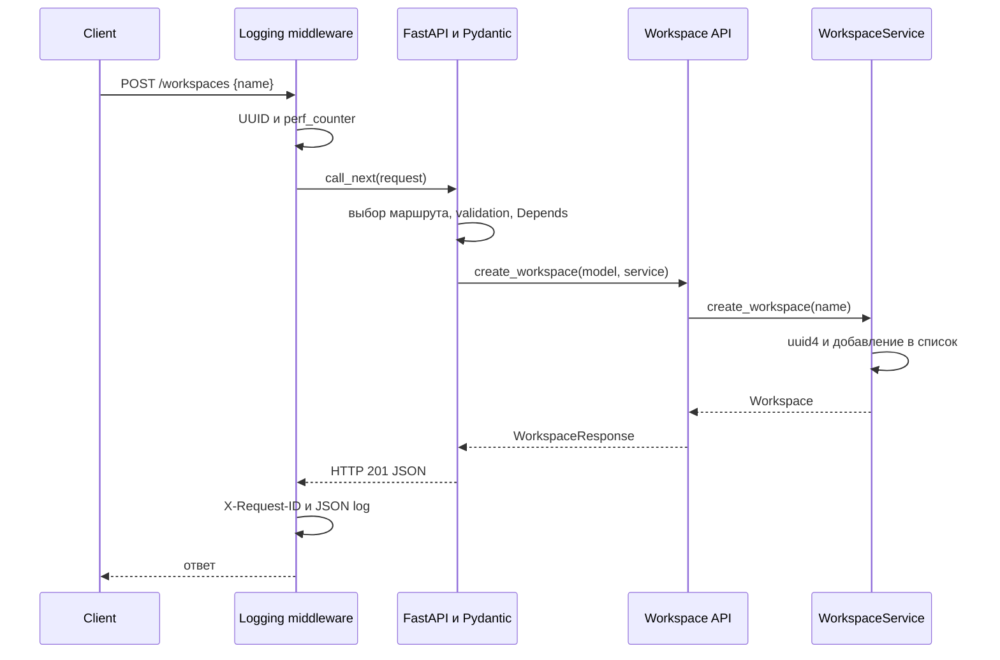

# Forge Week 1: учебное руководство

Это руководство для разработчика со знанием Swift/iOS, который изучает Python backend. Оно описывает код в текущем репозитории, а будущие возможности обозначает отдельно. См. также [архитектуру](ARCHITECTURE.md), [ADR-001](adr/ADR-001.md) и [backlog](../backlog.md).

## 1. Общая картина

Backend — процесс, который принимает запросы клиентов, проверяет данные, выполняет операции и возвращает результаты. Клиент и сервер обмениваются HTTP: метод и путь определяют операцию, JSON может содержать данные, статус и тело описывают результат. Клиент не вызывает Python-функцию напрямую: он отправляет HTTP-запрос, сервер Uvicorn передаёт его ASGI-приложению FastAPI, а FastAPI выбирает обработчик.

Forge задуман как пространство для технических задач над Git-репозиториями. Собственный backend даёт общее место для контрактов и будущего состояния. Сейчас он хранит Workspace и описания Task в памяти процесса; Git, агенты и постоянная база здесь ещё не реализованы.

Читать код удобно от `app/main.py`: он собирает приложение. Маршруты в `api` вызывают сервисы из `services`; `schemas` задаёт JSON-контракты; `core` содержит логирование. Тесты вызывают это приложение через TestClient.

## 2. Карта проекта и файлов

### Сборка приложения

`backend/pyproject.toml` описывает пакет `forge-backend`, Python 3.11+, FastAPI и Uvicorn; pytest и HTTPX входят в dev extra. `pip install -e ".[dev]"` устанавливает проект в editable-режиме и зависимости в активное окружение. Если пакет или зависимости недоступны, import или запуск завершится ошибкой. Пустые `__init__.py` обозначают пакеты; никакой бизнес-логики в них нет.

`app/main.py`: `create_app()` без аргументов создаёт FastAPI, регистрирует exception handlers и middleware, создаёт `WorkspaceService`, передаёт его в `TaskService`, кладёт оба в `app.state` и подключает три router. Возвращает независимое приложение. `app = create_app()` нужен Uvicorn: `app.main:app` означает модуль и объект. Если импорт или сборка приложения падает, сервер не сможет запуститься.

### Маршруты

`app/api/health.py`: `get_health()` вызывается FastAPI для GET `/health`, получает данные неявно через HTTP и возвращает `HealthResponse(status="ok")`. Он не проверяет внешние зависимости; ошибка импорта/обработчика не означает диагностическую проверку базы.

`app/api/workspaces.py`: `get_workspace_service(request)` берёт сервис из `request.app.state`; FastAPI вызывает его как dependency. `create_workspace(workspace, service)` получает проверенный `WorkspaceCreate`, вызывает `service.create_workspace(name)` и строит `WorkspaceResponse` со статусом 201. `list_workspaces(service)` преобразует список сервисных объектов в ответы со статусом 200. Если состояние приложения не инициализировано, dependency не найдёт сервис; предусмотренного отдельного бизнес-ответа для такого programming error нет.

`app/api/tasks.py`: `get_task_service(request)` получает сервис из `app.state`. `create_task(payload, service)` передаёт UUID, goal и criteria в сервис; `WorkspaceNotFoundError` преобразует в `ApiError` 404. `get_task(task_id, service)` получает UUID и возвращает TaskResponse либо вызывает `ApiError` 404. `TaskResponse.model_validate(task, from_attributes=True)` читает атрибуты dataclass. Pydantic проверяет HTTP-вход до вызова endpoint; неожиданные ошибки не скрываются сервисом.

### Контракты

`app/schemas/health.py`: `HealthResponse` с `status: Literal["ok"]`. `app/schemas/workspace.py`: `WorkspaceCreate` очищает края `name` и ограничивает длину 1–100; `WorkspaceResponse` содержит UUID и имя. `app/schemas/task.py`: `TaskCreate` требует UUID Workspace, goal 1–500 и список из 1–10 непустых criteria длиной до 300; `TaskResponse` содержит эти поля и ID Task. API получает модели от Pydantic и отдаёт JSON через FastAPI. Невалидный вход вызывает `RequestValidationError` и 422.

`app/schemas/error.py`: `ValidationIssue(field, message)`, `ErrorData(code, message, details)` и обёртка `ErrorResponse(error)`. `Field(default_factory=list)` создаёт отдельный пустой список при построении модели. Эти модели используются handler-ами; они не описывают внутренние исключения сервиса.

### Сервисы

`app/services/workspaces.py`: неизменяемый dataclass `Workspace(id, name)` и `WorkspaceService`. Конструктор создаёт список; `create_workspace(name)` генерирует UUID и добавляет объект; `list_workspaces()` возвращает копию списка; `get_workspace(workspace_id)` ищет первый объект и возвращает его или `None`. Вызовы идут из API и TaskService. Отсутствие Workspace само по себе здесь не исключение. Линейный поиск и память процесса подходят текущему объёму, но не обеспечивают persistence.

`app/services/tasks.py`: `WorkspaceNotFoundError`, dataclass `Task(id, workspace_id, goal, acceptance_criteria)` и `TaskService`. Конструктор получает WorkspaceService и создаёт словарь `_tasks`. `create_task()` сначала проверяет Workspace, при отсутствии выбрасывает исключение, иначе генерирует UUID, превращает criteria в tuple, сохраняет и возвращает Task. `get_task(id)` возвращает объект или `None`. Сервис не импортирует HTTP и самостоятельно не повторяет все Pydantic-проверки строк: прямой вызов может их обойти.

### Ошибки и логирование

`app/api/errors.py`: `ApiError(status_code, code, message)` переносит данные для HTTP-слоя. `app/api/error_handlers.py`: `register_exception_handlers(app)` регистрирует handlers; `_api_error_handler` обрабатывает ApiError, `_validation_error_handler` формирует безопасные details, `_http_error_handler` обрабатывает Starlette HTTPException и сохраняет заголовки. `_safe_field` ограничивает имена полей, `_error_response` строит JSONResponse. Внутренний текст Pydantic и input не возвращаются. Если ошибка не относится к зарегистрированным типам, общего catch-all handler здесь нет.

`app/core/logging.py`: `configure_http_logger()` получает `forge.http`, задаёт уровень INFO, отключает propagation и добавляет именованный StreamHandler с `JsonFormatter`, если его ещё нет. `JsonFormatter.format(record)` создаёт JSON из времени и `record.http_fields`. `app/core/request_logging.py`: `install_request_logging(app)` регистрирует middleware `log_http_request(request, call_next)`; оно генерирует ID, измеряет время, добавляет заголовок обработанному ответу и в `finally` пишет событие. Эти функции вызывает factory. Formatter ожидает HTTP-поля; произвольные события не являются поддержанным контрактом этого logger.

### Тесты

`tests/test_health.py` проверяет health и статус неизвестного маршрута. `test_workspaces.py` проверяет создание, список, длины и изоляцию приложений. `test_tasks.py` проверяет создание, получение, UUID, границы и отсутствие Workspace/Task. `test_errors.py` проверяет контракт и заголовки. `test_logging.py` содержит `CaptureHandler`, fixture `captured_logs` и проверки JSON, корреляции, маршрутов и исключения. Если assertion не выполнен, pytest сообщает тест как failed; код приложения эти файлы не исправляют.

## 3. Путь запроса от начала до конца

### Как создаётся приложение и сколько живут объекты

Фрагмент `app/main.py` приведён без изменения; имена router объявлены импортами выше:

```python
def create_app() -> FastAPI:
    app = FastAPI(title="Forge API")
    register_exception_handlers(app)
    install_request_logging(app)
    workspace_service = WorkspaceService()
    app.state.workspace_service = workspace_service
    app.state.task_service = TaskService(workspace_service)
    app.include_router(health_router)
    app.include_router(workspaces_router)
    app.include_router(tasks_router)
    return app


app = create_app()
```

Одна строка `app = create_app()` при импорте создаёт приложение, которое использует Uvicorn. Внутри каждого вызова factory создаётся **новый** `WorkspaceService`; затем именно этот объект передаётся конструктору `TaskService` и одновременно сохраняется в `app.state`. Это две ссылки на один экземпляр, а не две копии данных. Пока приложение живо, его сервисы доступны через state; коллекции живут вместе с сервисами. Два вызова factory создают два набора сервисов. Перезапуск процесса заново выполняет импорт и теряет старые коллекции. Глобальный logger существует на уровне процесса и настраивается идемпотентно — его lifetime отличается от lifetime данных приложения.

В `app/api/workspaces.py` dependency выглядит так:

```python
def get_workspace_service(request: Request) -> WorkspaceService:
    return request.app.state.workspace_service
```

FastAPI вызывает её для запроса и подставляет возвращённый объект в параметр `service: Annotated[WorkspaceService, Depends(get_workspace_service)]`. Сама dependency не конструирует WorkspaceService и не делает его глобальной коллекцией. В Swift это похоже на передачу одной ссылки на зависимость из контейнера приложения, но `Depends` разрешает её по декларации аргумента обработчика. Аналогичный `get_task_service` извлекает TaskService. Если при сборке забыть положить поле в `app.state`, эта ошибка проявится при разрешении dependency, а не станет корректным 404.



Клиент отправляет `{"name":"  Demo  "}`. `WorkspaceCreate` удаляет пробелы и проверяет длину. `Depends` возвращает тот же объект WorkspaceService, что создан factory. Сервис сохраняет `Workspace`, API формирует схему, FastAPI сериализует UUID в строку. Middleware добавляет ID и пишет событие. Повторный GET видит объект только в том же приложении.

Для Task клиент сначала получает ID Workspace и отправляет его с goal и criteria на POST `/tasks`. Pydantic проверяет UUID и поля. TaskService получает уже существующий WorkspaceService, ищет Workspace и либо выбрасывает `WorkspaceNotFoundError`, либо сохраняет Task в словарь. API преобразует исключение в 404 либо dataclass в TaskResponse. Создание Task не запускает работу агента.

### Workspace: POST, состояние, затем GET

Допустим, только что созданное приложение имеет `_workspaces == []`. Вход `POST /workspaces` — JSON `{"name":"  Demo  "}`. Сначала router выбирает обработчик, Pydantic строит `WorkspaceCreate` и обрезает края, dependency находит сервис. Фактический обработчик из `app/api/workspaces.py`:

```python
@router.post(
    "/workspaces",
    response_model=WorkspaceResponse,
    status_code=status.HTTP_201_CREATED,
)
def create_workspace(
    workspace: WorkspaceCreate,
    service: Annotated[WorkspaceService, Depends(get_workspace_service)],
) -> WorkspaceResponse:
    created = service.create_workspace(workspace.name)
    return WorkspaceResponse(id=created.id, name=created.name)
```

Аргумент `workspace.name` здесь уже равен `"Demo"`. Сервис исполняет эти реальные строки:

```python
    def create_workspace(self, name: str) -> Workspace:
        workspace = Workspace(id=uuid4(), name=name)
        self._workspaces.append(workspace)
        return workspace

    def list_workspaces(self) -> list[Workspace]:
        return list(self._workspaces)
```

Состояние меняется с `[]` на список с одним `Workspace(id=<созданный UUID>, name="Demo")`. HTTP-ответ — 201 и JSON `{"id":"<созданный UUID>","name":"Demo"}`: угловые скобки здесь обозначают переменное значение, а не буквальный UUID для запроса. При следующем `GET /workspaces` dependency возвращает тот же сервис; `list_workspaces()` создаёт копию контейнера, а API превращает каждый элемент в `WorkspaceResponse`. Ответ 200 содержит список с созданным объектом. Возврат копии не позволяет вызывающему коду добавлять элементы непосредственно в внутренний список сервиса; сами Workspace неизменяемы.

Если имя пустое после trim, Pydantic формирует 422 ещё до вызова `create_workspace`; список не меняется. Обработчик ошибок и middleware всё равно участвуют в формировании обработанного ответа и лога.

### Task: успешное создание и отсутствующий Workspace

Вход POST — объект с `workspace_id` из ответа выше, например `{"workspace_id":"<ID из ответа>","goal":"  Build API  ","acceptance_criteria":[" Works "]}`. Перед отправкой placeholder надо заменить реальным ID. Pydantic превращает строку в `UUID`, goal в `"Build API"`, а criterion в `"Works"`. Внутри `TaskService` выполняется фактическая проверка и запись:

```python
        if self._workspace_service.get_workspace(workspace_id) is None:
            raise WorkspaceNotFoundError(workspace_id)

        task = Task(
            id=uuid4(),
            workspace_id=workspace_id,
            goal=goal,
            acceptance_criteria=tuple(acceptance_criteria),
        )
        self._tasks[task.id] = task
        return task
```

Новый UUID становится ключом словаря `_tasks`, значение — `Task` с tuple критериев. Сервис не меняет список Workspace. API строит TaskResponse, JSON сериализует tuple как список; клиент получает 201 с `id`, `workspace_id`, `goal`, `acceptance_criteria`. GET `/tasks/{id}` ищет объект по ключу и возвращает тот же контракт со статусом 200. Форма Task не содержит статуса исполнения: создание не запускает агент.

Если UUID синтаксически верный, но Workspace отсутствует, `get_workspace` возвращает `None`; `WorkspaceNotFoundError` возникает **до** создания UUID Task и записи в словарь. Этот код из `app/api/tasks.py` переводит сервисную причину на HTTP-границу:

```python
    except WorkspaceNotFoundError as exc:
        raise ApiError(404, "WORKSPACE_NOT_FOUND", "Workspace not found") from exc
```

Централизованный handler отдаёт 404 с `error.code = "WORKSPACE_NOT_FOUND"`. Неверный UUID или пустой goal останавливается раньше, на Pydantic, и даёт 422; словарь Task в обоих случаях остаётся прежним.

## 4. Python: понятия на коде Forge

Класс — описание поведения, экземпляр — конкретный объект. Как Swift class и instance, два `WorkspaceService()` имеют разные списки. `@dataclass(frozen=True, slots=True)` создаёт удобную модель атрибутов; `frozen` запрещает их обычное переназначение, `slots` ограничивает атрибуты. `uuid4()` создаёт случайный UUID; `UUID` — его тип, JSON передаёт строку.

`list[Workspace]` хранит последовательность; `dict[UUID, Task]` связывает ключ и значение; `tuple[str, ...]` — неизменяемая последовательность criteria. `list(self._workspaces)` возвращает новый контейнер. Подсказки типов помогают человеку и инструментам, но сами по себе не гарантируют проверку на runtime. `Task | None` похоже на Swift `Task?`: значение может отсутствовать.

Исключение прерывает обычный поток. В `create_task` API блок `try/except` ловит только `WorkspaceNotFoundError` и создаёт `ApiError`; `raise ... from exc` сохраняет причину для диагностики. В middleware `finally` выполняется и при возврате, и при исключении. Он пишет лог; поскольку исключение там не подавляется, оно идёт дальше.

Декоратор `@router.get(...)` регистрирует функцию для маршрута, `@dataclass` формирует методы модели, `@pytest.fixture` регистрирует подготовку теста. `async def` объявляет coroutine; `await call_next(request)` передаёт управление обработке запроса и ждёт результат, не блокируя event loop обычным синхронным ожиданием. Сами сервисные методы здесь обычные `def`.

Python `logging` отделяет создание события от вывода. Logger создаёт LogRecord, Handler отправляет запись в поток, Formatter превращает её в текст. Это похоже на разделение источника события и destination, а не на простое `print`.

### Разбор dataclass и типов

Реальные определения из `app/services/workspaces.py`:

```python
@dataclass(frozen=True, slots=True)
class Workspace:
    id: UUID
    name: str
```

В отличие от обычного словаря, объект имеет фиксированные именованные атрибуты. Dataclass создаёт конструктор и другие стандартные методы; `frozen=True` запрещает обычное присваивание `workspace.name = ...`, а `slots=True` не даёт произвольно добавлять атрибуты. Это похоже на модель с `let` в Swift по намерению неизменяемости, но правила Python не идентичны Swift value semantics. UUID создаётся `uuid4()` отдельно для каждого объекта; в JSON он становится строкой.

В коде `self._workspaces: list[Workspace] = []` список принадлежит конкретному экземпляру сервиса, а `self._tasks: dict[UUID, Task] = {}` индексирует Task по ID. `acceptance_criteria: tuple[str, ...]` хранит неизменяемую последовательность строк; API принимает `list[str]` и сервис создаёт tuple. `Workspace | None` означает, что поиск может вернуть объект или `None` — аналог рассмотрения optional в Swift. Подсказки типов не являются runtime-проверкой самостоятельного вызова сервиса.

Декоратор `@router.post(...)` выполняется при импорте модуля: он регистрирует функцию как endpoint; создание Workspace происходит только при запросе. В `async def log_http_request` выражение `await call_next(request)` ждёт дальнейшую асинхронную обработку. В отличие от обычного вызова, coroutine нужно ожидать; это похоже на `await` в Swift concurrency, хотя детали scheduler различаются.

## 5. FastAPI и Pydantic

`APIRouter` группирует маршруты, которые `include_router` подключает к FastAPI. `Request` представляет текущий запрос и даёт доступ к `app.state`. `Depends` сообщает FastAPI, какую функцию вызвать для получения аргумента; это dependency injection через framework. Сервис не создаётся на каждый запрос: dependency извлекает экземпляр, созданный factory.

`response_model` задаёт контракт и сериализацию результата; `status_code=201` задаёт успешный статус создания. `BaseModel` описывает границу данных, а `Field(min_length=1, max_length=10)` ограничивает размер списка. `Annotated` связывает тип с дополнительными метаданными, например `StringConstraints(strip_whitespace=True, min_length=1, max_length=500)`. `model_validate(..., from_attributes=True)` строит API-модель из полей dataclass.

Схема API отвечает за JSON и проверку HTTP-входа; сервисная `Task` представляет данные внутри приложения и хранит criteria как tuple. Они похожи по содержимому, но имеют разные роли. Factory позволяет создать новое приложение со своим состоянием для теста и при этом экспортировать `app` для Uvicorn.

## 6. Ошибки

При неправильном UUID в path или body Pydantic вызывает `RequestValidationError`; `_validation_error_handler` возвращает 422 `VALIDATION_ERROR`. Пустой после trim goal идёт тем же путём: `details` содержит безопасное поле `body.goal` и фиксированное сообщение. Исходное значение, Pydantic context и traceback не включаются.

Если UUID Workspace корректен, но его нет, `TaskService.create_task` вызывает `WorkspaceNotFoundError`; API ловит его и поднимает `ApiError`, а handler возвращает 404 `WORKSPACE_NOT_FOUND`. Если Task не найдена, `get_task()` возвращает `None`, API поднимает `ApiError`, handler отвечает 404 `TASK_NOT_FOUND`.

Для неизвестного пути Starlette создаёт HTTPException 404; общий handler возвращает `NOT_FOUND`. Для неподдерживаемого метода он возвращает 405 `METHOD_NOT_ALLOWED` и передаёт `Allow`. Другие HTTPException получают `HTTP_ERROR` и сохраняют заголовки. Неожиданное исключение не оборачивается в ErrorResponse: middleware пишет событие со статусом 500 и пробрасывает его серверу. Ответ сервера при такой ошибке не гарантирует этот контракт и X-Request-ID.

Централизованные handlers позволяют разным маршрутам отдавать одинаковую форму `error/code/message/details`, не заставляя сервис знать о HTTP. При добавлении новых полей схемы allowlist безопасных имён в error handler необходимо пересмотреть.

## 7. Structured logging

При создании app `install_request_logging` получает logger через `configure_http_logger`. Logger с именем `forge.http` создаёт LogRecord на `logger.info`; `extra` помещает `http_fields` в запись. Один именованный Handler получает LogRecord и вызывает `JsonFormatter`; тот использует время `record.created` в UTC и сериализует поля в одну строку. Повторный вызов factory проверяет имя handler и не добавляет второй такой handler. Root logger через `basicConfig` не настраивается.

Каждый запрос получает новый `uuid4`, даже если клиент прислал свой `X-Request-ID`. Middleware устанавливает ID в ответ, если получил Response, и пишет тот же ID в лог. `perf_counter` измеряет прошедшее время, а route берётся из шаблона выбранного маршрута или становится `unmatched`. В этой записи нет тела, query, cookie или authorization. Отдельные access logs Uvicorn могут иметь другую политику и требуют проверки.

`finally` нужен, чтобы событие появилось при обычном ответе и при сбое. Начальный статус 500 заменяется реальным только после `call_next`. Если `call_next` выбросил исключение, `finally` выполняется и исключение продолжает распространяться. Длительность измеряется до возврата Response объектом middleware; это не доказательство завершения передачи всего streaming body клиенту.

### Чтение реального middleware

Этот фрагмент из `app/core/request_logging.py` показывает центральный участок; тело `logger.info` ниже в файле собирает разрешённые поля:

```python
        request_id = str(uuid4())
        started = time.perf_counter()
        status_code = 500
        try:
            response = await call_next(request)
            status_code = response.status_code
            response.headers["X-Request-ID"] = request_id
            return response
        finally:
            route = getattr(request.scope.get("route"), "path", None) or "unmatched"
```

В `try` успешный или обработанный ошибочный Response получает заголовок. До фактического выхода из функции Python выполняет `finally`: извлекает шаблон route и передаёт `http_fields` в `logger.info`. Если `call_next` поднял исключение, присваивание реального статуса и добавление заголовка не выполняются, а значение 500 остаётся в событии. `finally` не содержит `return` или подавления исключения — поэтому вызывающая сторона всё ещё видит сбой.

Logger — именованный источник; он решает уровень и направляет LogRecord в Handler. Handler отвечает за вывод в поток, Formatter — за представление конкретного LogRecord в JSON. `record.created` даёт время создания записи; `record.http_fields` содержит подготовленные middleware значения. В собственную запись не передаются сырые URL, тело и заголовки. Это снижает риск утечки, но отдельно работающий access log Uvicorn нужно оценивать самостоятельно.

## 8. Тестирование

`pytest` находит функции `test_*`; `assert` завершает тест неудачей, если условие ложно. `TestClient(create_app())` отправляет запросы ASGI-приложению в процессе теста, без проверки реальной сети. Fixture `client` создаёт приложение для теста и закрывает клиент после `yield`; fixture `workspace_id` сначала создаёт нужный Workspace. Это предотвращает перенос in-memory данных между такими тестами. Исключение: `test_health.py` использует общий экспортированный `app`, но его проверки не зависят от Workspace.

`pytest.mark.parametrize` запускает одну проверку с несколькими наборами. В `test_invalid_goal_returns_422` это пустая строка, пробелы и 501 символ. `test_create_and_get_task` создаёт Workspace, отправляет Task и сверяет полученный объект с GET. `test_http_exception_preserves_headers` проверяет статусы и заголовки 401/429/404/405 через тестовый маршрут. `test_unexpected_error_is_logged_and_raised` ожидает RuntimeError и проверяет запись 500 без текста исключения. `captured_logs` временно присоединяет handler к `forge.http` и удаляет его в `finally`.

Позитивный тест проверяет ожидаемый результат; негативный задаёт отсутствие или неправильный ввод. Из `backend` запустите `python -m pytest -q` после установки dev extra. Набор не доказывает работу с настоящей БД, сетью, несколькими worker, нагрузкой, агентами или конфиденциальностью Uvicorn access log.

### Разбор трёх существующих тестов

**1. `test_create_and_get_task`** из `tests/test_tasks.py`:

```python
def test_create_and_get_task(client: TestClient, workspace_id: str) -> None:
    created_response = client.post("/tasks", json=task_payload(workspace_id))

    assert created_response.status_code == 201
    created = created_response.json()
    assert UUID(created["id"])
```

Это начало фактического теста. `client` — новое приложение, `workspace_id` — ID предварительно созданного Workspace. Payload содержит goal с пробелами. POST меняет `_tasks`; последующие assertions полного теста проверяют нормализованный JSON и что GET по полученному ID возвращает тот же объект. Проверка `UUID(...)` падает, если ID не разбирается; она не доказывает отсутствие коллизий в принципе. Для двух отдельных Task есть другой тест.

**2. `test_missing_workspace_returns_404`** создаёт случайный UUID без Workspace и отправляет корректные goal и criteria:

```python
    response = client.post("/tasks", json=task_payload(str(uuid4())))

    assert response.status_code == 404
```

Полный тест дополнительно сравнивает тело с `WORKSPACE_NOT_FOUND`, сообщением и пустым `details`. Это проверяет цепочку service exception → ApiError → handler. По коду сервиса запись Task не происходит до проверки Workspace; этот тест непосредственно проверяет HTTP-результат, а не инспектирует приватный словарь.

**3. `test_unexpected_error_is_logged_and_raised`** создаёт отдельное приложение и тестовый маршрут, который поднимает `RuntimeError`. Его ключевой участок:

```python
    with TestClient(app) as client:
        with pytest.raises(RuntimeError, match="private-exception-value"):
            client.get("/broken")
```

Тест ожидает исключение на стороне TestClient, а не успешный ответ. Затем проверяет единственную JSON-запись с route `/broken`, статусом 500 и отсутствием текста исключения. Fixture `captured_logs` подключает временный Handler и удаляет его после теста. Данные приложения этот маршрут не меняет. Такой тест проверяет одновременно observability и то, что programming error не поглощён.

Для самостоятельной практики запустите из `backend` `python -m pytest -q tests/test_tasks.py` и проследите, какая fixture запускается до теста. Полный набор запускается командой из README; его результат зависит от установленного окружения и не заменяет проверку реального сервера.

## 9. Engineering decisions и failure modes

Modular monolith даёт явные границы без отдельного развёртывания каждого сервиса; это принятое направление в ADR-001. Коллекции в памяти подходят учебному Week 1, но процесс может завершиться и потерять данные; разные процессы видят разные коллекции. Task описывает намерение и критерии, AgentRun должен описывать отдельную попытку; сейчас последнего нет.

Независимость сервиса от HTTP позволяет вызывать его из другого интерфейса, но прямая передача строк сейчас обходит валидацию API. PostgreSQL и runtime не добавлялись в ограниченном scope Week 1; это не означает выбор конкретной технологии для будущего. Пока принимаются отсутствие durability, аутентификации, разрешений, исполнения, recovery и проверки результата; будущие решения должны адресовать эти пробелы отдельно.

## 10. Самопроверка

1. Кто выбирает функцию по HTTP-пути? **FastAPI/Starlette router.**
2. Почему пустой goal не попадает в TaskService через API? **Его отклоняет Pydantic.**
3. Что произойдёт при прямом вызове TaskService с пустым goal? **HTTP-валидация обойдена.**
4. Откуда dependency получает WorkspaceService? **Из app.state текущего приложения.**
5. Увидят ли два приложения один список? **Нет, каждый factory создаёт свой сервис.**
6. Что происходит с данными после рестарта? **Они теряются.**
7. Кто превращает отсутствие Workspace в 404? **API поднимает ApiError, handler формирует ответ.**
8. Почему Task не означает выполненную работу? **Это описание намерения, execution отсутствует.**
9. Почему UUID в JSON строка? **Ответ сериализуется из Python UUID.**
10. Что делает finally при исключении? **Пишет лог, после чего исключение распространяется.**
11. Откуда route в логе? **Из шаблона route в scope или `unmatched`.**
12. Почему входящему request ID не доверяют? **Middleware всегда создаёт собственный UUID.**
13. Что гарантирует `Allow` при 405? **Handler передаёт заголовки HTTPException.**
14. Доказывает ли TestClient работу между процессами? **Нет, он вызывает приложение в процессе теста.**

## 11. Подготовка к собеседованию

- Как вы отделяете HTTP-контракт от доменной логики? Покажите `TaskCreate`, API и TaskService и объясните ограничение прямых вызовов.
- Как протестировать изоляцию состояния? Создайте два приложения и проверьте, что объект первого не найден во втором.
- Чем отличается ошибка валидации от отсутствующего ресурса? В Forge это 422 от Pydantic и 404 после поиска сервисом.
- Как связать ответ с событием в логе без записи тела запроса? Сгенерировать request ID и вернуть его в заголовке и структурированной записи.
- Почему in-memory данные не подходят для нескольких workers? У каждого процесса своя память, а перезапуск уничтожает состояние.
- Какие компромиссы у modular monolith? Один deploy упрощает эксплуатацию, но границы и масштабирование отдельных нагрузок требуют внимания.

Это учебный проект и разбор реального кода Week 1; приведённые ответы не утверждают наличие production-опыта или реализованного agent runtime.
