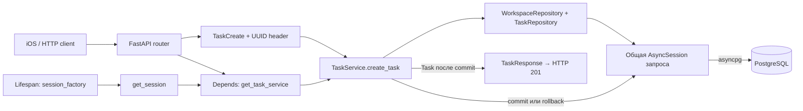

# Forge Week 2: Persistence & Data Model

Руководство для iOS-разработчика, который уже знаком с HTTP и Swift Concurrency и хочет проследить, как запрос превращается в зафиксированную запись PostgreSQL. Срез исходников — `main` после merge PR #10, коммит `571f228`. Для первого знакомства с FastAPI есть [учебный гид Week 1](LEARNING_GUIDE.md). Команды установки и запуска находятся в [README](../README.md).

## Оглавление

1. [От Week 1 к Week 2](#1-от-week-1-к-week-2)
2. [Карта проекта и путь запроса](#2-карта-проекта-и-путь-запроса)
3. [PostgreSQL и Docker Compose](#3-postgresql-и-docker-compose)
4. [SQLAlchemy 2.x Async](#4-sqlalchemy-2x-async)
5. [Доменные модели и ORM](#5-доменные-модели-и-orm)
6. [Миграции Alembic](#6-миграции-alembic)
7. [Транзакции](#7-транзакции)
8. [Графы состояний](#8-графы-состояний)
9. [Конкуренция и блокировки](#9-конкуренция-и-блокировки)
10. [Идемпотентное создание Task](#10-идемпотентное-создание-task)
11. [Тесты и evidence](#11-тесты-и-evidence)
12. [Сценарии отказа](#12-сценарии-отказа)
13. [Аналогии со Swift и iOS](#13-аналогии-со-swift-и-ios)
14. [Практические упражнения](#14-практические-упражнения)
15. [Самопроверка](#15-самопроверка)
16. [Interview и System Design](#16-interview-и-system-design)

## 1. От Week 1 к Week 2

| Срез | Путь операции | Где хранится Task после ответа |
| --- | --- | --- |
| Week 1 | HTTP → Service → in-memory state | В словаре процесса |
| Week 2 | HTTP → Service → Repository → AsyncSession → PostgreSQL | В зафиксированной строке таблицы `tasks` |

В Week 1 повторный GET работал, пока использовал тот же экземпляр сервиса. После перезапуска приложение создавало пустые коллекции. В Week 2 ID из ответа можно передать новому экземпляру backend, подключённому к той же БД. PostgreSQL хранит данные вне процесса API, проверяет ограничения и согласует запись из разных сессий. [Архитектура Week 1](ARCHITECTURE.md) · [ADR-001](adr/ADR-001.md)

**Persistence** в этом срезе позволяет прочитать последний зафиксированный статус и записанные события. **Durable agent execution** потребует ещё механизма, который после остановки процесса определит, какой шаг был закончен, безопасно продолжит работу и не повторит опасный side effect. Строка AgentRun со статусом `running` сама ничего не запускает. Agent runtime, tool execution, обработка approvals, retry/resume orchestration и независимая верификация относятся к будущей работе. Архитектура остаётся modular monolith. API, сервисы и репозитории вызывают друг друга внутри приложения, а SQL выполняется в отдельном процессе PostgreSQL. [ADR-001](adr/ADR-001.md) · [План проекта](../forge_progress.md)

## 2. Карта проекта и путь запроса

| Участок | Ответственность | Где читать |
| --- | --- | --- |
| Сборка FastAPI | `create_app()` подключает routers, обработчики ошибок и middleware. Lifespan создаёт фабрику сессий | [main.py](../backend/app/main.py) |
| HTTP и зависимости | Router разбирает запрос, `get_session()` выдаёт сессию, `get_task_service()` собирает сервис и репозитории | [dependencies.py](../backend/app/api/dependencies.py) · [tasks.py](../backend/app/api/tasks.py) · [workspaces.py](../backend/app/api/workspaces.py) |
| HTTP-схемы | Pydantic валидирует тело, затем формирует ответ из атрибутов доменного объекта | [schemas/task.py](../backend/app/schemas/task.py) · [schemas/workspace.py](../backend/app/schemas/workspace.py) |
| Домен | Dataclass для Task и Workspace, enum и правила допустимых переходов | [domain](../backend/app/domain) |
| Сервисы | Проверяют бизнес-условия, завершают транзакции, пробрасывают доменные ошибки | [services/tasks.py](../backend/app/services/tasks.py) · [services/agent_runs.py](../backend/app/services/agent_runs.py) · [services/workspaces.py](../backend/app/services/workspaces.py) |
| Репозитории | Строят SQL и преобразуют результат в объекты домена там, где это нужно вызывающему коду | [repositories](../backend/app/repositories) |
| Хранение | ORM-классы описывают таблицы и колонки, `session.py` настраивает engine и фабрику | [models](../backend/app/db/models) · [session.py](../backend/app/db/session.py) |
| Миграции | Alembic применяет revisions к БД и использует `Base.metadata` при сравнении схемы | [env.py](../backend/alembic/env.py) · [versions](../backend/alembic/versions) |
| Интеграционные тесты | Реальные запросы, отдельные подключения, rollback и наблюдение блокировок | [тесты переходов AgentRun](../backend/tests/test_agent_run_integration.py) · [тесты переходов Task](../backend/tests/test_task_transition_integration.py) · [тесты идемпотентности](../backend/tests/test_task_idempotency_integration.py) |



Проследим `POST /tasks` с валидным Workspace и без ключа.

1. FastAPI валидирует `workspace_id` и тело через `TaskCreate`. Pydantic обрезает пробелы по краям `goal` и каждого критерия, проверяет длину строк и число критериев. Опциональный `Idempotency-Key` разбирается как UUID.
2. `get_session()` открывает `AsyncSession` из фабрики, а `get_task_service()` передаёт ту же сессию обоим репозиториям и сервису.
3. Endpoint вызывает `TaskService.create_task(workspace_id, goal, acceptance_criteria, idempotency_key=None)`. Сервис ищет Workspace, генерирует UUID Task и сохраняет criteria как tuple. `TaskRepository.add()` добавляет ORM-объект в сессию.
4. Сервис ждёт `commit()` и возвращает доменную Task. Endpoint строит `TaskResponse.model_validate(task, from_attributes=True)`. HTTP-ответ содержит `id`, `workspace_id`, `goal` и `acceptance_criteria`. Статус и ключ идемпотентности в HTTP-схему не входят.
5. При завершении зависимости сессия закрывается. Последующий `GET /tasks/{task_id}` использует другую сессию, ищет строку по UUID и возвращает такой же формат ответа либо `404 TASK_NOT_FOUND`. Переходы состояний вызываются на уровне сервисов. HTTP routes для переходов и создания AgentRun пока отсутствуют. [HTTP handlers](../backend/app/api/tasks.py) · [HTTP schemas](../backend/app/schemas/task.py) · [TaskService](../backend/app/services/tasks.py)

## 3. PostgreSQL и Docker Compose

PostgreSQL server — процесс, который принимает подключения. Внутри инстанса есть именованные **databases**. Подключение выбирает одну database, например `forge`, а SQL внутри неё обращается к таблицам `workspaces`, `tasks` и другим. Две сессии могут смотреть на одну таблицу с разных подключений. Данные хранятся в каталоге PostgreSQL, а состояние клиентских соединений живёт только до их закрытия.

В Compose сервис `postgres` запускает `postgres:17`. Порт контейнера `5432` опубликован на loopback хоста, по умолчанию `127.0.0.1:55432`. Healthcheck вызывает `pg_isready`, а named volume `postgres_data` смонтирован в `/var/lib/postgresql/data`. Корневой `.env` задаёт `POSTGRES_USER`, `POSTGRES_PASSWORD`, `POSTGRES_DB` и при необходимости `POSTGRES_PORT`. Backend читает эти параметры через `Settings` и по умолчанию подключается к `127.0.0.1`. Переменные процесса могут переопределять настройки из файла. При повторном запуске с уже заполненным volume параметры инициализации контейнера сами по себе не создают новую БД и не меняют существующего пользователя. [compose.yaml](../compose.yaml) · [.env.example](../.env.example) · [settings.py](../backend/app/core/settings.py)

| Событие | Что пересоздаётся | Что можно прочитать после |
| --- | --- | --- |
| Перезапуск FastAPI | Python-процесс, engine, фабрика сессий и pool | Зафиксированные строки в той же доступной БД |
| Перезапуск PostgreSQL с тем же volume | Процесс БД и подключения | Зафиксированные данные после готовности PostgreSQL. Незавершённые транзакции не становятся сохранёнными |
| Запуск с новым пустым volume | Новый каталог данных и начальная БД | Схема приложения появляется после миграций. Данные старого volume остаются в старом хранилище |

`GET /health` проверяет доступность приложения и отвечает `{"status":"ok"}`. Он не открывает соединение с БД. Поэтому успешный HTTP health и успешная операция с Task отвечают на разные диагностические вопросы. [health.py](../backend/app/api/health.py) · [проверка подключения](../backend/tests/test_postgres_integration.py)

## 4. SQLAlchemy 2.x Async

| Объект | Время жизни в Forge | Роль |
| --- | --- | --- |
| `AsyncEngine` | Lifespan приложения при обычном запуске | SQL dialect, asyncpg и connection pool. Создаётся без немедленного подключения |
| `async_sessionmaker` | Lifespan приложения | Выдаёт новую настроенную `AsyncSession` при каждом вызове |
| `AsyncSession` | HTTP-запрос с DB-зависимостью или одна операция в интеграционном тесте | Хранит состояние ORM, отслеживает изменения и управляет транзакцией |
| Connection | Берётся из pool, когда сессии требуется SQL | Передаёт команды PostgreSQL. После завершения работы с транзакцией может быть переиспользовано |

Ниже два точных фрагмента. Первый создаёт фабрику, второй ограничивает lifetime сессии через FastAPI dependency.

```python
def create_session_factory(engine: AsyncEngine) -> async_sessionmaker[AsyncSession]:
    """Create a reusable factory; each concurrent task needs its own session."""
    return async_sessionmaker(engine, expire_on_commit=False)
```

```python
async def get_session(request: Request) -> AsyncIterator[AsyncSession]:
    async with request.app.state.session_factory() as session:
        yield session
```

`create_engine(settings: Settings) -> AsyncEngine` строит `URL.create(drivername="postgresql+asyncpg", ...)` из отдельных настроек. `pool_pre_ping=True` проверяет пригодность соединения при выдаче из pool. Потерю соединения в середине транзакции это не превращает в прозрачный retry. `hide_parameters=True` исключает параметры SQL из сообщений, которые форматирует SQLAlchemy. [session.py](../backend/app/db/session.py) · [dependencies.py](../backend/app/api/dependencies.py)

`expire_on_commit=False` оставляет уже загруженные атрибуты ORM доступными после commit. Обычное обращение к expired-атрибуту могло бы потребовать нового SQL, что особенно неудобно в async-коде. Эта настройка не обновляет объект из БД, если его изменила другая сессия. Для проверки сохранённого состояния тесты читают через новую сессию. Одну `AsyncSession` нельзя одновременно использовать из двух coroutine, поскольку они смешают mutable transaction state. [SQLAlchemy 2.0: AsyncSession и asyncio](https://docs.sqlalchemy.org/en/20/orm/extensions/asyncio.html)

Lifespan в `create_app(*, settings=None, session_factory=None)` кладёт фабрику в `app.state` и вызывает `await engine.dispose()` в `finally` на shutdown. Это освобождает ресурсы pool, которыми владеет приложение. При переданной `session_factory` за её engine отвечает вызывающая сторона. Похоже на composition root в iOS, который собирает зависимости и владеет долгоживущим ресурсом. Каждая операция получает свой короткоживущий контекст. [main.py](../backend/app/main.py)

## 5. Доменные модели и ORM

`Task` — frozen dataclass с UUID, goal, tuple критериев и типизированным `TaskStatus`. Он пригоден как результат сервиса. `TaskModel` — отображение таблицы `tasks`, в котором criteria представлен PostgreSQL ARRAY, статус хранится строкой, а `idempotency_key` — nullable UUID. Модель, загруженная сессией, изменяема и отслеживается ORM. [domain/task.py](../backend/app/domain/task.py) · [models/task.py](../backend/app/db/models/task.py)

Точный фрагмент маппинга показывает, где поле хранения остаётся внутри persistence layer, а строка статуса превращается в enum.

```python
    @staticmethod
    def _to_task(model: TaskModel) -> Task:
        return Task(
            id=model.id,
            workspace_id=model.workspace_id,
            goal=model.goal,
            acceptance_criteria=tuple(model.acceptance_criteria),
            status=TaskStatus(model.status),
        )
```

`TaskRepository.get()` использует `session.get(TaskModel, task_id)` и этот mapper. `get_for_update()` возвращает ORM-модель, поскольку сервис должен изменить её статус в той же транзакции. `WorkspaceRepository.get()` аналогично превращает `WorkspaceModel` в `Workspace`. На HTTP-границе действует ещё один контракт, `TaskResponse`, с собственным набором полей. [TaskRepository](../backend/app/repositories/tasks.py) · [WorkspaceRepository](../backend/app/repositories/workspaces.py) · [TaskResponse](../backend/app/schemas/task.py)

| Сущность | Связь и смысл |
| --- | --- |
| Workspace | Объединяет много Task |
| Task | Хранит намерение, критерии и собственный статус. Может иметь несколько AgentRun |
| AgentRun | Отдельная попытка. Пара `(task_id, attempt_number)` уникальна |
| AgentEvent | Событие одной попытки. Хранит JSONB payload, время и номер, уникальный в пределах AgentRun |
| ToolCall | Запись о вызове инструмента, привязанная к AgentRun |
| Approval | Запись согласования, привязанная к ToolCall. Несколько записей на один ToolCall допустимы |
| Artifact | Метаданные результата, привязанные к AgentRun. `storage_ref` хранит ссылку |

Внешние ключи в этой цепочке используют `ON DELETE RESTRICT`. База защищает целостность ссылок, а ограничения CHECK задают допустимые значения статусов. Граф переходов проверяется сервисами. Таблицы ToolCall и Approval описывают данные будущего исполнения. В текущем срезе нет выполнения вызовов инструментов или обработки решений о согласовании. [ORM execution models](../backend/app/db/models/execution.py) · [модели и ограничения](../backend/tests/test_execution_models.py)

## 6. Миграции Alembic

**Schema** — реальные таблицы, колонки и ограничения в PostgreSQL. **Metadata** — Python-описание SQLAlchemy, которое импортирует `alembic/env.py`. Редактирование `mapped_column(...)` само по себе не меняет уже запущенную БД. Для этого служит migration revision с идентификатором `revision`, предшественником `down_revision` и функциями `upgrade()` / `downgrade()`. Alembic сверяет версию БД через `alembic_version`. [env.py](../backend/alembic/env.py)

| Revision | down_revision | Что делает upgrade |
| --- | --- | --- |
| [`2bb706972ee8`](../backend/alembic/versions/2bb706972ee8_initial_workspaces_and_tasks.py) | `None` | Создаёт `workspaces` и `tasks`, FK, CHECK и индекс для `workspace_id` |
| [`ecb758eac83b`](../backend/alembic/versions/ecb758eac83b_execution_data_contracts.py) | `2bb706972ee8` | Добавляет AgentRun, AgentEvent, ToolCall, Approval и Artifact с FK и ограничениями |
| [`2e3bf72ac910`](../backend/alembic/versions/2e3bf72ac910_add_task_status.py) | `ecb758eac83b` | Добавляет `tasks.status` с `NOT NULL`, server default `queued` и `ck_tasks_status` |
| [`496f3a2c5b81`](../backend/alembic/versions/496f3a2c5b81_task_idempotency_key.py) | `2e3bf72ac910` | Добавляет nullable UUID `idempotency_key` и `uq_tasks_workspace_idempotency_key` |

На шаге со статусом уже существующие строки получают значение `queued` через default, заданный в DDL. Для новых строк PostgreSQL применяет этот default при INSERT, если поле опущено. Явный `NULL` будет отклонён `NOT NULL`. Текущий сервис, создавая Task, получает `TaskStatus.QUEUED` из dataclass и передаёт его репозиторию явно. Nullable ключ в следующей revision совместим со старыми строками и POST без заголовка. PostgreSQL допускает несколько `NULL` в этом UNIQUE.

`upgrade head` применяет оставшиеся revisions. Повтор на БД, уже стоящей на head, не выполняет их заново. `current` показывает текущую revision конкретной БД, `heads` показывает вершины файловой цепочки, `check` ищет расхождения, для которых Alembic сформировал бы изменения при autogenerate. `check` не проверяет каждую бизнес-гарантию или отсутствие потерь данных. Например, поведение уникального ключа под конкуренцией проверяется SQL-тестом. При старте FastAPI миграции не применяются. `downgrade()` описывает обратное изменение схемы. В этой цепочке удаление колонок и таблиц способно удалить данные. [Миграции и запуск](../README.md) · [env.py](../backend/alembic/env.py)

## 7. Транзакции

Одна транзакция объединяет изменения, которые должны стать видимыми вместе. В обычной сессии SQLAlchemy действует **autobegin**. Первая операция начинает работу с транзакцией без явного `session.begin()`, а первое обращение к БД получает connection. В Forge таким обращением при создании Task часто становится SELECT Workspace. После него выполняются INSERT и commit в той же сессии.

| Вызов | Что происходит |
| --- | --- |
| `session.add(model)` | ORM регистрирует новый объект. SQL для него может ещё не выполниться |
| `await session.flush()` | ORM отправляет накопленный SQL. Ограничения могут сработать, а другие сессии ещё не увидят эти изменения как committed |
| `await session.commit()` | SQLAlchemy при необходимости делает flush, затем фиксирует транзакцию |
| `await session.rollback()` | Транзакция отменяется. Подготовленные и отправленные, но не зафиксированные изменения теряются |

ORM-запрос может вызвать **autoflush** перед SELECT. Поэтому граница «первый SQL записи» может быть раньше commit. В ветке с ключом `await self.session.scalar(statement)` непосредственно выполняет INSERT с RETURNING. Ни flush, ни полученный ID сами по себе не подтверждают commit. Закрытие сессии освобождает соединение и завершает незакрытую транзакцию без сохранения. [TaskRepository](../backend/app/repositories/tasks.py) · [тесты транзакций сервисов](../backend/tests/test_service_transactions.py)

**Успешный переход.** `AgentRunService.transition_status(run_id, expected_status, target_status)` блокирует строку, проверяет текущее состояние и меняет атрибут `run.status`. Затем `AgentEventRepository.add_status_changed()` вычисляет следующий sequence и добавляет событие. Сервис вызывает commit один раз. В новой сессии видны новый статус и событие `agent_run_status_changed` с полями `from` и `to`. Если бы каждый репозиторий делал commit сам, статус мог бы сохраниться до записи события. [AgentRunService](../backend/app/services/agent_runs.py) · [AgentEventRepository](../backend/app/repositories/agent_events.py)

**Ошибка после записи.** Интеграционный тест идемпотентности вызывает настоящий INSERT, читает его результат в той же транзакции и искусственно выбрасывает `RuntimeError` перед commit. `TaskService.create_task()` вызывает rollback и пробрасывает исключение. Независимая сессия видит пустой Workspace. Новый запрос с тем же ключом успешно вставляет Task, потому что незавершённая запись не зарезервировала ключ навсегда. [Тест rollback](../backend/tests/test_task_idempotency_integration.py)

Точный фрагмент `TaskService.create_task()` показывает границу транзакции. `asyncio.CancelledError` наследуется от `BaseException`, поэтому `except Exception` его пропустил бы. Код пытается откатить транзакцию и повторно возбуждает исходное исключение при успешном rollback. Тест проверяет отмену во время INSERT, один rollback и отсутствие commit. Потеря подтверждения самого commit — отдельный случай с неизвестным для клиента исходом. [TaskService](../backend/app/services/tasks.py) · [тест отмены](../backend/tests/test_task_idempotency.py)

```python
            await self.session.commit()
            return task
        except BaseException:
            await self.session.rollback()
            raise
```

## 8. Графы состояний

`TaskStatus` и `AgentRunStatus` — отдельные enum с одинаковыми именами состояний. `validate_task_transition(current, target)` и `validate_agent_run_transition(current, target)` проверяют типы и разрешённые рёбра. Ни один граф не разрешает переход в себя. Ниже все исходящие рёбра из кода. [Граф Task](../backend/app/domain/task_transitions.py) · [граф AgentRun](../backend/app/domain/transitions.py)

| Из состояния | Разрешено для Task | Разрешено для AgentRun |
| --- | --- | --- |
| `queued` | `running`, `failed`, `cancelled` | `running`, `failed`, `cancelled` |
| `running` | `waiting_approval`, `verifying`, `failed`, `cancelled` | `waiting_approval`, `verifying`, `failed`, `cancelled` |
| `waiting_approval` | `running`, `failed`, `cancelled` | `running`, `failed`, `cancelled` |
| `verifying` | `running`, `succeeded`*, `failed`, `cancelled` | `succeeded`*, `failed`, `cancelled` |
| `succeeded` | Терминальное | Терминальное |
| `failed` | Терминальное | Терминальное |
| `cancelled` | Терминальное | Терминальное |

\* Доменный граф разрешает ребро, но **оба сервиса отклоняют запись `succeeded`**. Для Task это `TaskVerificationEvidenceRequiredError`, для AgentRun — `VerificationEvidenceRequiredError`. Параметра evidence у этих методов пока нет. Это защита от успешного завершения по одному утверждению исполнителя. CHECK в БД проверяет допустимость значения статуса, но не знает предыдущего состояния и не проверяет evidence. [TaskService](../backend/app/services/tasks.py) · [AgentRunService](../backend/app/services/agent_runs.py)

При вызове `transition_status(..., expected_status, target_status)` ожидаемый статус означает «я действую, если состояние всё ещё такое». Сервис сравнивает его с сохранённым значением под блокировкой. Расхождение даёт `StaleTaskStatusError` или `StaleAgentRunStatusError`; неверное ребро при совпадении статуса даёт доменную ошибку перехода. Терминальные состояния нельзя переоткрыть через эти сервисы.

Task хранит намерение и жизненный цикл задачи, AgentRun представляет отдельную попытку. Переход AgentRun не обновляет Task автоматически. У Task есть `verifying → running` для исправления, у AgentRun этого ребра нет. Будущий **retry** начнёт новую попытку, а **resume** продолжит ту же попытку с сохранённой позиции. Переход `waiting_approval → running` задаёт допустимость смены статуса. Для реального resume нужны ещё сохранённая позиция выполнения и оркестрация. [ADR-001](adr/ADR-001.md)

## 9. Конкуренция и блокировки

Пусть два запроса читают `queued` и хотят записать разные следующие состояния. Если каждый читает обычным SELECT, затем проверяет значение в Python и позже пишет, оба могут принять решение на основании одной старой строки. Это race condition между чтением и записью. Forge берёт блокировку до проверки. Точный фрагмент репозитория AgentRun:

```python
    async def get_for_update(self, run_id: UUID) -> AgentRunModel | None:
        statement = select(AgentRunModel).where(AgentRunModel.id == run_id).with_for_update()
        return await self.session.scalar(statement)
```

PostgreSQL выполняет `SELECT … FOR UPDATE` по PK. Блокировка действует до конца транзакции и мешает другим транзакциям изменить или взять конфликтующую блокировку той же строки. Обычный SELECT при MVCC может продолжать читать последнюю видимую зафиксированную версию. Операции над разными строками не обязаны ждать друг друга из-за этой row lock. [AgentRunRepository](../backend/app/repositories/agent_runs.py) · [PostgreSQL 17: row-level locks](https://www.postgresql.org/docs/17/explicit-locking.html#LOCKING-ROWS)

| Момент | Сессия A | Сессия B |
| --- | --- | --- |
| 1 | Начинает `queued → running`, блокирует AgentRun, читает `queued` | Готовит `queued → cancelled` |
| 2 | Меняет статус и готовит AgentEvent | Вызывает `SELECT … FOR UPDATE` той же строки и ждёт |
| 3 | Commit сохраняет статус и событие, освобождает lock | PostgreSQL при `READ COMMITTED` возвращает обновлённую строку |
| 4 | Завершает операцию | Сравнивает `expected=queued` с `actual=running`, получает stale error и откатывает свою транзакцию |

Обе попытки были допустимы из исходного состояния. Именно сравнение под lock мешает второй применить старое намерение. Если A откатится, B сможет увидеть `queued` и пройти свою проверку. Проверка статуса не является сравнением версии строки. Если Task успела пройти `running → verifying → running`, один лишь `expected_status=running` не различит два пребывания в `running`. [PostgreSQL 17: READ COMMITTED](https://www.postgresql.org/docs/17/transaction-iso.html#XACT-READ-COMMITTED) · [интеграционный сценарий AgentRun](../backend/tests/test_agent_run_integration.py)

Номер события вычисляется как `COALESCE(MAX(sequence), 0) + 1` для одного `agent_run_id`. При двух писателях без общей блокировки оба могут прочитать один максимум. UNIQUE отклонит дубликат, но один переход закончится ошибкой. С блокировкой родительского AgentRun второй писатель доходит до вычисления после завершения первого. Поэтому **каждый путь записи событий обязан брать ту же блокировку**. Это договорённость сервиса и репозитория. Нумерация событий не использует глобальный PostgreSQL sequence. [AgentEventRepository](../backend/app/repositories/agent_events.py) · [ограничения событий](../backend/app/db/models/execution.py)

## 10. Идемпотентное создание Task

Клиент генерирует UUID один раз для намерения «создать эту Task» и отправляет его в `Idempotency-Key` при всех повторах этого намерения. Workspace берётся из тела запроса. Ограничение `uq_tasks_workspace_idempotency_key` защищает пару `(workspace_id, idempotency_key)`, поэтому тот же UUID в другом Workspace допустим. Без заголовка каждый валидный POST создаёт новую Task с `NULL` в поле ключа.

| Запрос | Результат |
| --- | --- |
| Первый валидный POST с ключом | `201`, новая Task |
| Та же пара Workspace + key и те же нормализованные данные | `201`, прежний ID Task |
| Та же пара и другие данные | `409 IDEMPOTENCY_KEY_CONFLICT` |
| Некорректный UUID в заголовке | `422 VALIDATION_ERROR` |
| Workspace не найден | `404 WORKSPACE_NOT_FOUND` |

Сравнение использует `goal.strip()` и tuple из `criterion.strip()` в исходном порядке. Поэтому `[" первый ", "второй"]` и `["первый", "второй"]` совпадают, а перестановка критериев конфликтует. Текущий статус Task в сравнении не участвует. Replay возвращает существующую Task и не сбрасывает статус в `queued`. [HTTP handler](../backend/app/api/tasks.py) · [TaskService](../backend/app/services/tasks.py) · [HTTP-тесты](../backend/tests/test_tasks.py)

Псевдокод, сокращённый до ветки с ключом:

```text
проверить, что Workspace существует
нормализовать payload и подготовить Task с новым UUID
INSERT ... ON CONFLICT ON CONSTRAINT uq_tasks_workspace_idempotency_key
    DO NOTHING RETURNING id
если RETURNING дал ID:
    зафиксировать новую Task
иначе:
    отдельным SELECT прочитать Task по (workspace_id, idempotency_key)
    если строки нет: IdempotencyRecordNotFoundError
    если goal или ordered criteria отличаются: IdempotencyKeyConflictError
    завершить транзакцию и вернуть найденную Task
при исключении: rollback, затем пробросить исключение
```

`TaskRepository.add_with_idempotency_key(task, key)` возвращает bool по результату RETURNING. SELECT из `get_by_idempotency_key(workspace_id, key)` выполняется **отдельной командой**. При `READ COMMITTED` каждый SQL statement получает собственный snapshot. Конкурирующий INSERT B может ждать A и после её commit обнаружить конфликт, хотя строки ещё не было в snapshot самого INSERT B. Следующий SELECT B уже видит её и может сравнить payload. Forge полагается на `READ COMMITTED`; engine не задаёт другой уровень явно. [TaskRepository](../backend/app/repositories/tasks.py) · [Настройка engine](../backend/app/db/session.py) · [PostgreSQL 17: READ COMMITTED](https://www.postgresql.org/docs/17/transaction-iso.html#XACT-READ-COMMITTED)

Если A сделала rollback, её строка исчезает и B может вставить свою. Если A зафиксировалась, B при совпадении данных возвращает результат A, а при расхождении получает конфликт. UNIQUE в БД защищает эту гонку между процессами. Предварительная проверка «свободен ли ключ» обычным SELECT оставила бы окно между проверкой и INSERT.

Сейчас сравниваются сохранённые поля Task. Если API позже разрешит менять goal или criteria, повтор исходного запроса сможет сравнить исходный payload с уже отредактированной строкой и получить 409. До такого изменения понадобится отдельное решение о сохранении исходного запроса или его канонического fingerprint. Forge пока не хранит снимок HTTP-ответа, срок жизни ключа или отдельный журнал идемпотентности. [TaskService](../backend/app/services/tasks.py) · [Модель Task](../backend/app/db/models/task.py)

## 11. Тесты и evidence

Unit-тесты графов проверяют пары состояний без SQL. Unit-тесты сервисов с mocks проверяют ветвление, передачу аргументов и вызовы commit/rollback. HTTP-тесты подставляют fake repositories через `dependency_overrides` и проверяют контракты FastAPI. PostgreSQL-тесты проверяют то, что fake не воспроизводит: реальный UNIQUE, видимость после commit, блокировку и rollback. [Fake app](../backend/tests/fake_app.py) · [Тесты TaskService](../backend/tests/test_task_idempotency.py) · [Тесты графа](../backend/tests/test_task_transitions.py)

Fixture готовит синтетические записи с уникальными UUID и использует `try/finally` для очистки собственных данных и `dispose()` engine. Для конкурентной проверки сессия A ждёт сигнал `asyncio.Event` после получения lock или выполнения INSERT. Сессия B начинает конкурирующую операцию. Третья сессия опрашивает `pg_blocking_pids()`, пока среди блокирующих PID не появится соединение A. Затем тест отпускает A, проверяет результаты и читает строки новой сессией. Event задаёт порядок действий теста, а PostgreSQL сообщает о настоящей блокировке. Таймауты и отмена корутин ограничивают ожидание при ошибке. [AgentRun integration](../backend/tests/test_agent_run_integration.py) · [Task transition integration](../backend/tests/test_task_transition_integration.py) · [Task idempotency integration](../backend/tests/test_task_idempotency_integration.py)

Следующие команды предполагают установленный backend и активное виртуальное окружение. Из `backend` запустите обычный набор без выставленных opt-in переменных:

```bash
env -u FORGE_TASK06_TEST_DB -u FORGE_TASK05_TEST_DB -u FORGE_TASK04_TEST_DB \
  -u FORGE_TEST_SCHEMA_DB -u FORGE_TEST_POSTGRES python -m pytest -q
```

Для PostgreSQL укажите вместо `forge_task06_review` имя **уже мигрированной выделенной тестовой базы** с revision `496f3a2c5b81`. Фикстуры требуют, чтобы обе переменные совпадали и имя соответствовало `forge_task06_[a-z0-9_]+`. Перед записью они сверяют `current_database()`. `alembic current` и `alembic check` читают сведения о схеме и не применяют revisions. Команда pytest создаёт и очищает тестовые строки.

```bash
TEST_DB=forge_task06_review
POSTGRES_DB="$TEST_DB" python -m alembic current &&
POSTGRES_DB="$TEST_DB" python -m alembic check &&
POSTGRES_DB="$TEST_DB" FORGE_TASK06_TEST_DB="$TEST_DB" python -m pytest -q \
  tests/test_agent_run_integration.py \
  tests/test_task_transition_integration.py \
  tests/test_task_idempotency_integration.py
```

| Историческая проверка | Наблюдение |
| --- | --- |
| Обычный pytest | `241 passed, 31 skipped, 1 warning` |
| Step 06, три opt-in модуля вместе | `25 passed`, из них 9 проверок идемпотентности |
| Step 07A, пользовательская процедура перезапуска | HTTP Task response совпал до и после перезапуска |
| Step 07B, чистая `forge_task07_20261111_164823` | Upgrade до `496f3a2c5b81 (head)`, Alembic check и повторный upgrade прошли |

Это результаты предыдущих запусков, предоставленные для Week 2. Они не предсказывают результат в другом окружении. Restart-проверка подтверждает читаемость сохранённой Task в этом сценарии. Clean migration-проверка подтверждает воспроизводимость цепочки на пустой БД. Конкурентные integration tests отдельно подтверждают ожидаемое поведение транзакций и ограничений.

## 12. Сценарии отказа

| Ситуация | Что произойдёт сейчас | Граница гарантии |
| --- | --- | --- |
| API зафиксировал Task, но HTTP-ответ потерян | Повтор с исходным ключом, Workspace и тем же payload вернёт сохранённую Task. Без ключа новый POST может создать вторую строку | Клиент должен сохранить ключ до отправки. Сам факт timeout не сообщает, был ли commit |
| Два перехода одного AgentRun | Второй ожидает lock. После commit первого устаревший expected status отклоняется | Гарантия относится к переходам через сервис и общей транзакции, в которой взят lock |
| Вызов отменён или запись события упала | Сервис пытается выполнить rollback и пробрасывает ошибку. Если commit ещё не произошёл, статус и событие не сохранятся | Потеря связи во время commit может оставить его исход неизвестным вызывающей стороне |
| PostgreSQL недоступен | Операция с БД завершится ошибкой. API не имеет специального recovery или retry для этого случая. `/health` может отвечать `ok` | `pool_pre_ping` проверяет connection перед использованием, а readiness БД отдельно не публикуется через API |
| Миграция не прошла | Alembic завершится ошибкой. Разберите первую ошибку и проверьте `current` перед дальнейшими действиями | Успешный старт FastAPI не подтверждает схему. Статус старта БД и прохождение миграций проверяются отдельно |
| Изменился уровень изоляции | Алгоритм replay предполагает свежий snapshot у отдельного SELECT при `READ COMMITTED`. Более строгий режим может потребовать retry всей транзакции после ошибки сериализации | Автоматический retry транзакции не реализован. При смене изоляции нужен отдельный тест конкурентных сценариев |
| Клиент ожидал другой статус | Сервис поднимает stale error после чтения под lock. Нового статуса и события нет | Сервисы переходов пока не имеют HTTP routes или контракта ошибок для мобильного клиента |
| Повтор с тем же ключом и изменённым payload | `409 IDEMPOTENCY_KEY_CONFLICT`. Строка остаётся прежней | Идемпотентность действует только на создание Task в пределах Workspace |
| Verifier ещё не предоставил evidence | Сервисы отклоняют `succeeded` даже при допустимом ребре из `verifying` | Независимый verifier и хранение его решения в текущем flow ещё не реализованы |

Точки проверки в коде — [TaskService](../backend/app/services/tasks.py), [AgentRunService](../backend/app/services/agent_runs.py), [health route](../backend/app/api/health.py) и [engine](../backend/app/db/session.py). Поведение уровней изоляции описано в [документации PostgreSQL 17](https://www.postgresql.org/docs/17/transaction-iso.html).

## 13. Аналогии со Swift и iOS

| Знакомая идея | Аналог в Forge | Где заканчивается аналогия |
| --- | --- | --- |
| Composition root и dependency injection | `create_app()` собирает router и фабрику. `Depends` строит scoped зависимости для вызова | FastAPI разрешает граф зависимостей во время HTTP-обработки. Это не Swift property wrapper и не глобальный singleton |
| Ресурс с ограниченным lifetime и `defer` | `async with` закрывает сессию, `finally` вызывает `dispose()` при shutdown | Закрытие ресурса не подтверждает запись. Commit — явное решение сервиса |
| Swift Concurrency и `async/await` | На ожидании SQL coroutine отдаёт управление event loop. Другой запрос может продолжить работу | `await` не гарантирует взаимное исключение. Даже если coroutine остановилась, SQL-транзакция может продолжать удерживать lock |
| Swift `actor` | `SELECT FOR UPDATE` сериализует конфликтующий доступ к одной строке | Actor работает в пределах своего экземпляра и допускает reentrancy на suspension points. Lock действует между DB-транзакциями, в том числе из разных процессов, и живёт до конца транзакции |
| Типизированный value model и persistence model | Frozen `Task` пересекает сервисную границу. `TaskModel` привязан к ORM и может стать dirty | Python dataclass остаётся объектом с reference semantics. `frozen=True` ограничивает присваивание, но не превращает dataclass в Swift struct |
| Повтор запроса с URLSession | Клиент хранит UUID на одно намерение создания и использует его после потери ответа | Повтор транспорта сам по себе не обеспечивает идемпотентность. Сервер сравнивает данные и применяет UNIQUE в PostgreSQL |

Представьте, что пользователь нажал «Создать», а iOS потерял связь до получения ответа. View model может восстановить намерение из локально сохранённых данных и повторить POST с тем же ключом. Если Task уже существует, сервер возвращает прежний ID. Клиент не должен переиспользовать этот ключ для другого черновика.

## 14. Практические упражнения

### Без подключения к PostgreSQL

1. **Пройдите по зависимости вручную.** Начните с `api/tasks.py`. Запишите, где появляется UUID заголовка, кто создаёт `AsyncSession`, где вызывается commit и какой объект превращается в HTTP JSON. Затем сравните путь GET.
2. **Разложите три последовательности.** Предскажите результат для `Task verifying → running`, `AgentRun verifying → running` и `AgentRun verifying → succeeded`. Отдельно отметьте, где отказывает доменный граф, а где сервис.
3. **Найдите первую запись в БД.** Сравните ветки `add()` и `add_with_idempotency_key()`. Отметьте, где первый INSERT только запланирован, где отправлен, а где становится видимым другим сессиям.
4. **Проверьте границу отмены.** Откройте тест с `CancelledError`. Объясните, что изменилось бы при `except Exception` и почему одного `assert raises` недостаточно без проверки rollback.
5. **Нарисуйте конфликт.** Сначала завершите A с commit, затем повторите схему с rollback. Запишите, что вернёт RETURNING у B и зачем B может понадобиться отдельный SELECT.

Из `backend` можно выполнить только выбранные unit и HTTP-тесты:

```bash
python -m pytest -q tests/test_task_transitions.py tests/test_execution_transitions.py \
  tests/test_task_idempotency.py tests/test_tasks.py
```

### С выделенной PostgreSQL

Для просмотра схемы используйте уже мигрированную тестовую БД `forge_task06_*`. Следующий пример выполняется из корня при запущенном локальном Compose. Подставьте имя своей базы. `-X` исключает пользовательский psql startup script, а `BEGIN READ ONLY` ограничивает SQL чтением.

```bash
TEST_DB=forge_task06_review
docker compose exec -T postgres sh -c 'exec psql -X -v ON_ERROR_STOP=1 -U "$POSTGRES_USER" -d "$1"' sh "$TEST_DB" <<'SQL'
BEGIN READ ONLY;
SELECT current_database(), current_setting('transaction_isolation');
SELECT version_num FROM alembic_version;
SELECT conname, pg_get_constraintdef(oid)
FROM pg_constraint
WHERE conrelid = 'tasks'::regclass
  AND conname IN ('ck_tasks_status', 'uq_tasks_workspace_idempotency_key')
ORDER BY conname;
ROLLBACK;
SQL
```

Сопоставьте найденные ограничения с [TaskModel](../backend/app/db/models/task.py) и [revision ключа](../backend/alembic/versions/496f3a2c5b81_task_idempotency_key.py). Затем из `backend` запустите изолированный сценарий rollback из существующего набора. Он вставляет синтетическую запись, искусственно прерывает операцию перед commit и проверяет повторное использование ключа.

```bash
TEST_DB=forge_task06_review
POSTGRES_DB="$TEST_DB" FORGE_TASK06_TEST_DB="$TEST_DB" python -m pytest -q \
  tests/test_task_idempotency_integration.py::test_rollback_releases_key
```

Для разбора restart-проверки возьмите один и тот же ID Task и сравните HTTP-ответ GET до и после смены процесса FastAPI, подключённого к той же БД. Объясните, почему для этого вывода не требуется перезапускать контейнер и почему результат ничего не говорит о возобновлении AgentRun.

## 15. Самопроверка

### Вопросы

1. Кто создаёт engine, кто открывает `AsyncSession` и кто фиксирует `POST /tasks`?
2. В какой момент строка может существовать внутри A и оставаться невидимой в B?
3. Зачем здесь три представления Task и кто преобразует одно в другое?
4. Почему проверка expected status должна выполняться после получения lock?
5. Почему у Task есть `verifying → running`, а ответ «всё готово» не переводит ни Task, ни AgentRun в `succeeded`?
6. Какие результаты возможны для второго INSERT с тем же ключом? Почему fallback SELECT — отдельная команда?
7. Что подтверждает тест, где INSERT уже выполнился, а после rollback тот же ключ успешно использован снова?
8. Чем отличаются `heads`, `current` и `check`? Почему повтор `upgrade head` не создаёт таблицы снова?
9. Какие данные переживают restart backend и каких возможностей всё ещё не хватает для resume?

### Опорные ответы

1. Lifespan создаёт engine и фабрику, зависимость `get_session()` выдаёт сессию, `TaskService` делает commit или rollback. Репозитории участвуют в той же транзакции.
2. После flush или выполненного INSERT с RETURNING, но до commit. Собственная транзакция видит изменения, другая в `READ COMMITTED` увидит их после commit в новом snapshot.
3. ORM описывает строки и хранит технический ключ, dataclass переносит доменные данные, Pydantic описывает HTTP JSON. Repository выполняет маппинг ORM → домен, endpoint — домен → HTTP.
4. Иначе другой писатель может обновить строку между проверкой и записью. Lock сериализует доступ, проверка сравнивает намерение со значением, полученным после ожидания.
5. `Task` может вернуться к работе над результатом. AgentRun хранит отдельную попытку со своим графом. Оба сервиса требуют независимое evidence и сейчас отвергают `succeeded`.
6. Если первый INSERT закоммичен, второй получает конфликт уникальности в ветке DO NOTHING. Отдельный SELECT при `READ COMMITTED` видит строку и позволяет вернуть прежний ID или 409. Если первый INSERT откатился, второй может вставить свою строку.
7. Отправленный SQL не зарезервировал ключ навсегда. Независимая сессия не увидела строку после rollback, а новый INSERT с тем же ключом успешно зафиксировался.
8. `heads` показывает файловую вершину, `current` — текущую revision в БД, `check` — обнаруживаемый autogenerate drift. При повторном upgrade на head Alembic не находит неприменённых revisions.
9. Зафиксированные Task, AgentRun и события остаются в БД. Для resume нужны сохранённый прогресс исполнения, исполнитель, правила повторения side effects и оркестрация, которых в Week 2 ещё нет.

## 16. Interview и System Design

| Вопрос интервьюера | Как построить ответ |
| --- | --- |
| «Почему async SQLAlchemy не ускорит один медленный SQL-запрос?» | Await даёт event loop возможность обслуживать другие coroutine во время I/O. Время SQL зависит от работы PostgreSQL. Pool ограничивает доступные соединения, а каждой конкурентной транзакции нужна своя сессия |
| «Как реализовать атомарное обновление статуса и audit event?» | Открыть одну транзакцию, заблокировать родительскую строку, проверить expected status, изменить статус и добавить событие. Commit выполняет сервис после обеих операций. В Forge блокировка также сериализует выбор sequence |
| «Почему не сделать SELECT по ключу перед INSERT?» | Два запроса могут одновременно увидеть отсутствие строки. База решает гонку через UNIQUE и `ON CONFLICT`. Покажите, в каком snapshot второй запрос читает победившую строку |
| «Пользователь получил timeout. Можно ли повторить запрос?» | Различите ошибку доставки и исход транзакции. Для создания Task повторите тот же Workspace, UUID и payload. Покажите ветки при успешном commit первого запроса и при rollback |
| «Можно ли гарантировать exactly-once запуск агента, сохраняя AgentRun?» | Сохранённая строка помогает наблюдать состояние, но внешний side effect и commit БД имеют разные границы. Понадобятся стратегия восстановления, идентификаторы операций, контроль повторов и независимая проверка результата |
| «Как доказать, что конкурентный тест проверяет реальную гонку?» | Использовать отдельные соединения, остановить A после захвата lock или INSERT, наблюдать `pg_blocking_pids()` из третьей сессии, отпустить A и проверить committed rows независимо |

### Что я должен уметь объяснить

Проследить один `POST /tasks` от FastAPI dependency до строки в БД. На одном рисунке показать соединение из pool, границу транзакции и место commit. На втором показать гонку двух переходов и гонку двух INSERT с одинаковым ключом. Для каждого результата назвать слой, который обеспечивает гарантию.

### Частые ошибки

- Считать `flush()` подтверждением сохранения.
- Делиться одной сессией между конкурентными coroutine.
- Брать lock после чтения статуса или освобождать его до записи события.
- Считать ожидаемый статус полноценным version token.
- Генерировать новый ключ для каждой сетевой попытки одного и того же POST.
- Считать зелёный HTTP health доказательством готовности БД и применённых миграций.
- Принимать записанный статус `running` за доказательство того, что агент запущен.

### Deep Dive → Python Backend

- Разберите autobegin, unit of work и identity map на примере SELECT Workspace, `add()` и commit. Найдите место, где autoflush может отправить UPDATE до SELECT следующего sequence.
- Сравните `async with` и `try/finally` в зависимости, lifespan и тестовой fixture. Отметьте, кто владеет engine, транзакцией и конкретной сессией.
- Проследите propagation `CancelledError` от await в репозитории до сервиса. Сравните тест rollback с ошибкой до commit и мысленный сценарий, в котором потеряно подтверждение commit.
- Прочитайте тест с `asyncio.Event` и двумя транзакциями. Объясните, что обеспечивает порядок coroutine, а что наблюдает состояние PostgreSQL.

### Что дальше в Week 3

Roadmap предусматривает первый single-agent runtime. Предстоит отделить единичный model call от agent loop, привязать исполнение к AgentRun, определить typed final result и обработку timeout, tracing и usage/cost. Выбор runtime проходит отдельный technology gate. Persistence Week 2 даёт основу для состояния и событий. Возобновляемое исполнение, независимая верификация и безопасные инструменты требуют своих следующих этапов. [План Week 3](../forge_progress.md)
