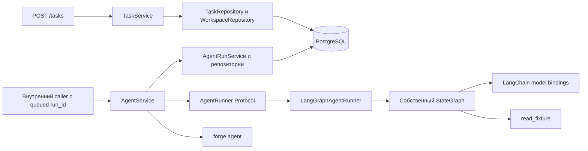
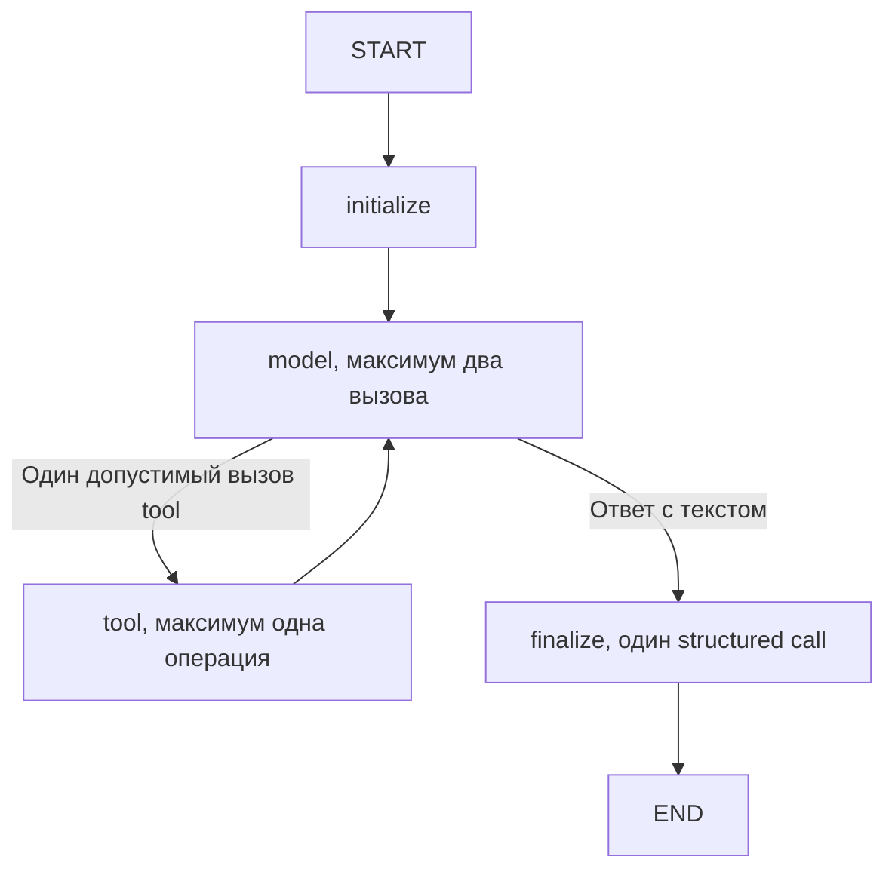
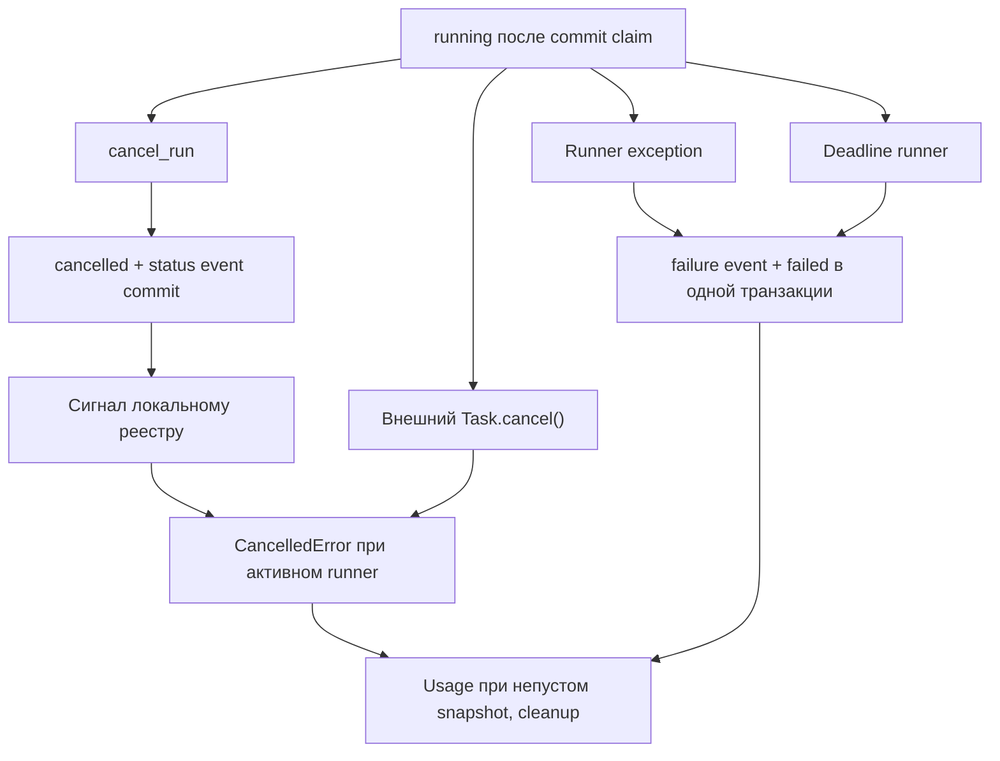
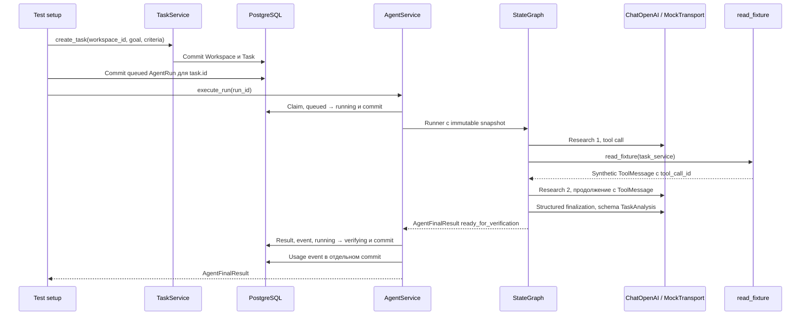
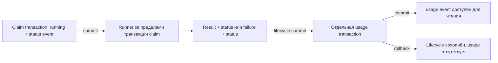

# Forge Week 3 — Single-Agent Runtime

Руководство для опытного Swift/iOS-инженера, который изучает Python backend и AI Product Engineering. Срез кода — `9edbf5e`, merge PR #29, плюс тесты и документация Step 10. [Week 1](LEARNING_GUIDE.md) знакомит с FastAPI, [Week 2](LEARNING_GUIDE_WEEK2.md) разбирает SQLAlchemy, транзакции и PostgreSQL, [README](../README.md) содержит команды. Ручная учебная приёмка Week 3 остаётся за владельцем.

## Оглавление

1. [Цель и архитектурные границы](#1-цель-и-архитектурные-границы)
2. [Model calls, сообщения, инструкции и токены](#2-model-calls-сообщения-инструкции-и-токены)
3. [Разделение абстракций LangChain](#3-разделение-абстракций-langchain)
4. [Structured output и tool calling](#4-structured-output-и-tool-calling)
5. [Прямой loop и create_agent](#5-прямой-loop-и-create_agent)
6. [StateGraph, reducers и завершение](#6-stategraph-reducers-и-завершение)
7. [Research, tool и finalization в Forge](#7-research-tool-и-finalization-в-forge)
8. [Application-граница AgentRunner и AgentService](#8-application-граница-agentrunner-и-agentservice)
9. [Четыре вида состояния](#9-четыре-вида-состояния)
10. [Claim, транзакции и row lock](#10-claim-транзакции-и-row-lock)
11. [Durable result, failure и events](#11-durable-result-failure-и-events)
12. [Deadline, retry disposition и cancellation](#12-deadline-retry-disposition-и-cancellation)
13. [ContextVar и snapshot usage](#13-contextvar-и-snapshot-usage)
14. [Decimal и историческая стоимость](#14-decimal-и-историческая-стоимость)
15. [Structured logging и correlation](#15-structured-logging-и-correlation)
16. [Полный проход Task → AgentRun](#16-полный-проход-task--agentrun)
17. [Что остаётся закоммиченным при отказе](#17-что-остаётся-закоммиченным-при-отказе)
18. [Команды проверки и матрица evidence](#18-команды-проверки-и-матрица-evidence)
19. [Аналогии со Swift и iOS](#19-аналогии-со-swift-и-ios)
20. [Упражнения, самопроверка и вопросы для интервью](#20-упражнения-самопроверка-и-вопросы-для-интервью)

## 1. Цель и архитектурные границы

Задача недели — довести уже подготовленный запуск до предварительного результата, ограничить действия агента и сохранить доменный исход. В modular monolith маршруты, сервисы, репозитории и адаптер графа находятся в одном Python-приложении. PostgreSQL хранит бизнес-состояние. LangChain даёт абстракции сообщений, моделей и tools, LangGraph управляет порядком узлов. Свой граф требует больше кода, чем готовый агент, зато делает точки проверки, бюджеты и финализацию видимыми. ADR-002 фиксирует образовательный выбор и оставляет OpenAI Agents SDK отложенным. [ADR-001](adr/ADR-001.md) · [ADR-002](adr/ADR-002.md)



Фрагмент из `main.py` показывает публичную сборку. В `POST /tasks` после `service.create_task(...)` строится `TaskResponse`. Вызывающий внутренний код передаёт отдельный `run_id` в `AgentService.execute_run()`. В финальном тесте queued AgentRun создаётся явно после Task. Автоматического запуска, scheduler и внешнего execution endpoint в этой сборке нет. Проверка `test_http_persistence_rollback_and_lifecycle` доказывает persistence у HTTP Task API, а `test_week3_task_to_agent_run_end_to_end` проверяет внутренний вызов отдельно. [Сборка](../backend/app/main.py) · [Task API](../backend/app/api/tasks.py) · [HTTP-тест](../backend/tests/test_repository_integration.py) · [E2E](../backend/tests/test_agent_service_integration.py)

```python
app.include_router(health_router)
app.include_router(workspaces_router)
app.include_router(tasks_router)
```

## 2. Model calls, сообщения, инструкции и токены

Один model call получает контекст и возвращает один ответ. В agent loop приложение может добавить ответ инструмента и снова вызвать модель. В `build_task_messages()` системное сообщение задаёт правила анализа, human-сообщение сериализует цель и критерии как данные. В графе `initialize()` заменяет системную инструкцию своей. `AIMessage` переносит текст, запросы tools и metadata. `ToolMessage.tool_call_id` связывает ответ с конкретным запросом. Код продолжения отправляет историю, иначе следующий вызов не увидит, что вернул fixture. [Построение сообщений](../backend/app/agent_runtime/model.py) · [Инициализация графа](../backend/app/agent_runtime/agent_graph.py)

Фрагмент `model.py`.

```python
payload = {"goal": goal, "acceptance_criteria": list(acceptance_criteria)}
return [
    SystemMessage(content=TASK_SYSTEM_INSTRUCTIONS),
    HumanMessage(content=json.dumps(payload, ensure_ascii=False)),
]
```

Токены измеряют обработанный моделью вход и выход. Число символов или длина массива сообщений эти величины не заменяют. Cache read входит в input, reasoning входит в output. Складывать эти подкатегории поверх total означало бы учесть их дважды. Код принимает нормализованное `usage_metadata` от слоя модели. При отсутствии или некорректных основных числах он хранит состояние пропуска, поэтому статистика не превращает неизвестный расход в ноль. Исследовательский узел учитывает вызов до отклонения пустого текста, malformed tool request, refusal или неполного ответа. Эти границы проверяют тесты списка текстовых блоков и extraction. [Граф](../backend/app/agent_runtime/agent_graph.py) · [Usage capture](../backend/app/agent_runtime/usage_capture.py) · [Тесты графа](../backend/tests/test_agent_graph.py) · [Тесты usage](../backend/tests/test_agent_usage_capture.py)

## 3. Разделение абстракций LangChain

HTTP payload Chat Completions зависит от SDK. `BaseChatModel` даёт вызывающему коду единый `ainvoke()` для типизированных сообщений, а `Runnable` покрывает и инструментальную binding, и структурированную обёртку. `ChatOpenAI` — конкретный адаптер. `ModelSettings` нужны лишь при создании клиента. Импорт бизнес-контрактов и запуск FastAPI не требуют OpenAI credential. Прямой вызов OpenAI SDK сэкономил бы один слой абстракции, но Forge пришлось бы самостоятельно поддерживать соглашения о сообщениях, tools и парсинге. Бизнес-сервисы остаются за собственным портом, чтобы не принять API LangChain за доменный контракт. [model.py](../backend/app/agent_runtime/model.py) · [ModelSettings](../backend/app/agent_runtime/settings.py) · [AgentRunner](../backend/app/services/agent_runner.py)

Фрагмент `model.py`.

```python
def create_openai_model(settings: ModelSettings) -> ChatOpenAI:
    return ChatOpenAI(
        model=settings.forge_model_name,
        api_key=settings.openai_api_key,
        timeout=settings.forge_model_timeout_seconds,
        max_retries=0,
    )
```

Offline SDK-тест вызывает конкретный `ChatOpenAI` с внедрёнными HTTPX clients, потому что production-фабрика принимает только `ModelSettings`. Реальные binding-функции применяются к этому клиенту. Ответ от MockTransport проходит SDK normalization, декодирование tool call, JSON schema и Pydantic. Отдельные tests с fake Runnable локализуют ошибки до сети и проверяют передачу аргументов. Реальный провайдер, его стабильность и биллинг требуют самостоятельных проверок. [Тесты модели](../backend/tests/test_agent_model.py) · [MockTransport в usage suite](../backend/tests/test_agent_usage_capture.py) · [E2E](../backend/tests/test_agent_service_integration.py)

## 4. Structured output и tool calling

Tool call предлагает действие и аргументы. Приложение решает, исполнять ли его. Structured output описывает форму итоговых данных. Если использовать один JSON-свободный ответ для обоих назначений, пришлось бы самостоятельно отличать намерение выполнить действие от текста результата. Forge отдельно связывает `read_fixture` с research-моделью и `TaskAnalysis` с финализатором.

Фрагмент из `structured_output.py`.

```python
return model.with_structured_output(
    TaskAnalysis, method="json_schema", strict=True, include_raw=True
)
```

`include_raw=True` оставляет `raw`, `parsed` и `parsing_error`, так что приложение может учесть usage даже при проблеме разбора. `TaskAnalysis` содержит summary, relevant components, assumptions и blocked reason. `AgentFinalResult` собирается приложением. Оно выводит status из blocker и добавляет observations, полученные в ходе исполнения fixture. Схема не делает вывод модели истинным. Поэтому результат остаётся предварительным. Запрещённые поля и malformed envelope проверяют `test_task_analysis_schema_rejects_runtime_fields` и тесты structured finalization. [Код schema binding](../backend/app/agent_runtime/structured_output.py) · [Binding fixture](../backend/app/agent_runtime/fixture_tools.py) · [Сборка результата](../backend/app/agent_runtime/finalization.py) · [Negative tests](../backend/tests/test_agent_finalization.py)

## 5. Прямой loop и create_agent

Прямой пример показывает два вызова, между которыми приложение проверяет запрос и добавляет результат инструмента. Он короткий для чтения, но при росте ветвей и phase-specific checks такой код усложняется. `create_agent` сам организует цикл и даёт middleware для лимитов. Учебная обёртка ограничивает два model calls, один tool call, recursion limit 16 и проверяет историю после возврата. Публичная сборка не обращается к этим модулям. `LangGraphAgentRunner` вызывает `run_agent_graph()` собственного графа.

Иллюстрация прямого цикла с одним tool round.

```python
first = await model.ainvoke(messages)
if first.tool_calls:
    observation = await validated_fixture_call(first.tool_calls)
    final = await model.ainvoke([*messages, first, observation])
```

В прямом демо проверяются name, количество запросов, ID, совпадение результата и незавершённый второй вызов. Готовый агент демонстрирует другую политику invalid arguments через ошибочный ToolMessage. Его тесты проверяют reset лимитов при повторном вызове того же объекта. Эти различия полезны для сравнения поведения. Forge не вводит второй runtime для lifecycle. [Прямой пример](../backend/app/agent_runtime/tool_calling_demo.py) · [create_agent demo](../backend/app/agent_runtime/create_agent_demo.py) · [Тесты модели и tool loop](../backend/tests/test_agent_model.py) · [Тесты create_agent](../backend/tests/test_create_agent_demo.py) · [Адаптер](../backend/app/agent_runtime/langgraph_runner.py)

## 6. StateGraph, reducers и завершение

`StateGraph` связывает функцию узла с решением, какой узел исполнится следующим. Схема input отделяет данные вызывающего от полей внутреннего state. Узел возвращает delta. Reducer определяет, как delta соединяется с предыдущим значением. В `AgentGraphState` `operator.add` складывает счётчики и приращения. `add_messages` добавляет сообщения либо заменяет сообщение с тем же ID. Именно замена видна в `graph_cycle_demo`, где финализация обновляет последний draft. В основном графе повторный ID отвергается до reducer, чтобы исследовательский ответ не затёр историю. У observations нет reducer. Текущий граф допускает ровно одно fixture исполнение, а `call_tool` возвращает новый список.

Фрагмент объявления `AgentGraphState`.

```python
messages: Annotated[list[AnyMessage], add_messages]
model_calls: Annotated[int, operator.add]
tool_calls: Annotated[int, operator.add]
observations: list[FixtureObservation]
```



Разница между условным ребром и бюджетом важна. Ребро выбирает продолжение после модели. Бюджет отклоняет неразрешённую работу до вызова. Recursion limit 16 отдельно ограничивает выполнение графа. Terminal node указывает конец вычисления. `builder.compile(checkpointer=False)` и per-invocation state позволяют повторно использовать граф без прикрепления его state к AgentRun. Тесты `test_draft_cycle_graph_accumulates_and_replaces_messages`, `test_agent_graph_rejects_duplicate_message_id` и `test_agent_graph_ainvoke_applies_recursion_limit_once` показывают разные уровни защиты. [Production graph](../backend/app/agent_runtime/agent_graph.py) · [Cycle demo](../backend/app/agent_runtime/graph_cycle_demo.py) · [Тесты reducer](../backend/tests/test_graph_cycle_demo.py) · [Тесты графа](../backend/tests/test_agent_graph.py)

## 7. Research, tool и finalization в Forge

Research получает цель, критерии и инструкцию работать с учебным fixture. Первый ответ может запросить `read_fixture`. Приложение допускает одно обращение за исполнение, один tool call в сообщении, непустой ID, зарегистрированное имя и валидные строгие аргументы `FixtureInput`. Аргумент `component` — одно из двух значений `task_service` и `agent_run_service`. Реализация возвращает заранее заданную строку и не обращается к файловой системе. Следующая модель читает `ToolMessage`, а финализатор получает новый компактный набор сообщений: цель, criteria, текстовые notes ответов и runtime observations. Это уменьшает нагрузку от полного transcript и сохраняет явное происхождение наблюдений.

Фрагмент извлечения наблюдения из `call_tool()`.

```python
fixture_observation = FixtureObservation(
    component=args.component, tool_call_id=call_id, content=checked.content
)
return {"messages": [checked], "tool_calls": 1, "observations": [fixture_observation]}
```

Граф проверяет, что после финализации существуют `AgentFinalResult`, raw `AIMessage` и счётчик вызовов равен единице. Нарушение любого инварианта превращается в ошибку execution. Отдельные спеки проверяют, что tool не вызывается при исчерпанном research budget, finalizer не вызывается при неверной истории и observations модели не заменяют наблюдения runtime. Схемы ToolCall и Approval в PostgreSQL уже существуют, но текущий fixture исполняется в графе без записи этих сущностей. [Fixture](../backend/app/agent_runtime/fixture_tools.py) · [Граф](../backend/app/agent_runtime/agent_graph.py) · [Finalizer](../backend/app/agent_runtime/finalization.py) · [Execution ORM](../backend/app/db/models/execution.py) · [Тесты графа](../backend/tests/test_agent_graph.py) · [Тесты финализатора](../backend/tests/test_agent_finalization.py)

## 8. Application-граница AgentRunner и AgentService

`AgentRunRequest` — frozen dataclass с `task_id`, `run_id`, целью и tuple критериев. Эта копия уже прочитанной задачи передаётся runner после commit. `AgentRunner` описывает структурный контракт и позволяет тесту подставить объект с подходящим методом без наследования. `LangGraphAgentRunner` выделяет результат графа, классифицирует обычные ошибки адаптера и сохраняет причину. `AgentService` владеет claim, deadline, map результата в lifecycle через `AgentRunService`, usage persistence и очисткой process-local handle. Такое разделение позволяет проверять SQL независимо от механики LangGraph. Передача `CompiledStateGraph` прямо в application service связала бы доменные операции с модельными сообщениями и правилами конкретного framework.

Точный фрагмент контракта.

```python
class AgentRunner(Protocol):
    async def run(self, request: AgentRunRequest) -> AgentFinalResult:
        ...
```

`test_application_contract_imports_without_runtime_frameworks_or_credentials` подтверждает независимый импорт, `test_agent_runner_port_accepts_an_independent_fake` — подстановку, `test_langgraph_runner_propagates_cancellation` — границу перехвата. Отдельно проверяется отказ `AgentService` сохранять объект, не соответствующий `AgentFinalResult`. [Контракты](../backend/app/services/agent_runner.py) · [AgentResult](../backend/app/services/agent_result.py) · [Адаптер](../backend/app/agent_runtime/langgraph_runner.py) · [AgentService](../backend/app/services/agent_service.py) · [Тесты адаптера](../backend/tests/test_agent_runner.py) · [Тесты deadline и runner](../backend/tests/test_agent_service_deadline.py)

## 9. Четыре вида состояния

| Объект | Владелец и время жизни | Пример |
|---|---|---|
| Task | Домен и PostgreSQL. Намерение за пределами одной попытки | Цель, acceptance criteria, отдельный Task status |
| AgentRun | Домен и PostgreSQL. Конкретная попытка Task | `task_id`, `attempt_number`, `running`, `final_result` |
| Graph state | Один invocation. Хранит ход вычисления | Messages, budgets, observations, финализация |
| Model context | Вход одного model call. Подмножество или пересборка state | System instructions, цель, tool response или compact notes |

Связь попытки с задачей и уникальность номера заданы в `AgentRunModel`. Фрагмент `TaskService.create_task()` заканчивается commit и возвращает `task`. Он не вызывает runtime. Тест создаёт queued AgentRun с этим `task.id` и затем подтверждает, что статус Task остался `queued`, пока AgentRun перешёл в `verifying`. Объединение Task и AgentRun упростило бы первую запись, но означало бы перезапись одной и той же строки при нескольких попытках и смешение независимых status transitions. [TaskService](../backend/app/services/tasks.py) · [Task ORM](../backend/app/db/models/task.py) · [Execution ORM](../backend/app/db/models/execution.py) · [E2E](../backend/tests/test_agent_service_integration.py)

```python
await self.session.commit()
return task
```

## 10. Claim, транзакции и row lock

Чтение `queued` без lock позволило бы двум исполнителям одновременно решить, что запуск свободен. `AgentRunRepository.get_for_update()` делает `SELECT … FOR UPDATE` и обновляет уже загруженный объект через `populate_existing=True`. Claim проверяет ожидаемый `queued`, читает Task, собирает snapshot, аппендит событие смены статуса и делает commit. Контекст `AgentService._claim()` закрывает сессию перед runner. Модель может обрабатываться секунды, а row lock в это время больше не удерживается. Другой claim после ожидания читает актуальный статус и получает stale error. Тест с двумя сессиями проверяет конкуренцию, отдельный тест читает committed `running` из runner. [Репозиторий запуска](../backend/app/repositories/agent_runs.py) · [Claim](../backend/app/services/agent_runs.py) · [Границы сессий](../backend/app/services/agent_service.py) · [PG lifecycle tests](../backend/tests/test_agent_service_integration.py)

Фрагмент `claim_for_execution()`.

```python
await self._transition_locked(run, AgentRunStatus.QUEUED, AgentRunStatus.RUNNING)
await self.session.commit()
return request
```

При добавлении события `AgentEventRepository.append()` берёт тот же lock по ID родителя без autoflush, затем flush и отдельным SELECT читает `MAX(sequence) + 1`. При `READ COMMITTED` отдельный SELECT видит события, зафиксированные предыдущим владельцем lock, включая случай, когда lock statement ждал. `UNIQUE(agent_run_id, sequence)` остаётся проверкой на уровне БД. Репозиторий не завершает транзакцию. Вариант `SELECT MAX + 1` без сериализации дал бы конфликт даже при корректном формате события. Тесты в PostgreSQL покрывают конкурентные writers, rollback и повторное использование номера. [Append](../backend/app/repositories/agent_events.py) · [Тесты sequence](../backend/tests/test_agent_event_append_integration.py) · [BL-08 и BL-09](../backlog.md)

## 11. Durable result, failure и events

Колонка `AgentRun.final_result` допускает SQL NULL, а CHECK требует JSONB-объект для любого сохранённого JSON. SQL проверяет верхний уровень, а `encode_agent_result()` и `decode_agent_result()` проверяют версию и application shape. `AgentRunService.complete_execution()` сохраняет итог, `agent_result_recorded` и переход одним commit. Статус меняется на `verifying` для `ready_for_verification` и `failed` для `blocked`. `blocked` сохраняет полезный предварительный результат. Execution exception даёт другое durable представление: SQL NULL и `agent_execution_failed` со стабильным кодом, в той же транзакции с `running → failed`. Полный текст ошибки не входит в payload.

Точный фрагмент определения целевого состояния.

```python
result_status = document["result"]["status"]
target = AgentRunStatus.VERIFYING if result_status == "ready_for_verification" else AgentRunStatus.FAILED
```

Можно было бы хранить весь результат и трассу в каждом событии. Forge хранит результат в строке запуска, историю переходов и ограниченные метаданные — отдельными events. Это позволяет читать итог прямо, а порядок проверять по sequence. Service lock и expected status препятствуют позднему сохранению после отмены, дубликату итога и reopen terminal state. Переход в `succeeded` доменно возможен из `verifying`, но сервис отклоняет его до реализации независимого evidence. Существующие тесты проверяют форму JSONB, versioned envelope, rollback и guards. [Миграция результата](../backend/alembic/versions/1d972cc34fbe_agent_run_final_result.py) · [Result codec](../backend/app/services/agent_result_codec.py) · [Failure codec](../backend/app/services/agent_failure.py) · [Service](../backend/app/services/agent_runs.py) · [Тесты результата](../backend/tests/test_agent_result_persistence_integration.py) · [Тесты переходов](../backend/tests/test_execution_transitions.py)

## 12. Deadline, retry disposition и cancellation

Model timeout ограничивает отдельный вызов SDK. Service deadline по умолчанию 60 секунд покрывает всё `AgentRunner.run()`, включая несколько моделей и fixture. Claim, result validation и persistence живут вне этого таймера. `asyncio.timeout_at` работает по clock event loop. Дополнительная проверка после await отвергает поздний результат, даже если runner подавил отмену таймера. `AgentRunnerError("execution_deadline_exceeded")` сохраняет причину `TimeoutError`, если сработал timeout context. Обычный `TimeoutError` из runner вне собственного истечения получает отдельный `runner_timeout` в классификаторе приложения.

Фрагмент deadline helper.

```python
loop = asyncio.get_running_loop()
deadline = loop.time() + self._execution_timeout_seconds
timeout = asyncio.timeout_at(deadline)
```

`AgentFailureCode` задаёт стабильную категорию. `retry_disposition` выводится из кода и помогает оценить ситуацию. Например, `provider_rate_limited` — кандидат для transient retry, `provider_quota_exhausted` — отдельная категория, `provider_rate_limit_unknown` требует review. Политика оценивает риск, а повторных запусков в сервисе нет. SDK также сконфигурирован с `max_retries=0` в production-фабрике. Различение помогает не тратить одну попытку на серию непрозрачных повторов. [Deadline](../backend/app/services/agent_service.py) · [Error classification](../backend/app/agent_runtime/error_classification.py) · [Failure policy](../backend/app/services/agent_failure.py) · [Тесты 401/429/503](../backend/tests/test_agent_failure_classification.py) · [Deadline tests](../backend/tests/test_agent_service_deadline.py)



Доменная отмена работает как отдельная транзакция. Только после подтверждённого commit вызывается `request_cancel`. Реестр сигнализирует `asyncio.Task.cancel()` во время активного runner. Вне runner он отмечает handle, а сервис проверяет прерывание на своих границах. Если закрытие сессии упало после commit, `finally` сохраняет сигнал. Внешний `Task.cancel()` прерывает coroutine и сам не фиксирует `cancelled` в БД. Повторная отмена и отсутствие локального worker не означают гарантированную доставку сигнала. Сервис не ждёт завершения cleanup в ответ на `cancel_run()`. Tests разыгрывают commit/rollback, отмену реального графа и конкуренцию с завершением. [Реестр](../backend/app/services/active_runs.py) · [Тесты cancellation](../backend/tests/test_agent_cancellation.py) · [Интеграционные гонки](../backend/tests/test_agent_service_integration.py)

## 13. ContextVar и snapshot usage

Usage нужен одновременно в research и structured wrapper. Глобальный mutable collector смешал бы конкурентные запуски. Явная передача collector по каждой сигнатуре прозрачна, но распространила бы детали измерения через runner, graph state и финализатор. Forge привязывает collector к invocation контекстом. Владелец открывает его вокруг runner. `ContextVar.set()` даёт token для восстановления предыдущего значения. При завершении `finally` закрывает collector и восстанавливает контекст. Снимок из immutable tuple можно валидировать и кодировать после закрытия. Задача, унаследовавшая старый контекст, видит закрытый collector, и поздний ответ не меняет snapshot.

Фрагмент `capture_agent_usage()`.

```python
collector = UsageCollector(run_id)
token = _current_usage.set(collector)
try:
    yield collector
finally:
    collector.close()
    _current_usage.reset(token)
```

`invoke_observed_model()` регистрирует попытку на границе `ainvoke()` и завершает запись статусом ответа, ошибки или отмены. `reported` означает валидные основные токены, `missing` — отсутствие, `invalid` — некорректные основные поля. Неизвестная необязательная подкатегория не уничтожает валидные totals. Два независимых графа, отмена до ответа, исключение провайдера и поздняя задача покрыты тестами. [Collector](../backend/app/services/agent_usage.py) · [Invoke wrapper](../backend/app/agent_runtime/usage_capture.py) · [Тесты capture](../backend/tests/test_agent_usage_capture.py) · [Тесты snapshot](../backend/tests/test_agent_usage.py)

## 14. Decimal и историческая стоимость

Сумма цен малых вызовов требует десятичной арифметики и известных ставок для соответствующей стадии модели. Forge использует `Decimal` в явном `localcontext(_COST_CONTEXT)`. Тариф на миллион задан отдельно для обычного input, cached input и output. Reasoning уже входит в output. Для неизвестного cache breakdown оценка возможна только когда он не меняет сумму. Отсутствие данных или тарифа помечает вызов как unknown cost. Оценщик суммирует priced calls и отдельно ставит `cost_complete`. Это полезнее ответа `0` для всех неучтённых вызовов и точнее двоичных float при сохранении денег.

Формула из `_estimate_call()` после проверки предпосылок.

```python
input_cost = (tokens.input_tokens - cached) * tariff.input_usd_per_million
if cached_rate is not None:
    input_cost += cached * cached_rate
output_cost = tokens.output_tokens * tariff.output_usd_per_million
return ModelCallCost(call.call_number, CostStatus.ESTIMATED, (input_cost + output_cost) / _MILLION)
```

Для синтетического E2E uncached input равен 50, cached — 21, output — 29. Расчёт `(50×2.00 + 21×0.50 + 29×8.00) / 1_000_000` даёт `Decimal("0.00034250")`. В событии `agent_usage_recorded` хранится snapshot и историческая конфигурация ставок с десятичными строками. Чтение новым сервисом воспроизводит сумму без текущего pricing. Эта оценка относится к сообщённым счётчикам и сохранённому учебному тарифу. У провайдера может быть иная тарификация, invoice с этим тестом не сравнивается. [Agent cost](../backend/app/services/agent_cost.py) · [Usage codec](../backend/app/services/agent_usage_codec.py) · [Тесты стоимости](../backend/tests/test_agent_cost.py) · [E2E persistence](../backend/tests/test_agent_service_integration.py)

## 15. Structured logging и correlation

Оператору нужно найти один execute среди многих, не читая prompt или raw exception. `AgentLogContext` создаёт новый `operation_id` при каждом execute/cancel. `run_id` связывает обе операции, `task_id` появляется после успешного claim и отсутствует в cancel. Контекст операции передаётся явно. Уже существующий `ContextVar` применяется к usage collector, поскольку он нужен более глубоко в model calls. Logger `forge.agent` применяет allowlist с отдельной схемой для начала/завершения операции, начала/завершения фазы, классифицированного сбоя и usage summary.

Фрагмент из `AgentService.execute_run()`.

```python
observer = AgentObserver(AgentLogContext(run_id, AgentOperation.EXECUTE))
with observer.operation():
    handle = self._active_runs.register(run_id)
```

`AgentJsonFormatter` берёт timestamp из LogRecord и проверяет типы, enum, UUID и допустимые поля. `perf_counter_ns()` измеряет длительности, а UTC timestamp помогает найти запись. `completed` характеризует возврат метода, в том числе когда результат `blocked`. `agent_usage_observed` фиксирует измерение перед persistence. Зафиксированное `agent_usage_recorded` читается из PostgreSQL. HTTP logger сохраняет собственную схему и корреляцию. Синхронный sink может задержать вызов, а при сбое записи теряются. Тесты запускают конкурентные asyncio tasks и отказ реального StreamHandler, проверяют отсутствие canaries и сохранение primary exception. [Logger и formatter](../backend/app/core/logging.py) · [Observer](../backend/app/services/agent_observability.py) · [Unit observability](../backend/tests/test_agent_observability.py) · [PostgreSQL observability](../backend/tests/test_agent_service_integration.py)

## 16. Полный проход Task → AgentRun

Запустите `test_week3_task_to_agent_run_end_to_end` по инструкции ниже. Он использует фактические PostgreSQL sessions и SDK transport, а provider replies полностью синтетические. ID появляются в ходе setup и используются во всех последующих проверках. Настроенная `.invalid`-ссылка проходит через `httpx.MockTransport`. Оба клиента имеют `trust_env=False`, SDK retries равны нулю, tracing явно выключен.



1. Setup добавляет Workspace через `WorkspaceRepository`, затем вызывает `TaskService.create_task()` с настоящими репозиториями. Создание Task фиксируется и проверяется SQL-запросом на отсутствие связанного AgentRun. Только после этого setup создаёт queued AgentRun (attempt 1, `task_id` результата TaskService).
2. Claim читает цель и ordered acceptance criteria, коммитит `queued → running` и возвращает request. Сервис регистрирует active handle до claim и освобождает его в `finally`.
3. Research HTTP-запрос предлагает один `read_fixture`. Mock reply даёт `fixture-1` и 12/8/20 токенов. Tool возвращает строку про область действия ключа идемпотентности.
4. Второй HTTP-запрос содержит `ToolMessage` с тем же `fixture-1`. Ответ research сообщает 24/10/34 токена и даёт notes.
5. Третий запрос просит `response_format=json_schema` и передаёт compact context с actual fixture observation. Ответ финализатора сообщает 35/11/46. Из модели берётся preliminary summary и assumptions, из исполнения — observation `synthetic_fixture`. Утверждения о реальном репозитории и успешной независимой проверке отсутствуют.
6. Фаза result validation сериализует контракт. Транзакция сохраняет result и переводит запуск в `verifying`. Usage затем сохраняется отдельной транзакцией. История содержит ровно четыре события:

   | Sequence | Event | Содержимое |
   |---:|---|---|
   | 1 | `agent_run_status_changed` | `queued → running` |
   | 2 | `agent_result_recorded` | `schema_version=1`, `result_status=ready_for_verification` |
   | 3 | `agent_run_status_changed` | `running → verifying` |
   | 4 | `agent_usage_recorded` | Три наблюдения, `schema_version=1` и исторические тарифы |

7. В snapshot 71 input, 29 output, 100 total. Cached 21 и reasoning 14 входят в эти totals. Все три вызова reported и priced. `usage_complete` и `cost_complete` истинны. Стоимость `Decimal("0.00034250")`. В `forge.agent` те же totals и цена plain string `"0.0003425"`. Пять пар фаз прошли `completed`, начиная с claim и заканчивая usage persistence. Общий `operation_id` связывает фазы. Canaries, сообщения, ответы, raw arguments и фраза о `succeeded` отсутствуют.
8. Execution engine освобождается. Новый engine и новый `AgentService` без переданного pricing читают сохранённый result, отсутствие failure и usage с исторической стоимостью. Runner оставлен невызванным. Через настоящий `AgentRunService` попытка `verifying → succeeded` возвращает `VerificationEvidenceRequiredError`. Запуск по-прежнему `verifying` с теми же четырьмя событиями. Task и номер попытки сохранены.

Фрагмент сборки графа из теста.

```python
graph = create_agent_graph(create_tool_calling_model(model), create_structured_task_model(model))
runner = LangGraphAgentRunner(graph)
```

Unit fake помогает проверить ветку без SDK, отдельные SQL-тесты — race и rollback. Полный offline flow проверяет wiring этих слоёв и чтение из нового pool. Тест охватывает внутренний application-вызов. Live delivery, production load и настоящий счёт провайдера остаются за пределами этого evidence. [E2E и lifecycle suite](../backend/tests/test_agent_service_integration.py) · [Снимок токенов MockTransport](../backend/tests/test_agent_usage_capture.py)

## 17. Что остаётся закоммиченным при отказе

Жизненный цикл и usage отвечают на разные вопросы. Единая долгоживущая транзакция вокруг модели удержала бы row lock на протяжении внешнего I/O, а ошибка usage откатила бы полезный результат. В Forge короткие транзакции дают явные точки фиксации бизнес-данных и допускают ситуацию, когда lifecycle сохранён, а usage нет. При чтении опирайтесь на фактические записи PostgreSQL.



| Точка отказа | Что остаётся в PostgreSQL | Что видит caller |
|---|---|---|
| Claim отсутствующего или устаревшего run | Предыдущее состояние и история | Claim error, runner и usage не вызываются |
| `ready` и rollback result transaction | Claim сохранён, status остаётся `running`, итог и result event откатываются. Наблюдавшийся usage может записаться отдельно | Persistence error |
| Нормальный `blocked` | `failed` и сохранённый blocked result, result event и status. Failure metadata в этой ветви нет | `AgentFinalResult` с `blocked` |
| Runner exception или deadline, failure commit успешен | `failed`, SQL NULL вместо result, failure event и status, при наблюдении usage отдельным event | Исходное application exception после классификации |
| Failure persistence откатилась | Claim сохранён, failure и финальный status не зафиксированы этой транзакцией, usage всё ещё может быть записан | Transition/persistence exception с исходной ошибкой runner в cause |
| Доменная отмена победила | `cancelled` и status event, без позднего результата. Если отмена из `verifying`, ранее сохранённый результат остаётся | `cancel_run` возвращает после запроса локального сигнала, активное execution может завершиться `CancelledError` |
| Только внешняя coroutine cancellation | Без доменной транзакции отмены предыдущий статус может остаться `running`. Возможен частичный usage | `CancelledError` |
| Usage write после успешного result commit упал | Result и lifecycle остаются. После rollback usage event отсутствует | `AgentUsagePersistenceError`, SQL error в cause |
| Usage write упал при уже возникшей ошибке или отмене | Состояние зависит от ранее завершённых транзакций | Первичная ошибка сохраняет identity и cause, добавляется `agent_usage_persistence_failed` |

Фрагмент политики в `finally` у `execute_run()`.

```python
except Exception as write_error:
    if primary_error is None:
        raise AgentUsagePersistenceError("usage_persistence_failed") from write_error
    primary_error.add_note("agent_usage_persistence_failed")
```

Сбой процесса после claim оставляет записанный `running`. Свежий engine читает данные, но не получает сохранённую точку продолжения графа. Повторная внешняя отмена до commit может помешать записи usage. Исход commit и ошибка освобождения соединения различаются, что особенно важно для `cancellation_persistence`. Тесты `test_agent_service_usage_survives_completion_transaction_rollback`, `test_agent_service_usage_write_failure_preserves_primary_outcome` и `test_agent_service_observability_records_real_graph` подтверждают разные стороны этой таблицы. [Оркестрация](../backend/app/services/agent_service.py) · [Lifecycle транзакции](../backend/app/services/agent_runs.py) · [Интеграционные случаи](../backend/tests/test_agent_service_integration.py)

## 18. Команды проверки и матрица evidence

Из `backend`, используя установленный `.venv`. Обычный прогон запускайте с выключенными PostgreSQL opt-ins. Во второй команде используется существующая выделенная база. На другой машине сначала создайте отдельную базу и мигрируйте к head по README.

```bash
unset FORGE_TEST_POSTGRES FORGE_TEST_SCHEMA_DB FORGE_TASK04_TEST_DB FORGE_TASK05_TEST_DB FORGE_TASK06_TEST_DB
.venv/bin/python -m pip check
.venv/bin/python -m pytest -q -rs

POSTGRES_HOST=127.0.0.1 POSTGRES_PORT=55432 \
POSTGRES_DB=forge_task06_week3_result_20261114_123241 \
FORGE_TASK06_TEST_DB=forge_task06_week3_result_20261114_123241 \
.venv/bin/python -m pytest -v \
  tests/test_agent_service_integration.py::test_week3_task_to_agent_run_end_to_end
```

Режимы тестирования покрывают разные границы. Unit tests локализуют контракты, исключения и счётчики без PostgreSQL. MockTransport проверяет преобразование HTTP в SDK, при этом ответы контролирует тест. PostgreSQL opt-in включает реальные commits, constraints, lock и rollback. Чтобы сравнить результаты, считайте каждый node ID один раз. Обычный прогон Step 10 дал `749 passed, 157 skipped`. Основной PostgreSQL suite дал `151 passed`. Отдельные прогоны дали ещё 6 (connection 2, Task schema 2, repository 1, execution schema 1). В сумме покрыто **906 уникальных случаев**, 0 итоговых failures, 0 pytest warnings, 0 оставшихся skipped. Отдельный запуск одного E2E входит в 151 и учитывается там. Все четыре базы на PostgreSQL `17.11`, `READ COMMITTED` и revision `1d972cc34fbe (head)`. `alembic check` подтвердил отсутствие новых upgrade operations. [Полные команды](../README.md#полная-проверка-postgresql-для-week-3) · [Итоги и exit criteria](../forge_progress.md)

До исправлений на свежем head `test_migrated_schema_metadata` упал на новых колонках `status` и `idempotency_key`, а `test_migrated_schema_constraints` прошёл. `test_execution_schema_and_constraints` упал на старой проверке nullability. Обновлены тесты отражённой схемы и SQL NULL/JSONB constraints. Для metadata `Task` проверяется точный список, nullable UUID `idempotency_key`, `VARCHAR(32) DEFAULT 'queued'`, именованные CHECK и `UNIQUE(workspace_id, idempotency_key)`. Для execution tables nullable остаются только `AgentRun.final_result` и `Approval.decided_at`. Для result проверяется JSONB, допускаются SQL NULL и объект, массив, строка и JSON null отклоняются. [Task schema](../backend/tests/test_schema_integration.py) · [Execution schema](../backend/tests/test_execution_schema_integration.py) · [JSONB object cases](../backend/tests/test_agent_result_persistence_integration.py)

### Матрица architecture audit

В колонке «Итог» runtime означает наблюдаемое в тестах поведение, static — подтверждённую границу исходников. Поведение стороннего провайдера и production deployment имеют отдельные пределы измерения.

| Критерий | Место в исходниках | Evidence | Итог | Ограничение |
|---|---|---|---|---|
| ADR-001 modular monolith | [ADR-001](adr/ADR-001.md), [create_app](../backend/app/main.py), [Task API](../backend/app/api/tasks.py) | [HTTP repository integration](../backend/tests/test_repository_integration.py), [Task tests](../backend/tests/test_tasks.py) | Static + runtime PASS | HTTP публикует health, workspaces и tasks |
| ADR-002 LangChain и custom StateGraph | [ADR-002](adr/ADR-002.md), [bindings](../backend/app/agent_runtime/structured_output.py), [graph](../backend/app/agent_runtime/agent_graph.py), [adapter](../backend/app/agent_runtime/langgraph_runner.py) | [Step 10 E2E](../backend/tests/test_agent_service_integration.py) | Static + runtime PASS | SDK проверен с MockTransport |
| create_agent и direct loop учебные | [Demo create_agent](../backend/app/agent_runtime/create_agent_demo.py), [direct demo](../backend/app/agent_runtime/tool_calling_demo.py), [adapter](../backend/app/agent_runtime/langgraph_runner.py) | [Demo tests](../backend/tests/test_create_agent_demo.py), [model tests](../backend/tests/test_agent_model.py) | Static + runtime PASS | Единственный lifecycle runtime использует custom graph |
| AgentRunner независим от адаптера | [Protocol](../backend/app/services/agent_runner.py) | [Импорт без SDK и независимый fake](../backend/tests/test_agent_runner.py) | Runtime PASS | Протокол определяет только application input/output |
| Task и AgentRun различаются | [TaskService](../backend/app/services/tasks.py), [Task ORM](../backend/app/db/models/task.py), [Run ORM](../backend/app/db/models/execution.py) | [E2E и lifecycle](../backend/tests/test_agent_service_integration.py), [idempotency](../backend/tests/test_task_idempotency_integration.py) | Runtime PASS | Внешний `POST /tasks` создаёт только Task |
| PostgreSQL владеет lifecycle | [AgentRunService](../backend/app/services/agent_runs.py), [repositories](../backend/app/repositories/agent_runs.py) | [PG transitions](../backend/tests/test_agent_run_integration.py), [fresh-engine read](../backend/tests/test_agent_service_integration.py) | Runtime PASS | Граф и логи имеют собственный срок жизни |
| Claim завершается до runner | [claim_for_execution](../backend/app/services/agent_runs.py), [граница claim session](../backend/app/services/agent_service.py) | `test_agent_service_commits_claim_before_runner_and_finishes_in_new_session` и `test_agent_service_concurrent_claim`. [PG lifecycle](../backend/tests/test_agent_service_integration.py) | Runtime PASS | Сериализуется попытка по одному run ID |
| Ready приводит к verifying | [complete_execution](../backend/app/services/agent_runs.py) | [Atomic result tests](../backend/tests/test_agent_result_persistence_integration.py), [E2E](../backend/tests/test_agent_service_integration.py) | Runtime PASS | Требуется независимая проверка |
| Независимый verification guard | [Run guard](../backend/app/services/agent_runs.py), [Task guard](../backend/app/services/tasks.py) | [Run transition guard](../backend/tests/test_agent_run_integration.py), [Task guard](../backend/tests/test_task_transition_integration.py), [E2E](../backend/tests/test_agent_service_integration.py) | Runtime PASS | Проверено отклонение, verifier отсутствует |
| Terminal run не открывается повторно | [Переходы](../backend/app/domain/transitions.py), [write guards](../backend/app/services/agent_runs.py) | [Полный перебор пар](../backend/tests/test_execution_transitions.py), [late result](../backend/tests/test_agent_result_persistence_integration.py) | Runtime PASS | Повторное исполнение требует другой attempt, orchestration отсутствует |
| Бюджеты, fixture validation и cancellation | [Graph](../backend/app/agent_runtime/agent_graph.py), [FixtureInput](../backend/app/agent_runtime/fixture_tools.py), [Registry](../backend/app/services/active_runs.py) | [Graph negative tests](../backend/tests/test_agent_graph.py), [cancellation](../backend/tests/test_agent_cancellation.py), [реальный граф и гонки](../backend/tests/test_agent_service_integration.py) | Runtime PASS | Cancel cooperative и process-local |
| Result, failure, usage persistence | [Result codec](../backend/app/services/agent_result_codec.py), [Failure codec](../backend/app/services/agent_failure.py), [Usage codec](../backend/app/services/agent_usage_codec.py) | [Result constraints](../backend/tests/test_agent_result_persistence_integration.py), [PG failure, usage, rollback](../backend/tests/test_agent_service_integration.py) | Runtime PASS | Usage сохраняется отдельной транзакцией |
| Логи сохраняют lifecycle semantics | [Observer](../backend/app/services/agent_observability.py), [Logger](../backend/app/core/logging.py) | [Sink failures и canaries](../backend/tests/test_agent_observability.py), [PG event history](../backend/tests/test_agent_service_integration.py), [HTTP logs](../backend/tests/test_logging.py) | Runtime PASS | Best effort, локальный синхронный sink |
| Нет production checkpoint/resume | [Graph compile](../backend/app/agent_runtime/agent_graph.py), [Adapter](../backend/app/agent_runtime/langgraph_runner.py) | [Независимые graph invocations](../backend/tests/test_agent_graph.py), [fresh-engine read](../backend/tests/test_agent_service_integration.py) | Static подтверждён | Fresh read даёт записанное состояние |
| Только fixture tool, без shell, repository mutation и MCP | [Связанный tool](../backend/app/agent_runtime/fixture_tools.py), [tool node](../backend/app/agent_runtime/agent_graph.py) | [Валидация аргументов, бюджета и имени](../backend/tests/test_agent_graph.py), [E2E tool](../backend/tests/test_agent_service_integration.py) | Static + runtime PASS | Permissions, approvals runtime и sandbox за границей этого среза |

## 19. Аналогии со Swift и iOS

| Python / Forge | Аналогия | Где аналогия заканчивается |
|---|---|---|
| `Protocol` и constructor injection | `protocol AgentRunner` и инъекция зависимости в use case | Swift обычно объявляет conformance, Python допускает структурное совпадение и проверяется типизатором или по вызову |
| Frozen dataclass и tuple | Value snapshot со свойствами `let` | `frozen` запрещает присваивание полей. В Forge tuple специально исключает mutable список acceptance criteria |
| Pydantic strict model | `Decodable` плюс проверяющий инициализатор | JSON schema задаёт форму model reply, а инварианты status и происхождения проверяются отдельно |
| `async with` и `try/finally` | Resource scope и `defer` | `AsyncSession` связана с транзакциями и соединением, конкурентным задачам нужны отдельные сессии |
| `ContextVar` | `@TaskLocal` | Контекст наследуется по правилам asyncio tasks и восстанавливается по token. Значение collector mutable до close |
| ActiveRunRegistry | Process-local map активных Swift Tasks | Сериализация внутри actor ограничена процессом. PostgreSQL lock координирует разные подключения |
| `operator.add` и `add_messages` | Merge policy для state reducer | Reducer библиотеки решает добавление или замену полей. Доменную валидацию выполняют отдельные функции |
| `Decimal` с явным context | Foundation.Decimal и заданные правила округления | Ставки сериализуются строками, а unknown usage остаётся отдельным состоянием |
| `forge.agent` | Structured `Logger` с correlation fields | Сдвиг календарного времени влияет на timestamp, elapsed берётся из другого clock |

Иллюстрация Swift для сопоставления application port.

```swift
protocol AgentRunner {
    func run(_ request: AgentRunRequest) async throws -> AgentFinalResult
}
```

При тестировании на iOS mock URLProtocol или подмена transport дают сходную точку контроля с HTTPX MockTransport. Подмена networking проверяет обмен, который произошёл внутри теста. В Forge отдельный слой evidence дают транзакционные тесты на настоящем PostgreSQL. [Python port](../backend/app/services/agent_runner.py) · [Context и snapshot](../backend/app/services/agent_usage.py) · [MockTransport в SDK-тесте](../backend/tests/test_agent_usage_capture.py) · [Блокировка](../backend/app/repositories/agent_runs.py)

## 20. Упражнения, самопроверка и вопросы для интервью

1. Запустите локальный graph cycle без БД и провайдера. Проследите, почему `rounds == 2` и последний draft заменяется. Затем выполните [тесты cycle](../backend/tests/test_graph_cycle_demo.py) и объясните разницу между stream updates и values.
2. В [тестах графа](../backend/tests/test_agent_graph.py) выберите `test_agent_graph_rejects_tool_without_remaining_model_budget`. Перед запуском предскажите, сколько tool calls успеет выполниться и почему порог проверяется до `ainvoke()`.
3. В [capture tests](../backend/tests/test_agent_usage_capture.py) сравните missing usage, invalid core usage и реальную отмену. Посчитайте ожидаемый subtotal, если третий model call не вернул usage. Объясните, откуда берутся 54 известных токена и `0.0001995 USD`.
4. Запустите E2E и два schema-теста по [README](../README.md#полная-проверка-postgresql-для-week-3). Сверьте четыре sequence-номера и поля Task. Затем разберите `usage-rollback` в [observability integration](../backend/tests/test_agent_service_integration.py). Назовите транзакцию, которая уже зафиксирована.
5. Выполните [тест корреляции](../backend/tests/test_agent_observability.py) `test_agent_observability_concurrent_operations`. Найдите два разных `operation_id` для одного `run_id` и объясните, почему у cancel `task_id=null`. Сравните `completed` и committed status.

Команда для первого упражнения из `backend`.

```bash
.venv/bin/python - <<'PY'
import asyncio
from app.agent_runtime.graph_cycle_demo import create_draft_cycle_graph

async def main():
    state = await create_draft_cycle_graph().ainvoke({"topic": "Review claim boundary"})
    assert state["rounds"] == 2 and state["outcome"] == "prepared"
    for message in state["messages"]:
        print(message.id, message.content)

asyncio.run(main())
PY
```

### Вопросы для интервью и system design

- Как выбрать между SDK, готовым агентом и явным графом, если нужен собственный lifecycle и контроль каждого side effect?
- Почему держать lock на протяжении LLM-вызова дорого? Что произойдёт с двумя параллельными claim при снятии lock из `get_for_update()`?
- Как распознать частично наблюдаемый usage без ложного нуля, если один provider вернул timeout?
- Что потребуется для durable resume после crash между commit claim и завершением tool? Какие свойства должны иметь сохранённые checkpoints и повторяемые side effects?
- Как построить независимую verification, чтобы сгенерированный текст никогда сам не считался доказательством тестового прогона?
- Какие доказательства добавит live provider integration поверх MockTransport? Как отделить контракт SDK, стабильность провайдера, latency и фактический биллинг?

### Самопроверка и опорные ответы

| Вопрос | Опорный ответ |
|---|---|
| Что происходит после `POST /tasks`? | Сохранена Task, возвращается TaskResponse. Для внутреннего execute нужен отдельный queued AgentRun и его `run_id` |
| Где приложение решает, можно ли вызвать инструмент? | `call_tool()` проверяет оставшийся budget, один запрос, allowlisted name, ID и `FixtureInput` перед `read_fixture.ainvoke()` |
| Когда первый PostgreSQL lock освобождается? | При commit claim и до runner. Task snapshot уже прочитан |
| Когда нормальный execute сохраняет `failed`? | Когда структурированный результат `blocked`. При исключении отдельный путь записывает failure metadata с SQL NULL result |
| Почему `verifying` сохранился после отказа `succeeded`? | `AgentRunService` требует evidence, откатывает попытку и пропускает запись status event |
| Что переживает rollback usage? | Предыдущий commit результата и перехода. Лог `agent_usage_observed` показывает измерение, запись lifecycle подтверждает PostgreSQL |
| Как получены `0.00034250 USD`? | 50 uncached input по 2, 21 cached по 0.50 и 29 output по 8 на миллион. Reasoning входит в output |
| Что случится при внешнем `Task.cancel()` без `cancel_run`? | Coroutine получает CancelledError. В БД возможен прежний `running` и partial usage при успешной отдельной записи |
| Что доказывает fresh-engine read? | Durable result и usage воспроизводятся из PostgreSQL, включая исторические ставки. Перезапуск execution state остаётся вне теста |
| Какие признаки понимания предъявить на учебной приёмке? | Объяснить model/tool/model/finalize, отделить четыре вида состояния, предсказать историю отказа и воспроизвести три ручных теста |

Ответы служат для сверки после самостоятельного объяснения. Технические прогоны подтверждают реализацию, а учебную приёмку фиксирует владелец. [Exit criteria и открытое evidence](../forge_progress.md)
