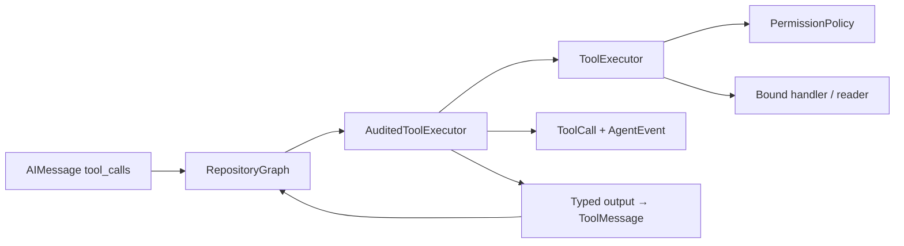
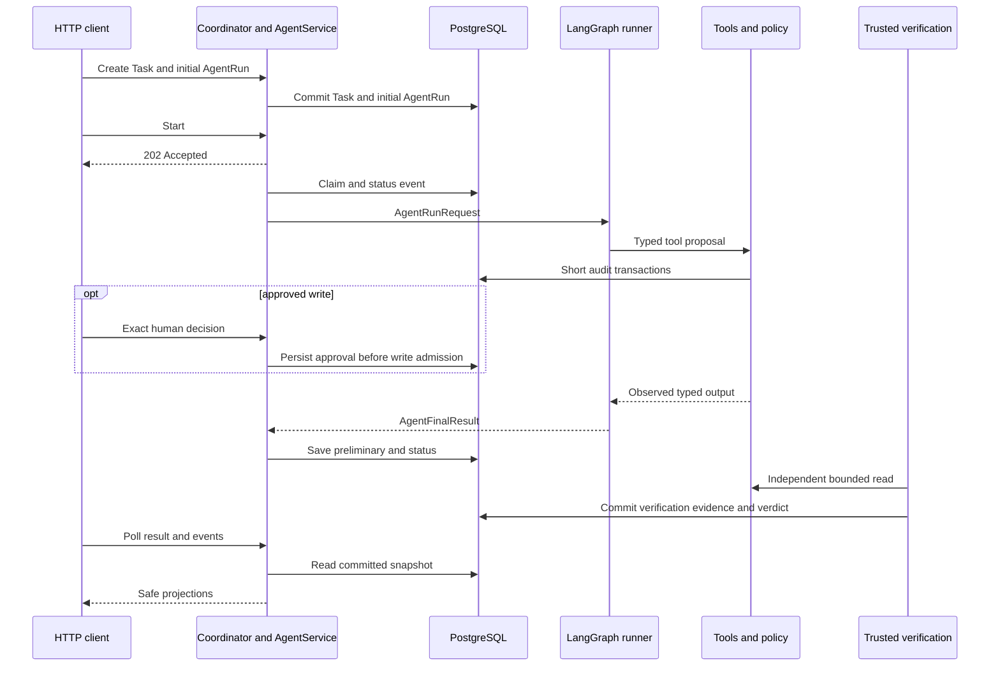

# Forge Week 4 — Tool System, Permissions & Audit

Учебник для разработчика со знанием Swift/iOS и HTTP. Срез исполнения — `b86ff2cdcb439e124a2062e2688efca8dde1a652` после merge [PR #63](https://github.com/eva-tarasov/myFirstForge/pull/63). [Week 1](LEARNING_GUIDE.md) вводит FastAPI, [Week 2](LEARNING_GUIDE_WEEK2.md) — PostgreSQL и SQLAlchemy, [Week 3](LEARNING_GUIDE_WEEK3.md) — агента, structured result, deadline и usage. Здесь эти механизмы связаны с инструментами, человеческим решением и независимой проверкой.

Откройте файл рядом с каждым фрагментом, проследите вызывающую цепочку, затем проверьте свой прогноз указанным тестом. Фрагменты приведены с сокращениями для чтения. Полные offline-команды и точное post-merge evidence находятся в [M1 Final Acceptance Gate](WEEK4_M1_FINAL_ACCEPTANCE_GATE.md). Самостоятельный учебный checkpoint фиксирует владелец.

## Оглавление

1. [Архитектура Tool System](#1-архитектура-tool-system)
2. [ToolSpec и ToolRegistry](#2-toolspec-и-toolregistry)
3. [Typed input и output](#3-typed-input-и-output)
4. [ToolExecutor и ошибки](#4-toolexecutor-и-ошибки)
5. [Capabilities и PermissionPolicy](#5-capabilities-и-permissionpolicy)
6. [Least privilege и path scopes](#6-least-privilege-и-path-scopes)
7. [Repository tools и бюджеты](#7-repository-tools-и-бюджеты)
8. [Path traversal, symlink и TOCTOU](#8-path-traversal-symlink-и-toctou)
9. [ToolCall и AgentEvent](#9-toolcall-и-agentevent)
10. [Controlled apply_patch](#10-controlled-apply_patch)
11. [Side effects и idempotency](#11-side-effects-и-idempotency)
12. [Approval gate](#12-approval-gate)
13. [Репозиторные графы LangGraph](#13-репозиторные-графы-langgraph)
14. [Independent Verification](#14-independent-verification)
15. [Preliminary result и final verdict](#15-preliminary-result-и-final-verdict)
16. [AgentRun lifecycle и cancellation](#16-agentrun-lifecycle-и-cancellation)
17. [Public AgentRun HTTP API](#17-public-agentrun-http-api)
18. [Public Approval и Evidence HTTP API](#18-public-approval-и-evidence-http-api)
19. [Live OpenAI smoke и диагностика](#19-live-openai-smoke-и-диагностика)
20. [Итоговая архитектура Week 4](#20-итоговая-архитектура-week-4)
21. [Практикум и самопроверка](#21-практикум-и-самопроверка)
22. [Deep Dive → Python Backend](#22-deep-dive--python-backend)

## 1. Архитектура Tool System

**Проблема.** Модель возвращает предложение вызова с именем и JSON-аргументами. Приложению нужны предсказуемая схема, допуск к ресурсу, исполнение и записи для последующей проверки. Mental model — открывайте право на конкретное действие на каждой нужной границе.



Вариант с универсальным `run_command` дал бы больше функций ценой сложного ограничения входа и эффектов. Forge выбирает небольшой каталог с typed boundary на каждый tool. Описания tools извлекаются из того же каталога, с которым работает executor. Модель выбирает предложение, backend выбирает root и права. Read-only runner собирает границы так:

```python
executor = create_fixture_executor(root=binding.root, context=context, baseline=binding.baseline)
audited = AuditedToolExecutor(executor, ToolCallService(self._session_factory))
```

**Failure modes.** Неизвестный call name, подменённый binding, denied path и отказ аудита прерывают вызов. Сбой идентификации workspace должен проявиться до обращения к модели. В Swift полезна аналогия с composition root, где implementation сервиса и доступы задаются из доверенного слоя приложения. [RepositoryAgentRunner](../backend/app/services/repository_agent_runner.py) · [Тест проверки binding](../backend/tests/test_repository_agent_graph.py)

**Интервью.** Где проходит граница между умением модели описать вызов и разрешением исполнить операцию? Кто выбирает root и какой слой отвечает за audit?

## 2. ToolSpec и ToolRegistry

**Проблема.** Схема функции для модели и код исполнения могут разойтись. Mental model — immutable каталог маршрутов с привязкой к реализации. Spec описывает имя, версию, классы input/output, capability, риск, timeout, side effect и approval. `RegisteredTool` в дополнение хранит handler, path selector и возможный bound context.

У прямой регистрации произвольных функций меньше boilerplate, но трудно обнаружить дубликат или неправильную схему. Forge повторно валидирует spec при объявлении каталога и сохраняет проверенный снимок. В lookup важна точная версия, а имена уникальны внутри каталога. Discovery возвращает только spec и выполняется без вызова handler.

```python
fields = {name: getattr(definition.spec, name) for name in ToolSpec.model_fields}
spec = ToolSpec.model_validate(fields)
```

Это нужно, потому что `model_copy(update=...)` может создать объект в обход валидации. Frozen защищает от обычного присваивания уже созданному экземпляру. Отдельная проверка нужна на новой границе доверия. В Swift близкая идея — `struct` с проверяющим initializer и ручной проверкой результата декодирования.

**Failure modes.** Каталог отклоняет повторное имя, async path selector и weakened `model_config` схемы. При несовпадении версии вызов получает стабильный код. Сценарии `test_registry_rejects_invalid_copied_spec` и `test_registry_does_not_invoke_handler` различают безопасность регистрации и исполнение. [ToolSpec](../backend/app/tools/contracts.py) · [ToolRegistry](../backend/app/tools/registry.py) · [Тесты реестра](../backend/tests/test_tool_registry.py)

**Интервью.** Что именно гарантирует frozen? Почему spec с `repository.write` описывает требуемую capability, а выдаётся она в другом месте?

## 3. Typed input и output

**Проблема.** JSON подходит для передачи данных, но словарь может содержать лишнее поле или неправильный тип. Mental model — DTO на каждой стороне недоверенной границы. Сгенерированная JSON Schema помогает модели строить запрос, строгая Pydantic-валидация на сервере проверяет фактический JSON.

```python
class ReadFileInput(ToolInput):
    path: str

class ReadFileOutput(ToolOutput):
    path: str
    content: str
    size_bytes: int
```

Для read tool schema не содержит workspace ID, root, scopes или флаг approval. Они поступают из доверенного context. Базовые модели используют `strict=True`, `extra="forbid"` и `frozen=True`. Вход валидируется до выбора путей. Выход проверяется по точному классу схемы и повторно валидируется из хранимых значений, чтобы случайный сконструированный объект или сериализатор не скрыл несоответствие. Для Swift-аналогии `Codable` задаёт переносимый shape, а бизнес-инварианты остаются в проверяющем initializer или policy.

**Trade-off и ошибки.** Автоматические приведения типов удобны для некоторых HTTP-вводов. На boundary инструментов важнее обнаруживать несоответствие до действия. Ошибка входа даёт `invalid_input`, ошибка возвращённого результата — `invalid_output`. Повтор выходной проверки особенно важен, если handler уже создал side effect и завершился обычным return. [Схемы](../backend/app/tools/repository/schemas.py) · [Валидация](../backend/app/tools/executor.py) · [Тесты контракта](../backend/tests/test_tool_contracts.py) · [Тесты входа и выхода](../backend/tests/test_tool_executor.py)

**Интервью.** Почему Pydantic принимает корректную строку с путём, хотя policy вправе отклонить её? Что проверяется при `model_copy` и когда это важно?

## 4. ToolExecutor и ошибки

**Проблема.** Один shim должен отличать неправильный вызов, отказ доступа, нарушение протокола handler и прерывание времени. Mental model — последовательность pre-admission, handler и postcondition. В read-only маршруте право должно быть `ALLOW`, а зарегистрированный handler должен быть async и без обязательного approval. Для audited read `before_handler` фиксирует admission до выполнения, вне handler timeout.

```python
timeout = asyncio.timeout(spec.timeout_ms / 1000)
deadline = timeout.when()
# ...
async with timeout:
    output = await handler(tool_input)
```

Forge после выполнения проверяет оставшуюся внешнюю отмену и монотонный deadline. Это учитывает случай, когда loop занят, таймер ещё не сработал, а handler уже завершился или выбросил исключение. Сохранённая явная информация о partial side effect обрабатывается отдельно. Отмена кооперативна. Уничтожение coroutine не возвращает уже изменённые байты.

**Варианты и trade-off.** Исключения могут содержать тело запроса, пути и внутренности хоста. Forge отдаёт стабильный `ToolErrorCode`, выполняет один handler без retry и сохраняет сведения об эффекте там, где наблюдал его. `handler_failed` и `tool_timeout` имеют разные причины. Отдельное место для SQL admission облегчает диагностику. В Swift это похоже на cancellation-aware async operation с явным ownership побочного эффекта.

**Failure modes.** Синхронный I/O внутри async handler может задержать loop. Handler может подавить отмену. Deadline проверяется после выхода из scope, а защита от принудительного удержания loop требует process boundary. Опорные тесты — `test_executor_preserves_swallowed_external_cancellation` и `test_executor_classifies_exception_after_monotonic_deadline_as_timeout`. [Executor](../backend/app/tools/executor.py) · [Error codes](../backend/app/tools/errors.py) · [Тесты](../backend/tests/test_tool_executor.py)

**Интервью.** Почему оператор `async with asyncio.timeout` сам по себе не гарантирует жёсткий wall-clock? Что происходит после успешного handler и невалидного output?

## 5. Capabilities и PermissionPolicy

**Проблема.** Инструмент может существовать в каталоге, но данному run могут быть разрешены только некоторые операции. Mental model — capability определяет вид операции, scope ограничивает ресурс, approval управляет конкретным допущенным write. `PermissionContext` содержит доверенные `run_id`, `workspace_id`, набор capabilities и read/write scopes.

```python
capability = spec.capability
if not isinstance(capability, Capability) or capability not in context.capabilities:
    return PermissionDecision(PermissionOutcome.DENY, PermissionReason.CAPABILITY_NOT_GRANTED)
```

`PermissionPolicy.evaluate` проверяет context, вид capability, объявленный набор путей, protected components и применимый scope. Только после проверок ресурсного доступа write или операция с approval получает `APPROVAL_REQUIRED`. Reader дополнительно проверяет паттерн доступа перед обходом или чтением. Writer проверяет правомочность всех целей. Глобальные роли были бы проще для демонстрации, а explicit capability позволяет выбрать отдельные read и write области и избежать модельных grant.

**Failure modes.** Missing grant, подставленный context, защищённый файл и запрещённый элемент в multi-path наборе означают отказ целому действию. Review capability HTTP даёт доступ к маршруту решения. Внутренние file capabilities остаются обязательными. В iOS полезно сравнить это с разделением права на тип операции и конкретный разрешённый ресурс. [Policy](../backend/app/permissions/policy.py) · [Context](../backend/app/permissions/context.py) · [Тест отказа до approval](../backend/tests/test_permission_policy.py)

**Интервью.** Почему положительный human approval не расширяет write scopes? Где должна храниться информация о grant для текущего run?

## 6. Least privilege и path scopes

**Проблема.** Строковый prefix может спутать `src` и `src-backup`, а путь пользователя бывает абсолютным или содержит `..`. Mental model — авторизуем канонический список компонентов в пределах доверенного root.

```python
def matches_scope(path: tuple[str, ...], scope: tuple[str, ...], *, recursive: bool) -> bool:
    if recursive:
        return path[:len(scope)] == scope
    return path == scope
```

Exact grant `PathScope("sample.txt")` разрешает чтение файла. Recursive grant `PathScope("src", recursive=True)` покрывает компоненты внутри `src`. Parser отклоняет абсолютные пути, tilde prefix, обратные слеши, двоеточия, управляющие символы и компоненты `.` или `..` внутри пути. Отдельный `"."` обозначает корень. Защищены `.git`, `.env` и `.env.*` без учёта регистра.

**Варианты и trade-off.** Scope файла уменьшает объём доступных данных, каталог даёт удобный discovery. Даже при точном доступе к файлу внутренний reader может открыть нужные дескрипторы его предков для навигации, сохраняя resource policy. Smoke рекламирует только `read_file`, потому что `list_files` подразумевает каталог. Отказ второй live-попытки от `list_files` был зафиксирован audit. Точный аргумент неизвестен. [Логические пути](../backend/app/permissions/paths.py) · [Тесты scopes](../backend/tests/test_permission_policy.py) · [Live gate](WEEK4_M1_LIVE_SMOKE_GATE.md)

**Интервью.** Почему сравнение компонентов сильнее `str.startswith`? Какие операции даёт exact scope каталога и зачем для потомков нужен recursive grant?

## 7. Repository tools и бюджеты

**Проблема.** Даже безопасная операция может занять много памяти, времени и model tokens. Mental model — каждый инструмент ограничивает вход, объём обхода и полезный результат. Read-only каталог содержит `list_files`, `read_file`, `search_files` и `git_diff`. `search_files` ищет литерал, выдаёт ограниченные matches и учитывает неподдерживаемый текст. `git_diff` сравнивает с неизменяемым `FixtureBaseline`, поэтому вызову достаточно файлового reader и сравнения текста.

```python
content, size = reader.read_text(arguments.path, spec=spec)
check_output_size(len(arguments.path.encode("utf-8")) + size)
return ReadFileOutput(path=arguments.path, content=content, size_bytes=size)
```

Reader ограничивает файл 64 КиБ, глубину 16, записи на каталог 256 и число просмотренных записей 4096. Search отдельно ограничивает файлы и суммарное чтение. JSON, сообщения графа и wire envelope имеют дополнительные пределы. Длина строки Unicode и число UTF-8 байтов различаются. Решение между «вернуть всё» и streaming выбирается по контракту. Forge использует bounded outputs для предсказуемого fixture сценария.

**Failure modes.** Слишком большой, нелегальный или неподдерживаемый файл даёт безопасный отказ. Превышение search budget отличается от штатной выдачи результата. Swift-аналогия — проверять `text.utf8.count` и ограничивать получение страниц, а для данных учитывать полную сериализацию. [Handlers](../backend/app/tools/repository/handlers.py) · [Reader budgets](../backend/app/tools/repository/filesystem.py) · [Baseline](../backend/app/tools/repository/baseline.py) · [Тесты инструментов](../backend/tests/test_repository_tools.py)

**Интервью.** Почему ограничить только размер ответа недостаточно? Как immutable baseline делает `git_diff` воспроизводимым?

## 8. Path traversal, symlink и TOCTOU

**Проблема.** После проверки строки соседний процесс может подменить файл или каталог до открытия. Mental model — разделяйте логическую авторизацию и физический доступ по дескриптору. Forge использует exact entry names, `dir_fd`, `O_NOFOLLOW`, проверку device/inode и типа объекта. Проверка существования относительной строки через `Path.resolve()` сама по себе оставляет промежуток до `open()`.

```python
flags = os.O_RDONLY | os.O_NOFOLLOW | os.O_NONBLOCK
```

При чтении эти флаги используются с trusted parent descriptor. Reader отклоняет symlink, специальные файлы и hard links с несколькими ссылками. Он сопоставляет открытый объект со stat, проверяет размер при чтении и закрывает дескрипторы через контекстные менеджеры. Writer повторно сверяет identity и content fingerprint перед заменой.

**Trade-off и ошибки.** Такой подход уменьшает риски traversal и substitutions на поддерживаемом POSIX. Доверенные предки root и изоляция fixture остаются требованиями caller. TOCTOU — окно между проверкой и действием. Дескриптор привязывает часть проверок к объекту, но внешние записи и разрыв между наблюдением verifier и SQL commit остаются возможны. В Swift/iOS полезно сравнить с гарантией системного sandbox: здесь Python caller формирует локальную границу и нуждается в отдельной инфраструктурной изоляции для недоверенных workspace. [Filesystem](../backend/app/tools/repository/filesystem.py) · [Логические пути](../backend/app/permissions/paths.py) · [Тест подмены symlink](../backend/tests/test_safe_repository.py)

**Интервью.** Почему проверка `is_symlink` перед обычным `open` уязвима к гонке? Что устанавливает проверка device/inode?

## 9. ToolCall и AgentEvent

**Проблема.** В логе нужно различать предложение, реальный допуск и наблюдённый исход. Mental model — `ToolCall` хранит состояние, `AgentEvent` — упорядоченную историю. До handler разные транзакции фиксируют `proposed` и `running`. После вызова отдельная транзакция фиксирует `succeeded` или ошибку. Отклонённый до admission write или read может перейти в `denied`.

```python
await self._tool_calls.finish(
    ticket, ToolCallStatus.SUCCEEDED, duration_ms=_duration_ms(started_at_ns),
)
return output
```

`AgentEventRepository.append` сериализует append по row lock родителя и присваивает `sequence` внутри run. Связанные мутация строки и событие коммитятся вместе. Payload аудита версионирован и хранит tool ID, имя, версию, статус, код и длительность там, где они известны. `tool_call_id` LangChain связывает сообщения одного обмена, audit UUID создаётся backend. Публичные HTTP события публикуют безопасную проекцию.

**Trade-off и ошибки.** Одна длинная транзакция на handler удерживала бы блокировку во время файлового/сетевого ожидания. Короткие фазы позволяют свежей сессии увидеть admission, но process crash или неоднозначный commit требуют reconciliation. Коммит `running` фиксирует допуск, поэтому эффект проверяют отдельно. [Audited executor](../backend/app/services/audited_tool_executor.py) · [ToolCall service](../backend/app/services/tool_calls.py) · [Append](../backend/app/repositories/agent_events.py) · [Тесты PostgreSQL](../backend/tests/test_tool_call_integration.py)

**Интервью.** Что видно другой SQL-сессии между `running` и `succeeded`? Как гарантируется порядок двух concurrent append?

## 10. Controlled apply_patch

**Проблема.** Для write нужны точные допустимые цели и однозначное применение. Mental model — сначала разобрать и подготовить изменения, затем заменить существующие файлы при совпадении исходников. Forge использует ограниченный унифицированный diff с LF и существующими файлами, ограничения 64 КиБ, 4 файла и 32 hunks. Parser отвергает неподдерживаемый синтаксис и небезопасные цели. Writer проверяет read и write для всех целей.

```python
patch = parse_patch(text)
self._authorize(patch.paths)
# Подготовка и staging опущены. Перед каждой заменой выполняется revalidate.
os.replace(name, target.patch.components[-1], src_dir_fd=target.parent, dst_dir_fd=target.parent)
```

Patch связывается с содержимым исходников через fingerprints и повторные проверки. Staging выполняется в целевом каталоге, затем действует атомарность отдельной замены файла. Альтернатива вызвать внешнюю команду с широкими возможностями потребовала бы дополнительного sandbox и сохранила бы вопрос точного соответствия reviewed output. Здесь меньше выразительность, зато известны форматы, ресурсы и границы эффекта.

**Failure modes.** Изменившийся исходник даёт конфликт, а сбой после одной из замен даёт `patch_partial_apply`. Replacement уже выполненных файлов автоматически не откатывается. В Swift аналогия — `FileManager.replaceItemAt` для одного файла, которую нельзя автоматически распространить на транзакцию нескольких файлов. [Parser](../backend/app/tools/repository/patch.py) · [Writer](../backend/app/tools/repository/writer.py) · [Тесты parser](../backend/tests/test_patch_parser.py) · [Тест partial apply](../backend/tests/test_repository_patch.py)

**Интервью.** Почему совпадение только строк hunks недостаточно для утверждённой операции? Как классифицировать сбой во второй замене?

## 11. Side effects и idempotency

**Проблема.** Клиент теряет ответ и не знает, был ли commit. В read/write сценарии он также может не знать, заменён ли файл. Mental model — три разных договора. Idempotent Task create возвращает тот же объект для того же канонического payload. Approval claim допускает один конкретный ToolCall. Verification replay читает исход той же попытки проверки с совпавшей идентичностью.

```python
existing_payload = normalize_task_input(existing.goal, list(existing.acceptance_criteria))
if existing_payload != (goal, criteria):
    raise IdempotencyKeyConflictError("Idempotency key already used with different task data")
task = existing
```

Task initial run POST имеет отдельный узкий replay. Возвращается единственный `queued` run с номером попытки 1. Если запуск уже вышел из `queued` или история содержит больше одной строки, клиенту нужен GET по известному ID либо обработка конфликта. Повторная запись изменившегося файла не становится безопасной из-за совпадения patch. SQL rollback и local filesystem replacement принадлежат разным системам.

**Trade-off и ошибки.** Автоматический replay снижает стоимость сетевого сбоя для идемпотентных команд. Автоматический retry мутации после неизвестного результата может повторить оплату или side effect. Для write Forge опирается на состояние ToolCall, точные source fingerprints и одноразовый claim. После restart durable resume здесь нет. Swift-аналогия — операция HTTP клиента, которая требует явного `Idempotency-Key` и затем запрашивает сохранённый state. [TaskService](../backend/app/services/tasks.py) · [Initial run](../backend/app/services/agent_runs.py) · [Concurrent replay](../backend/tests/test_task_idempotency_integration.py) · [Single-use claim](../backend/tests/test_approval_integration.py)

**Интервью.** Как разрешить неоднозначный результат потерянного HTTP-ответа? Чем отличается replay Task create от повторного исполнения runner?

## 12. Approval gate

**Проблема.** Модель может предложить write, а человек должен одобрить точную допустимую операцию. Mental model — заявка, решение, допуск и результат являются разными фазами. Доверенный `ApprovedToolExecutor` валидирует proposal, рассчитывает snapshots исходников, резервирует in-memory slot и связывает его с per-run outcome. `ApprovalGate.request` сохраняет ToolCall, Approval, status и аудит до публикации waiter.

```python
decision = await self._pending.wait(operation)
# Проверки отмены, решения, дедлайна и fingerprints опущены.
await self._gate.claim(operation)
```

SQL locks идут `AgentRun → ToolCall → Approval`. Decision коммитится отдельно и будит waiter после commit. Claim проверяет живой exact binding, подтверждённую строку approval и audit metadata. После проверки исходников он переводит run обратно в `running`, а ToolCall — из `proposed` в `running`. Handler вызывается после commit допуска. `PendingApprovals` использует `asyncio.Event` и монотонный `timeout_at`. Иногда строка pending переживает потерю локального waiter.

**Варианты и trade-off.** Внутрипроцессное ожидание достаточно для локального single-worker и обходится без длинной транзакции. Внешний durable workflow потребовал бы правил restart, leases и reconciliation. Нынешний per-run outcome хранит метаданные exact операции, а `AgentService` сверяет нужный исход с PostgreSQL. В Swift continuation можно будить один раз, а здесь вдобавок требуется durable commit решения.

**Failure modes.** Reject, истечение времени, изменившиеся исходники, stale approval, отказ bind и cancel до handler останавливают запись. После side effect операция может завершиться partial failure. Дубликат решения отклоняется, после restart один сохранённый `approved` без live slot не допускает write. Опорные проверки — `test_postgres_approval_claim_is_single_use_and_normal_executors_still_block` и `test_postgres_restart_without_live_operation_never_claims_approved_row`. [Approved executor](../backend/app/services/approved_tool_executor.py) · [Gate](../backend/app/services/approval_gate.py) · [Waiter](../backend/app/services/pending_approvals.py) · [Тесты PostgreSQL](../backend/tests/test_approval_integration.py)

**Интервью.** Почему UI может получить подтверждение решения до применения patch? Как избежать TOCTOU между review и write и какие окна останутся?

## 13. Репозиторные графы LangGraph

**Проблема.** После ответа модели нужно ограниченно маршрутизировать tool request, исследование и финализацию. Mental model — граф ведёт временный ход исследования, а backend владеет lifecycle. Граф использует добавление сообщений и счётчиков через reducers. `read-only` допускает до двух research, одного инструмента и одной финализации. Approved граф допускает до трёх research и двух последовательных tool calls, после write новые инструменты запрещены.

```python
message = _repository_tool_message(output, name, call_id)
return {"messages": [_prepare_message(message, history)], "tool_calls": 1}
```

`_repository_request` требует ровно одну команду, допустимое имя и корректный call ID. Возвращённый ToolMessage использует тот же model ID. Финальный запрос создаётся отдельно с JSON Schema. `checkpointer=False` сохраняет текущую реализацию transient. По сравнению с универсальным агентным loop явный StateGraph улучшает читаемость budgets и failure modes. Роль приложения можно сопоставить с координатором flow в iOS, который коммитит domain state вне временного UI-потока.

**Failure modes.** Невалидные, параллельные или повторные tool requests, refusal, network errors и deadline прерывают ветвь. Для репозиторных инструментов прямой ToolMessage участвует в research, а финализатор получает `analysis_notes` и пустой `observations`. При одинаковых notes offline SPIKE получил одинаковый finalization payload для разных байтов. Долг provenance-aware handoff открыт. [Read graph](../backend/app/agent_runtime/repository_graph.py) · [Approved graph](../backend/app/agent_runtime/approved_repository_graph.py) · [Финализация](../backend/app/agent_runtime/finalization.py) · [Сопоставление call ID](../backend/tests/test_repository_agent_graph.py) · [BL-10](../backlog.md#bl-10--передача-repository-evidence-в-finalization)

**Интервью.** Почему `AgentRun` не следует хранить только в graph state? Как заменить model adapter с сохранением approval и verification?

## 14. Independent Verification

**Проблема.** Агент может верно описать действие и ошибочно заявить об исходе. Mental model — доверенный код формирует план и сам получает наблюдения. План связывает run, task, workspace, fixture revision, упорядоченные критерии, цели и ожидаемые SHA-256. Observer переиспользует read-only инструменты и вычисляет digest из реально прочитанных байтов. Независимость обеспечивается отдельным источником плана и повторным наблюдением.

```python
@property
def verdict(self) -> VerificationVerdict:
    if not self.audit_complete or not self.isolated_fixture:
        return VerificationVerdict.INCONCLUSIVE
    return self.file_verdict
```

`VerificationService` читает и сверяет состояние, отпускает открытые транзакции во время наблюдения, затем под блокировкой перечитывает run и Task, удостоверяется в прежнем preliminary result и сверяет audit. Evidence и terminal transition при PASS/FAIL коммитятся вместе. При отсутствующем или неоднозначном наблюдении, incomplete audit или неподтверждённой изоляции verdict — `INCONCLUSIVE`, run остаётся `verifying`. При полном наборе несовпавший digest даёт `FAIL`. Совпадение всех проверок при полноценном аудите даёт `PASS`.

**Варианты и trade-off.** LLM-as-judge может оценивать текст, но потребовал бы отдельной модели доверия. SHA-256 даёт детерминированные проверки состояния ограниченного fixture и ничего не говорит об авторстве изменений. Между чтением файла и commit evidence остаётся окно. В iOS аналог — независимая проверка файла по manifest с ожидаемым digest, полученным по доверенному каналу.

**Failure modes.** Изменённый после research файл, чужой binding, отмена перед публикацией, попытка повторить другой plan под тем же attempt ID. Опорный тест `test_postgres_read_only_graph_reaches_durable_verdict[mismatch]` меняет байты после успешного ToolCall и получает FAIL. [Plan и aggregate](../backend/app/services/verification_contract.py) · [Observer](../backend/app/services/verification_observer.py) · [Сервис](../backend/app/services/verification_service.py) · [E2E](../backend/tests/test_verification_e2e_integration.py)

**Интервью.** Какие свойства даёт digest, а какие привносит audit? Почему транзакция backend не может изолировать произвольные файлы?

## 15. Preliminary result и final verdict

**Проблема.** UI и модель могут назвать successful handler итогом рассмотрения Task. Mental model — результат анализа, lifecycle status и verifier verdict принадлежат разным контрактам. `TaskAnalysis` допускает `blocked_reason: str | None`. Финализатор повторно валидирует схему, отклоняет refusal/обрыв и строит `AgentFinalResult`.

```python
status="blocked" if analysis.blocked_reason is not None else "ready_for_verification",
```

`ready_for_verification` означает пригодный для независимого разбора preliminary. Непроверенные утверждения и pending verification находятся в assumptions. Существенное препятствие даёт непустой `blocked_reason`. Для ready сервис сохраняет preliminary и переводит run в `verifying`. Для blocked он сохраняет preliminary и завершает run как `failed` с отдельной причиной анализа. Typed execution failure фиксируется через своё событие. Общий путь статусов отклоняет прямой `succeeded`.

**Trade-off и ошибки.** Отдельный verdict требует второго шага после успешного исследования, давая проверяемую границу доверия. Provider HTTP 200, valid schema и usage могут быть при blocked. При отмене из `verifying` сохраняется предварительный результат, но поздняя публикация verifier отклоняется. В Swift удобно моделировать это enum cases для pending review, blocked, verified и execution failure с отдельными associated values.

Опорные тесты — `test_finalization_derives_status_and_preserves_raw_metadata` и `test_provider_shaped_finalization_preserves_safe_outcome_and_usage[blocked]`. [Finalizer](../backend/app/agent_runtime/finalization.py) · [AgentRunService](../backend/app/services/agent_runs.py) · [Finalizer tests](../backend/tests/test_agent_finalization.py) · [Provider-shaped regression](../backend/tests/test_week4_live_smoke.py)

**Интервью.** Какие поля должен показать клиент после ready completion, когда evidence ещё не сохранено? Как диагностически отличить `failed` с blocked от ошибки исполнителя?

## 16. AgentRun lifecycle и cancellation

**Проблема.** Клиент может отсоединиться или запросить отмену, пока приложение держит coroutine. Mental model — PostgreSQL хранит подтверждённый lifecycle, registry доставляет локальный сигнал. `AgentService` сначала claim-ит queued run, освобождает SQL session и вызывает runner с общим дедлайном. `ActiveRunRegistry` принадлежит coordinator и передаётся явно.

```python
if committed:
    with observer.phase(AgentPhase.CANCELLATION_SIGNAL):
        active_runs.request_cancel(run_id)
```

Сначала атомарно коммитятся `cancelled` и event. Затем registry доставляет сигнал в текущий event loop. Если commit не подтверждён, локальный сигнал по этой ветви не отправляется. Completion и cancellation соревнуются под блокировкой строки. Committed ready result может остаться в `cancelled`. Если первым уже сохранён `failed` или `succeeded`, отмена терминального run отклоняется. Tool deadline ограничивает handler, дедлайн агента — invocation runner. Обе границы кооперативны.

**Варианты и trade-off.** Сигнал до commit быстрее останавливал бы coroutine, но мог бы отменить работу при откатившемся обновлении SQL. Commit-first делает видимым решение домена. Сбой процесса может потерять registry, локальная отмена не отменяет завершённые внешние действия. Аналог в Swift — флаг `Task.cancel()` требует проверок в async функции и живёт отдельно от записи в базе.

**Failure modes.** Отмена до claim, во время approval, после claim, late completion и rollback статуса. `test_http_cancel_constraint_failure_rolls_back_without_signaling_runner` и `test_http_cancel_verifying_run_wins_before_verification_publication` проверяют порядок. [AgentService](../backend/app/services/agent_service.py) · [Registry](../backend/app/services/active_runs.py) · [HTTP coordinator](../backend/app/services/in_process_run_coordinator.py) · [Тесты](../backend/tests/test_agent_runs_start_cancel_integration.py)

**Интервью.** Какая отмена меняет доменный статус? Что должен сделать клиент при потере ответа Cancel? Почему терминальный run не следует возобновлять как часть retry?

## 17. Public AgentRun HTTP API

**Проблема.** Stateful orchestration занимает больше времени, чем HTTP-команда. Клиенту нужен ID и безопасный способ восстановить картину после разрыва соединения. Mental model — команды изменяют lifecycle, GET показывают committed projection. Start передаёт задачу в lifespan-owned coordinator. Task claim выполняется асинхронно.

| Endpoint | Что получает клиент |
| --- | --- |
| `POST /tasks/{task_id}/runs` | `201` с начальной попыткой либо `200` узкого replay единственной queued attempt 1. Конфликт истории или статуса даёт `409`. |
| `GET /agent-runs/{run_id}` | Метаданные run, его Task, attempt number, текущий status и created timestamp. |
| `POST /agent-runs/{run_id}/start` | `202`, `accepted=true` и `Location`. Нет binding — `503`, слот занят другим run — `429`, текущее состояние уже недопустимо для start — `409`. |
| `POST /agent-runs/{run_id}/cancel` | `200` после commit или replay уже отменённого run. `failed` и `succeeded` отклоняются с `409`. |
| `GET /agent-runs/{run_id}/events` | Keyset `after_sequence`, bounded page, `next_after_sequence`, `has_more`. |
| `GET /agent-runs/{run_id}/result` | Run status, preliminary status, failure code, usage и verification verdict по committed snapshot. |

```python
snapshot = await self._events.read_result_snapshot(
    run_id, event_types=_RESULT_KINDS, limit=MAX_RESULT_EVENTS + 1, workspace_id=workspace_id,
)
```

Граница `512 + 1` выявляет переполнение истории до формирования результата. При невалидном history сервис безопасно отказывает. Пустая страница events сохраняет курсор. Отключение приложения-клиента после `202` не отменяет работу. Swift-аналогия — view model отменяет собственный poll через `Task.cancel()`, а пользовательская команда Cancel остаётся отдельным POST.

**Trade-off и ошибки.** Polling проще для локального API, где events durable и page bounded. SSE и распределённое ownership требуют новых контрактов. Клиент должен различать `202`, queued, executing и terminal. Start и Cancel требуют доверенного `RunExecutionBinding`. В default app binding отсутствует. Здесь development endpoint доступен без пользовательской аутентификации. [HTTP routes](../backend/app/api/agent_runs.py) · [Read service](../backend/app/services/agent_run_reads.py) · [История на границе](../backend/tests/test_agent_runs_read_integration.py) · [HTTP E2E](AGENT_RUN_HTTP_E2E_GATE.md)

**Интервью.** Почему `202` нельзя интерпретировать как подтверждение SQL claim? Как после сетевого обрыва безопасно продолжить отображение timeline?

## 18. Public Approval и Evidence HTTP API

**Проблема.** Просмотр статуса и доступ к точному содержимому patch имеют разные требования к полномочиям. Mental model — две разные bearer capabilities для одного выбранного backend workspace. Read token открывает approvals list/detail и evidence. Отдельный review/decision token открывает exact patch и точное approve/reject.

```python
expected = sha256(token.get_secret_value().encode()).digest()
supplied = sha256(credential.encode()).digest()
return hmac.compare_digest(expected, supplied)
```

| Маршрут под `/agent-runs/{run_id}` | Контракт |
| --- | --- |
| `GET /approvals`, `GET /approvals/{approval_id}` | Durable metadata и безопасный structural preview при совпадении live slot. Холодная pending запись может быть доступна без preview. |
| `GET /approvals/{approval_id}/review` | Exact patch и fingerprint только для разрешённой live operation. |
| `POST /approvals/{approval_id}/decision` | Approve предъявляет fingerprint прошедшего review patch. Reject его не требует. `recorded: true` относится к commit решения. |
| `GET /evidence`, `GET /evidence/{attempt_id}` | Сохранённые summary и checks. Список использует keyset pagination, read повторно не запускает verifier. |

Guard проверяет capability до session. Затем SQL связывает workspace с Task и run, чужие и отсутствующие ресурсы возвращаются одинаковым 404. Отсутствующая capability конфигурация закрывает маршрут. Stale review/decision даёт конфликт. Успешные ответы exact review, decision и evidence используют `Cache-Control: no-store`. Длина токена проверяется на 32–512 символов, entropy обеспечивает источник. Клиент Swift может хранить capability в Keychain, а UI должен различать подтверждение решения и последующий результат ToolCall.

**Trade-off и ошибки.** Раздельные токены сужают раскрытие содержимого, но локальная capability не устанавливает личность человека. В runtime изменение источника после review может отменить допуск. Повторный GET приватного evidence должен вернуть тот же committed результат, при этом новое commit может добавить следующую попытку. Опорный E2E — `test_http_12e_approve_to_verified_pass`, а также reject, потеря HTTP-ответа и scoped denial. [Approval routes](../backend/app/api/approvals.py) · [Decision service](../backend/app/services/approval_decisions.py) · [Evidence routes](../backend/app/api/evidence.py) · [HTTP E2E](../backend/tests/test_public_http_e2e_integration.py)

**Интервью.** Какие сведения следует показать в structural preview? Почему можно показать persisted pending approval после рестарта, а исполнить его нельзя?

## 19. Live OpenAI smoke и диагностика

**Проблема.** MockTransport проверяет локальный контракт, а provider может отличаться доступностью модели, ответами и учётом usage. Mental model — один отдельно принятый bounded live experiment на синтетическом файле, с тем же HTTP и PostgreSQL путём. Dry-run заменяет внешнюю model transport на MockTransport. Graph, permissions, DB, HTTP ASGI и independent verification исполняются.

```python
MAX_REQUESTS = MAX_MODEL_CALLS + MAX_FINALIZATION_CALLS
MAX_OUTPUT_TOKENS = 512
MAX_REQUEST_BYTES = 16 * 1024
```

В live scope только `read_file` и `PathScope("sample.txt")`. Harness требует выделенную PostgreSQL, явный opt-in, модель `gpt-6-luna` и credentials владельца. Chat Completions requests ограничены до трёх, с `reasoning_effort=none`, полностью проверенным wire budget, retries 0 и без tracing. Модель, wire payload и result projection относятся к разным границам диагностики. `model_requests` считает передачи в transport. `last_model_stage` сообщает последнюю стадию на этой границе. `error_type` и `failure_phase` выдаются как ограниченные метаданные.

**Что показали пять попыток.** Первая достигла ToolCall и упала как `graph_execution_failed`, точная причина UNKNOWN. Вторая сохранила отказ `list_files` в условиях scope файла. Третья завершилась `execution_failed` после трёх запросов, причина UNKNOWN. Offline воспроизвёл, как прежняя диагностика маскировала валидный blocked под generic failure. Четвёртая сохранила настоящий `blocked`, причина выбора модели UNKNOWN. После уточнения preliminary semantics пятая дала `LIVE_PASS` с 3 requests, 1 read, independent PASS и 1068 токенами. Стоимость неизвестна. Один успешный live запуск не покрывает approved write и поведение при нагрузке.

**Trade-off и ошибки.** Usage — сумма наблюдённых токенов, стоимость может остаться неизвестной. Ответ, потерянный после отправки, требует диагностики до нового оплачиваемого запуска. В Swift близкая граница — контролируемый `URLSession` transport в тестах и отдельный ручной smoke реального API. Опорные сценарии `test_offline_rejects_unadvertised_list_files_before_tool_call` и `test_provider_shaped_finalization_preserves_safe_outcome_and_usage`. [Harness](../backend/scripts/week4_live_smoke.py) · [Smoke tests](../backend/tests/test_week4_live_smoke.py) · [Live evidence](WEEK4_M1_LIVE_SMOKE_GATE.md)

**Интервью.** Что можно выводить из `usage_complete=true`? Почему при одном ToolCall, трёх model requests и HTTP 200 всё ещё возможен `blocked`?

## 20. Итоговая архитектура Week 4

**Проблема.** Объединить модель, файл, SQL и человека без размытия ответственности. Mental model — отдельный владелец каждой записи и эффекта, последовательные проверки на границах.



```python
class AgentRunner(Protocol):
    async def run(self, request: AgentRunRequest) -> AgentFinalResult:
        ...
```

ADR-001 сохраняет modular monolith. ADR-002 сохраняет LangChain и собственный StateGraph за `AgentRunner`. Отдельный сервис на каждый слой увеличил бы стоимость доставки, distributed ownership и recovery. Текущая композиция даёт реальную SQL атомарность для конкретных фаз, явный in-process ownership, контролируемую файловую поверхность и проверяемое место для verdict. Swift protocol и отдельный coordinator дают знакомую аналогию, но БД остаётся источником committed business state независимо от клиента.

**Failure modes и границы.** Durable workflow, process sandbox, user authentication, multi-worker scheduling и Linux deployment проверяются отдельно до заявлений о более широком использовании. Terminal run не переоткрывается. Retry означает новую попытку с собственной политикой, resume означает продолжение прежнего процесса с восстановлением его состояния. Успешный local bounded сценарий и техническая матрица не завершают самостоятельную учебную проверку владельца. [ADR-001](adr/ADR-001.md) · [ADR-002](adr/ADR-002.md) · [Runner protocol](../backend/app/services/agent_runner.py) · [R0, исторический срез](ARCHITECTURE_REVIEW_WEEK4.md) · [Текущая матрица](WEEK4_M1_FINAL_ACCEPTANCE_GATE.md)

**Интервью.** Что изменится при запуске второго worker? Какие транзакции, leases и reconciliation понадобятся для durable resume, если держать текущие интерфейсы?

## 21. Практикум и самопроверка

Выполняйте команды из `backend` штатным Python 3.13 из проверенного окружения. Для PostgreSQL подставьте команды практикума в [блок M1 gate](WEEK4_M1_FINAL_ACCEPTANCE_GATE.md#postgresql-opt-in-http-e2e-и-smoke-dry-run) после guard и экспорта opt-in переменных вместо основного набора прогонов. Используйте `"$forge_python"` вместо `python` внутри блока. После выхода из subshell экспортированные переменные исчезают. Тесты создают временные fixtures и используют MockTransport, где есть model calls.

### 21.1. От схемы до безопасного чтения

```zsh
python -m pytest -q tests/test_tool_contracts.py tests/test_tool_registry.py tests/test_permission_policy.py
python -m pytest -q tests/test_repository_agent_graph.py::test_repository_graph_passes_audited_tool_output_with_exact_call_id
```

1. Найдите `ReadFileInput`, построение spec и path selector. Запишите, какие данные модель может предложить, а какие задаёт backend.
2. До прогона сравните `sample.txt`, `./sample.txt`, `src/sample.txt` и `.env` для exact `PathScope("sample.txt")`. Объясните, в какой функции отклоняется каждый недопустимый путь.
3. В тесте найдите ID в AIMessage и ToolMessage. Проследите возвращаемый output до research и затем перечислите поля JSON финализации.

**Самопроверка.** Read grant действует для `sample.txt`. `./sample.txt` нарушает канонический формат. `src/sample.txt` выходит за exact scope. `.env` защищён. В финализации repository graph оставляет `observations=[]`; прямая копия tool content доступна на границе research.

### 21.2. HTTP-команды и реальные ID из ответов

```zsh
python -m pytest -q tests/test_agent_runs_http_e2e_integration.py::test_http_11d_read_only_workflow
python -m pytest -q tests/test_public_http_e2e_integration.py::test_http_12e_approve_to_verified_pass
```

1. Откройте `http_run` и проследите Workspace, Task и UUID из ответа `POST /tasks/{task_id}/runs`. Ответом `202` проверяется принятие отдельного Start.
2. В approve E2E найдите выдачу списка, точный URL review, возвращённый fingerprint и передачу этого значения в POST decision. Определите первую точку, где файл действительно изменился.
3. Сравните последовательность events из HTTP с durable state из SQL. Объясните, почему между `200 recorded` и записью `succeeded` допустимы новые состояния.

**Самопроверка.** Клиент использует полученные ID и cursor, отобразить `succeeded` можно после committed verification. При сбое после отправки decision сначала читается состояние. Тест отдельно удерживает commit, чтобы проверить, когда evidence виден HTTP-клиенту. [Read E2E](../backend/tests/test_agent_runs_http_e2e_integration.py) · [Approval E2E](../backend/tests/test_public_http_e2e_integration.py)

### 21.3. Гонки, verification и failure

```zsh
python -m pytest -q tests/test_agent_runs_start_cancel_integration.py::test_http_cancel_constraint_failure_rolls_back_without_signaling_runner
python -m pytest -q 'tests/test_verification_e2e_integration.py::test_postgres_read_only_graph_reaches_durable_verdict[mismatch]'
python -m pytest -q 'tests/test_week4_live_smoke.py::test_provider_shaped_finalization_preserves_safe_outcome_and_usage[blocked]'
```

1. Нарисуйте два порядка commit для cancellation и completion. Добавьте точку локального сигнала и исход с SQL constraint failure.
2. Запишите, сколько раз физически прочитан файл в mismatch-кейсе. Следует предсказать successful ToolCall и отдельный final FAIL. Назовите, кто поставляет expected digest.
3. Сопоставьте корректный blocked и malformed structured output. Объясните, почему один даёт сохранённый preliminary, а другой — classification и свой набор usage.

**Самопроверка.** После rollback отмены registry не получает локальный сигнал по этой ветви. Файл читается на этапе research и повторно verifier. Blocked сохраняется без события execution failure; ошибка разбора фиксируется отдельным кодом. Usage зависит от того, вернул ли SDK наблюдаемую метаданную.

### 21.4. Бесплатный smoke и итоговый разбор

```zsh
python -m scripts.week4_live_smoke --dry-run
```

В выводе найдите `OFFLINE_PASS`, 3 mock requests, `read_file / succeeded`, `verification=pass`, 90 синтетических токенов и `fixture_cleanup=completed`. Затем сопоставьте с accepted live запуском владельца. Объясните, почему expected count dry-run воспроизводим, а фактический bill live остаётся UNKNOWN. [Обе категории evidence](WEEK4_M1_FINAL_ACCEPTANCE_GATE.md)

### Контрольные вопросы для самостоятельной приёмки

- Проследите путь Task → AgentRun → ToolCall → preliminary → verification без подсказок по названиям методов.
- Объясните, где заканчивается idempotency Task, начинается one-shot admission и почему restart меняет состояние ожидания.
- Предложите воспроизводимый тест на permission denial, race до write и late commit verifier.
- Сравните пять live попыток. Для третьей отдельно назовите подтверждённые факты и гипотезы.
- Нарисуйте безопасный escalation для продукта с несколькими workers, сохранив ADR-001/002 и перечислив недостающие гарантии.

## 22. Deep Dive → Python Backend

| Тема | Что разобрать руками | Проверка |
| --- | --- | --- |
| Pydantic strict/frozen и `model_copy` | Сконструировать copied spec с неверным risk, затем пройти повторную валидацию registry. Сравнить validation и serialization результата. | `tests/test_tool_registry.py::test_registry_rejects_invalid_copied_spec` |
| Async deadline и cancellation | Расставить `Event` до handler и при commit. Объяснить `Task.cancelling()`, проверку дедлайна после выхода из timeout scope и сохранение partial effect. | `tests/test_tool_executor.py::test_executor_preserves_swallowed_external_cancellation` |
| POSIX resource lifetime | Для каждого FD указать владельца, scope контекстного менеджера и действия при нечитаемом path. Сопоставить inode, alias и exact name. | `tests/test_safe_repository.py::test_reader_closes_descriptors_on_success_and_failure` |
| SQLAlchemy AsyncSession и READ COMMITTED | Проследить один request и отдельный handler scope. Сравнить `flush`, `commit`, row lock и fresh read. | `tests/test_tool_call_integration.py::test_postgres_running_commit_is_visible_without_audit_session_during_handler` |
| `asyncio.Event` и after-commit notify | Предсказать состояние запроса, если decision commit выполнен, а ответ потерян до выдачи. | `tests/test_approval_decision_integration.py::test_postgres_lost_response_reconciles_committed_approval_before_cancellation` |
| SHA-256 и логическая идентичность | Сравнить patch fingerprint, source fingerprints и expected digest, выбранный verifier. | `tests/test_approval_integration.py::test_postgres_approval_detects_source_mutation_outside_hunk` |
| Graph reducers и structured output | Проследить message IDs, счётчики и shape конечного результата. Записать ожидаемые ошибки отсутствующей финализации. | `tests/test_agent_finalization.py::test_agent_graph_finalization_openai_mock_transport` |
| ASGI lifespan и bounded polling | Сопоставить route template, 202, registry, cursor и SQL cap. | `tests/test_agent_runs_read_integration.py::test_postgres_result_history_limit_and_events_polling` |

Отметьте выполненные задания только после собственного объяснения, а технический и учебный итоги запишите отдельно в [прогрессе](../forge_progress.md#прогресс-week-4).
