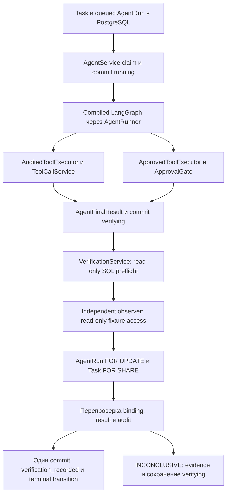

# Week 4 · Step 10D — сквозная регрессия Independent Verification v1

Проверка выполнена на ветке `test/week4-step10-verification-e2e` в Week 4 worktree. До изменений `HEAD`, локальный `origin/main` и опубликованный `main` совпадали с `79679a5ce17a546ab78d64de2ca40f2fa306c1b8` после PR #56. Рабочее дерево было чистым. Python 3.13.0 загружал модули 09A, 09B и 10A–10C из этого worktree. В opt-in использованы четыре существующие выделенные базы на loopback, PostgreSQL 17.11, `READ COMMITTED` и Alembic `1d972cc34fbe`.

## Поток и границы

PostgreSQL владеет статусом AgentRun. Граф возвращает preliminary result. `AgentRunService` сохраняет его в JSON v1 и коммитит `verifying`. `VerificationService` запускается отдельным вызовом. SQL preflight закрывается перед наблюдением, а публикация выполняется в новой короткой транзакции. ToolCall и Approval имеют собственные события и границы commit. Parent run lock сериализует запись audit, отмену и финализацию. `transition_status(..., SUCCEEDED)` сохраняет guard, terminal AgentRun закрыт для новых попыток финализации, а Task сохраняет свой статус. Повтор существующего attempt возвращает запись по UUID. [ADR-001](adr/ADR-001.md) · [ADR-002](adr/ADR-002.md) · [Контракт 10A–10C](VERIFICATION_V1_CONTRACT.md) · [Финализация](../backend/app/services/verification_service.py#L52)

Новые проверки переиспользуют PostgreSQL fixture с UUID-scoped cleanup, реальный SDK с HTTPX MockTransport, сценарии публикации approval и запросы из свежих сессий из 09A/09B. E2E задаёт собственный критерий Task и строит план с expected digest из заранее заданных bytes до исполнения графа. Модель отвечает офлайн и её structured output сохраняется как preliminary result. Тесты измеряют вызовы реального reader и `os.replace`; для частичного эффекта второй вызов `os.replace` выдаёт синтетический `OSError`. [E2E suite](../backend/tests/test_verification_e2e_integration.py)

## Матрица сквозного покрытия

В первом столбце после номера все node IDs имеют префикс `tests/test_verification_e2e_integration.py::` относительно `backend`.

| Сценарий | Node ID | Исход и связь с исходным покрытием |
| --- | --- | --- |
| 01 · Read-only | `test_postgres_read_only_graph_reaches_durable_verdict[pass]` | 09A раньше заканчивался в `verifying`. Новый тест проверяет второе независимое чтение, durable PASS, `succeeded`, единственный preliminary result, ToolCall audit и сохранение Task в `queued`. |
| 02 · Approved write | `test_postgres_approved_read_write_graph_reaches_durable_success` | 09B раньше заканчивался в `verifying`. Новый тест читает fixture, ждёт точного approval, видит одну замену после решения и подтверждает durable PASS и `succeeded` через новый engine. |
| 03 · Mismatch | `test_postgres_read_only_graph_reaches_durable_verdict[mismatch]` | После настоящего графа сохранённый ToolCall успешен, а контролируемое изменение перед независимым чтением даёт durable FAIL и `failed`. Причина несовпадения в пределах теста известна из постановки сценария. |
| 04 · Permission denied | `test_postgres_denied_graph_never_reads_or_creates_verification` | 09A проверял отказ до reader. Дополнительно проверены неизменённые bytes, durable denied audit и отсутствие preliminary result и evidence даже при явном вызове verifier. |
| 05 · Approval rejected | `test_postgres_approval_failure_never_enters_verification[rejected]` | Сохранены согласованные rejected Approval и denied ToolCall. Замен файлов не было. Реальный verifier отклоняет terminal execution без preliminary result. |
| 06 · Cancellation | `test_postgres_cancel_after_preliminary_blocks_late_observation` | Отмена выполнена после настоящего preliminary result и до проверки. Поздний verifier получает stale status до reader, сохраняются `cancelled` и preliminary result, история событий прежняя. |
| 07 · Partial write | `test_postgres_approval_failure_never_enters_verification[partial-apply]` | Реальный writer меняет первый файл, второй остаётся исходным. Один проход замены, audit сохраняет `patch_partial_apply`; terminal `failed` принадлежит execution. Verification evidence отсутствует. |
| 08 · Binding | `test_postgres_two_graph_runs_cannot_exchange_verification_binding` | Два реальных runs с отдельными Task, workspace и root. Чужие access/SQL binding отклоняются до чтения, а агрегирование чужих observations даёт INCONCLUSIVE. Второй run остаётся `verifying`. |
| 09 · Replay | Часть `test_postgres_read_only_graph_reaches_durable_verdict[pass]` | После terminal commit тот же attempt не добавляет чтений или AgentEvent. Конфликт в той же identity покрыт существующим 10C node ниже. |

Оба положительных пути сверяют статус, result и evidence через новый SQL engine. Последовательности AgentEvent непрерывны, terminal transition идёт сразу после единственного `verification_recorded`. Metadata checks используют синтетические credentials, raw bytes, patch и абсолютный root как sentinel. Логический путь остаётся частью evidence v1.

## Существующие gates

Эти тесты входят в полные регрессии и дополняют сценарии 10D. Node IDs указаны относительно `backend`.

| Свойство | Node IDs и наблюдаемое поведение |
| --- | --- |
| Cancel vs verify | `tests/test_verification_service_integration.py::test_postgres_verification_waits_on_actual_parent_row_lock[cancel]` и `tests/test_verification_service_integration.py::test_postgres_verification_waits_on_actual_parent_row_lock[verify]`. `pg_blocking_pids()` подтверждает ожидание блокировки. Первый commit определяет terminal outcome. |
| Два verifier | `tests/test_verification_service_integration.py::test_postgres_concurrent_verifiers_serialize_without_duplicate_evidence[same-attempt]` и `tests/test_verification_service_integration.py::test_postgres_concurrent_verifiers_serialize_without_duplicate_evidence[different-attempts]`. Одно durable evidence на terminal decision. |
| Rollback | `tests/test_verification_service_integration.py::test_postgres_verification_rolls_back_every_partial_phase[commit]` и `tests/test_verification_service_integration.py::test_postgres_verification_real_event_constraint_rolls_back_evidence_and_status`. Ошибка до commit и реальный SQLSTATE 23505 оставляют прежний snapshot в независимой сессии. |
| Потеря подтверждения COMMIT | `tests/test_verification_service_integration.py::test_postgres_verification_lost_commit_acknowledgment_replays_durable_attempt`. Повтор обнаруживает один уже закоммиченный результат. |
| Изменение audit между фазами | `tests/test_verification_service_integration.py::test_postgres_verification_rechecks_data_after_observation[audit]`. Совпадение файла при изменившемся audit даёт INCONCLUSIVE. |
| Direct success guard | `tests/test_agent_run_integration.py::test_succeeded_requires_evidence`. Общий переход отклоняется и не добавляет событие. |
| Повреждённое evidence | `tests/test_verification_evidence.py::test_evidence_rejects_tampered_stored_payload[verdict-fail]`. Decoder отклоняет подменённый verdict. |
| Отсутствие read grant | `tests/test_verification_observer.py::test_observer_obeys_independent_read_scopes[no-grants]`. Целевой файл не открывается, итог INCONCLUSIVE. |
| SQL session во время чтения | `tests/test_verification_service_integration.py::test_postgres_observation_has_no_open_sql_session_and_cancellation_persists_nothing`. Во время наблюдения отсутствуют открытые SQL sessions. |
| Частичный эффект и отсутствие retry | `tests/test_approved_repository_integration.py::test_postgres_approved_graph_write_failure_is_audited_without_retry[partial-apply]`. Два вызова замены для двух файлов, сохранён один частичный эффект. |
| Конфликт replay | `tests/test_verification_service_integration.py::test_postgres_verification_idempotent_replay_and_conflicting_identity`. Повтор возвращает ту же запись, изменённый запрос с той же identity отклоняется. |

## Результаты

Исходные файлы 09A/09B/10C содержали 81 тест. Селекторы новых связок выбрали ноль из них, pytest завершился кодом 5 при collection. Это RED покрытия. Исходный runtime baseline 09A/09B прошёл. Первый новый E2E прогон и финальный прогон после раздельных fixture bindings дали GREEN. Дефект runtime в этих сценариях не воспроизведён.

| Прогон | Passed | Failed | Skipped |
| --- | ---: | ---: | ---: |
| Исходные PostgreSQL suites 09A/09B | 26 | 0 | 0 |
| Step 10A/10B, codec 10C и смежные unit regression gates | 252 | 0 | 0 |
| Новый E2E модуль | 8 | 0 | 0 |
| Owner `--focused` | 6 | 0 | 0 |
| Полная ordinary suite, owner `--full` | 1463 | 0 | 336 |
| Полная PostgreSQL opt-in suite, owner `--postgres` | 336 | 0 | 0 |

При ordinary прогоне пропущены opt-in сценарии. PostgreSQL opt-in включает 55 integration tests 10C, 26 тестов 09A/09B и AgentRun, ToolCall и Approval regressions. `pip check` подтвердил зависимости, `git diff --check` прошёл. Локальный owner script расположен в `/private/tmp/forge-10d-owner-verification.zsh`. Режимы `--focused` и `--postgres` сверяют локальный адрес, имя БД, версию, isolation и ревизию перед тестами.

## Ограничения и handoff

- **KEEP** · Modular monolith, ownership application services и PostgreSQL gate. Результат 10D относится к проверенным disposable fixtures с заранее определённым ожидаемым состоянием.
- **DEFER** · Защита shared workspace от внешних writers, filesystem snapshot и durable resume. Другой процесс может изменить файл после наблюдения и до SQL commit. Approved write меняет файлы по отдельности, частичный эффект остаётся видимым. SQL rollback относится к durable evidence и статусу.
- **SPIKE** · Causal attribution конкретного изменения агенту. Полный audit плюс совпавшие bytes подтверждают наблюдавшийся результат и согласованность записанного lifecycle. Они не устанавливают авторство изменения.
- **Технический долг** · Установление эксклюзивности fixture остаётся ответственностью доверенного caller. Sandbox, durable workflow и работа с произвольными workspace требуют собственных контрактов. Offline MockTransport не покрывает live provider.
- **Учебные вопросы** · Проследить путь от preliminary result графа до независимого verdict. Объяснить, почему потеря ответа COMMIT требует replay той же identity, почему rollback SQL не откатывает уже выполненный `os.replace` и как отмена использует parent lock.
- **Приёмка владельцем** · Воспроизвести owner gate и принять evidence для закрытия Step 10. Далее по roadmap остаются Step 11 public AgentRun API, Step 12 public approval/evidence API и Step 13 bounded live OpenAI smoke с технической и учебной приёмкой M1. [Roadmap Week 4](../forge_progress.md#прогресс-week-4)
