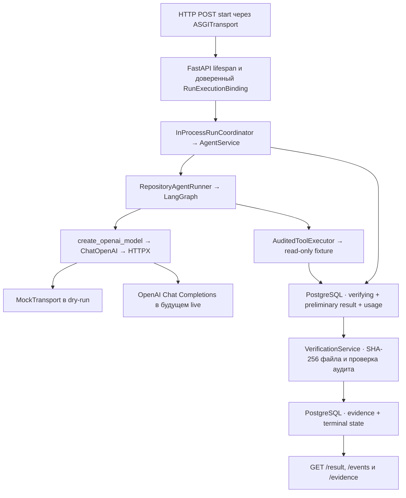

# Week 4 · Steps 13A–13B · Live OpenAI Smoke Gate

Step 13A зафиксировал offline dry-run и условия допуска live smoke. Live smoke Step 13B принят по результату владельца. Приёмка M1 остаётся отдельным этапом.

## Окружение

- Worktree `/Users/dev/Desktop/myFirstForge-week4`, ветка `feat/week4-step13-live-smoke`. Исходное дерево чистое. HEAD, локальный `origin/main` и опубликованный `main` совпали на `e1c23fb7edc0fe362f640afb3a73f578b88c8eba`. [PR #61](https://github.com/eva-tarasov/myFirstForge/pull/61)
- Python 3.13.0 из `/Users/dev/Desktop/forge/backend/.venv/bin/python`. Проверенные импорты `app` и harness разрешаются в Week 4 worktree.
- На `127.0.0.1:50088` проверены `forge_task03_week4_audit_4d6f653603`, `forge_task04_week4_audit_4d6f653603`, `forge_task05_week4_audit_4d6f653603` и `forge_task06_week4_audit_4d6f653603`. Все четыре используют PostgreSQL 17.11, READ COMMITTED и Alembic `1d972cc34fbe`. Harness допускает только последнюю БД и сверяет её параметры в read-only транзакции перед созданием fixture.

## Архитектура и границы проверки



1. Dry-run проверяет сериализацию реального SDK, маршрутизацию графа, HTTP и транзакции на синтетических ответах. Live smoke дополнительно проверит доступ выбранного проекта к модели, поддержку конкретного payload и поведение ответов провайдера.
2. Модель предлагает инструмент и формирует предварительный результат. `RepositoryAgentRunner` связывает модель с read-only инструментами, а `AuditedToolExecutor` вместе с runtime permission checks выполняет чтение и сохраняет ToolCall.
3. `create_openai_model` задаёт `max_retries=0`. HTTPX transport создаётся с `retries=0`. Harness делает один POST start и не перезапускает run.
4. После timeout или потери ответа запрос мог быть обработан и оплачен провайдером. Usage за такой запрос может остаться неизвестным. Автоматический повтор увеличил бы число попыток без возможности подтвердить судьбу первого запроса.
5. `create_structured_task_model` запрашивает строгую JSON Schema. Она описывает форму результата. Граф и финализатор обрабатывают отказы, обрывы и ошибки валидации. Фактическую верность ответа устанавливает отдельная проверка. [Structured Outputs](https://developers.openai.com/api/docs/guides/structured-outputs?api-mode=chat)
6. Стандартный `ModelSettings` использует 15 с. Harness задаёт HTTPX 10 с для сетевых операций каждого запроса. `AgentService` ограничивает invocation runner 60 с. Сценарий HTTP, polling и verification имеет общий срок 65 с. Проверка БД, seed, удаление записей и disposal имеют отдельные бюджеты по 5 с. При остановке lifespan coordinator ждёт отмену и завершение ограниченными интервалами по 2 с. Сценария ожидания approval нет.
7. Read-only граф разрешает до 2 research calls, 1 finalization call и 1 tool call. Harness проверяет на границе HTTP до 3 запросов, тело до 16 KiB на запрос и `max_completion_tokens=512`. Максимум генерируемых токенов по контракту API составляет 1536 на попытку. JSON-байты не являются прямым счётчиком входных токенов. Тариф, входные токены и судьба оборвавшихся запросов определяют фактический расход. [Chat Completions API](https://developers.openai.com/api/reference/resources/chat/subresources/completions/methods/create)
8. `AgentService` сохраняет полученные usage-метаданные, а `/result` публикует их безопасную проекцию. Harness не передаёт прайсинг в coordinator, поэтому `known_cost_usd=null` и `cost_complete=false` ожидаемы. Даже полные usage-метаданные не подтверждают сумму счёта.
9. `VerificationService` сравнивает байты файла с ожидаемым SHA-256 из плана доверенного вызывающего кода и сверяет PG-аудит. Smoke требует сначала `verifying` и пустой verdict, затем `verification_recorded` перед переходом в `succeeded`. Evidence list/detail, result и events должны быть согласованы.
10. В модель уходят фиксированные синтетические Task, схемы инструментов и результаты чтения из временного fixture. Абсолютный путь, идентификаторы БД, Bearer capability, пользовательские файлы и пароли исключены из payload. В live-режиме ключ передаётся SDK как авторизация официального HTTPS endpoint.

## Решение smoke harness

Кандидат `gpt-6-luna` выбран по документированной совместимости с Chat Completions, function calling при `reasoning_effort=none` и Structured Outputs. Страница модели указывает только идентификатор `gpt-6-luna`, поэтому отдельный датированный snapshot в harness не задан. Chat Completions сохраняет текущий протокол Forge. [Модель GPT-6 Luna](https://developers.openai.com/api/docs/models/gpt-6-luna)

Harness использует существующий `create_openai_model`. Вокруг синхронного вызова фабрики он подставляет конструктор, который передаёт реальные HTTPX-клиенты и параметры бюджета настоящему `ChatOpenAI`. После выхода исходная фабрика полностью восстановлена. Это локальная плата за переиспользование фабрики, у которой сейчас нет аргументов для transport и лимита токенов. На пути отправки отдельная проверка контролирует фактический URL, модель, параметры бюджета, read-only инструменты и строгую схему. Live transport использует обычный HTTPS, а dry-run — только MockTransport и ASGITransport. Синхронные обращения SDK запрещены в обоих режимах.

Сценарий использует один временный каталог с синтетическим файлом, `repository_read` и ровно один `PathScope`. Он создаёт Workspace, Task и queued AgentRun с новыми UUID. В teardown после закрытия lifespan удаляются записи, привязанные к UUID сценария. Если недоступность БД мешает очистке, команда завершится ошибкой. В этом случае перед следующей попыткой надо разобраться с выделенной БД. Таймауты приложения и очистки кооперативные.

`--run` проверяет `FORGE_WEEK4_LIVE_SMOKE=1`, явный `FORGE_MODEL_NAME=gpt-6-luna`, пригодный `OPENAI_API_KEY` и выделенный PostgreSQL. Dry-run использует собственный случайный синтетический ключ. Настройки harness не загружают root `.env`. LangSmith tracing отключён на время вызовов даже при включённом флаге в окружении. Логи Forge содержат безопасные метаданные. Ошибки CLI отображаются фиксированными кодами. Prompts, сырые ответы и содержимое файлов не печатаются.

При успешной независимой verification без ToolCall выводится `*_PARTIAL_NO_TOOL_CALL`, exit 2. Для полного smoke требуется успешный аудированный read-only ToolCall. Ошибка сценария или конфигурации возвращает exit 1. Некорректные CLI-аргументы возвращают exit 2 с фиксированным сообщением. Успешный сценарий возвращает exit 0.

## Приёмка Step 13A

Владелец принял Step 13A на `6ba2afb4bd3c6f8e5a842ddcaf61dc8f243027a1` после 26 smoke-тестов, 4 HTTP E2E и `OFFLINE_PASS`. Offline gate использовал 3 синтетических запроса, 1 ToolCall и независимую verification с результатом `pass`.

## Step 13B · Диагностика и бюджет

Step 13A опубликован в [PR #63](https://github.com/eva-tarasov/myFirstForge/pull/63) на ветке `feat/week4-step13-live-smoke`. Первый live smoke владелец запустил с опубликованного `9c468d7f7a2bfb17e92b1bd12eb6d542af5cd48b`.

В Chat Completions SDK отправляет `messages` и описание разрешённых функций. Ответ `choices[].message.tool_calls` содержит имя функции, JSON-аргументы и идентификатор. [Граф](../backend/app/agent_runtime/repository_graph.py) проверяет имя и допустимое число вызовов, передаёт аргументы локальному executor и возвращает результат с тем же `tool_call_id`. В отдельном запросе финализации [Structured Outputs](../backend/app/agent_runtime/structured_output.py) запрашивает строгую `TaskAnalysis`, а [финализатор](../backend/app/agent_runtime/finalization.py) проверяет отказ, обрыв и содержательные ограничения. HTTP 200 от провайдера подтверждает получение ответа, а Forge может завершить run статусом `succeeded` только после записи независимого verdict. [Function calling](https://developers.openai.com/api/docs/guides/function-calling), [Structured Outputs API](https://developers.openai.com/api/docs/guides/structured-outputs?api-mode=chat)

Harness читает `execution_failure_code` из сохранённой проекции `/result`. Для отказа финального парсинга, который SDK поднимает раньше `TaskAnalysis`, адаптер harness преобразует типизированные ошибки обрыва, фильтрации и валидации в существующий `StructuredOutputError`. Для отказа локального transport guard используется его фиксированный код. SDK может обернуть этот отказ в ошибку соединения, хотя запрос ещё не отправлялся. [Классификация Forge](../backend/app/agent_runtime/error_classification.py), [Проекция результата](../backend/app/services/agent_run_reads.py)

| Причина | Безопасный результат |
| --- | --- |
| Успешная verification и успешный аудированный `read_file` | `LIVE_PASS`, exit 0 |
| Успешная verification без ToolCall | `LIVE_PARTIAL_NO_TOOL_CALL`, exit 2 |
| HTTP 400, 404, 422 от провайдера | `LIVE_FAILED`, `provider_request_rejected`, exit 1 |
| HTTP 401, 403 от провайдера | `LIVE_FAILED`, `provider_auth`, exit 1 |
| HTTP 429 от провайдера | `LIVE_FAILED`, `provider_quota_exhausted`, `provider_rate_limited` или `provider_rate_limit_unknown`, exit 1. Последний охватывает другие provider-коды 429, включая spend limit, если Forge их отдельно не классифицировал |
| Сетевой таймаут или ошибка соединения | `LIVE_FAILED`, `provider_timeout` или `provider_connection`, exit 1 |
| Ошибка структурированной финализации | `LIVE_FAILED`, `structured_output_invalid`, exit 1 |
| Локальный отказ или сбой | Фиксированный код, например `model_request_too_large`, `local_deadline_exceeded` или `fixture_cleanup_failed`, exit 1 |

Счётчик `model_requests` отражает передачи в transport, включая попытки с неизвестным результатом. При сохранённом execution failure harness ждёт usage до 1 с в пределах общего дедлайна. Неизвестные данные остаются `null` или помечаются `usage_complete=false`. `fixture_cleanup=completed` выдаётся после возврата из SQL cleanup и удаления временного каталога. При отказе до подробного JSON владелец может сообщить exit и фиксированный код, оставив неподтверждённые поля неизвестными.

Один запуск допускает до трёх Chat Completions POST на официальный HTTPS endpoint и один read-only ToolCall. При `reasoning_effort=none` модель поддерживает function calling на этом endpoint. Строгая схема, `max_completion_tokens=512` и тело не больше 16 КиБ проверяются перед каждой отправкой. SDK и transport retries выключены, редиректы отключены. Offline тесты проверяют даже ответы с заголовком `x-should-retry: true`, сетевые ошибки и отказ до отправки при нарушении бюджета. Бюджеты времени и запрет write capability описаны выше. [GPT-6 Luna](https://developers.openai.com/api/docs/models/gpt-6-luna), [Chat Completions API](https://developers.openai.com/api/reference/resources/chat/subresources/completions/methods/create)

Offline-проверка Step 13B с выделенным PostgreSQL дала 39 passed в smoke suite и 4 passed в существующем HTTP E2E. Совместный прогон дал 43 passed. Dry-run вернул `OFFLINE_PASS` и `fixture_cleanup=completed`.

**Тариф OpenAI на 20 ноября 2026 года**, USD за 1 млн токенов: обычный input **$0.10**, cached input **$0.01**, запись кеша при применимости **$0.125**, output **$0.50**. При трёх запросах и 1536 выходных токенах выходная составляющая по этому тарифу — до **$0.000768**. Входные токены оплачиваются отдельно, а провайдер мог обработать запрос, ответ на который потерян. Usage Forge отражает полученные счётчики. Фактический расход сверяется по данным отдельного API-проекта. [Тариф модели](https://developers.openai.com/api/docs/models/gpt-6-luna), [Лимиты расходов](https://developers.openai.com/api/docs/guides/spend-limits)

## Первый live smoke

| Поле | Подтверждённое значение |
| --- | --- |
| Опубликованный SHA | `9c468d7f7a2bfb17e92b1bd12eb6d542af5cd48b` |
| Модель, запусков | `gpt-6-luna`, 1 |
| Outcome, exit code | `LIVE_FAILED`, 1 |
| Код Forge | `graph_execution_failed` |
| Передано model requests в transport | 1 |
| Сохранено записей ToolCall | 1 |
| Usage | `known_total_tokens=376`, `usage_complete=true` |
| Verification | Не выполнялась, `verification=null` |
| Cleanup | `completed` |
| UTC запуска и фактическая стоимость | Не подтверждены, `known_cost_usd=null`, `cost_complete=false` |
| Точная первопричина | **UNKNOWN** |

Данные в таблице получены от владельца. Повторных live-запросов в ходе диагностики не было. На этом этапе Step 13B и M1 оставались открытыми.

### Где мог произойти отказ

| Участок | Что могло произойти |
| --- | --- |
| Проверки графа до proposal | `_repository_request` проверяет количество вызовов, ID, имя и форму словаря аргументов. Ошибка здесь возникает до `ToolCallService.propose`. При одном запросе эта ветвь сама по себе не объясняет сохранённую запись. [Граф репозитория](../backend/app/agent_runtime/repository_graph.py#L42) |
| После proposal, до handler | Audit сначала коммитит `proposed`. `ReadFileInput.path` требует строку в строгой схеме. Некорректное поле даёт `failed / invalid_input`. Абсолютный путь, защищённый компонент или путь вне `PathScope("sample.txt")` дают `denied / permission_denied`. Политика различает причины, но ToolCall сохраняет общий код. К примеру, аргумент `directory="."` при вызове `list_files` выходит за пределы этого grant. Ошибка аудита старта также может прервать выполнение. [Executor](../backend/app/tools/executor.py#L58), [PermissionPolicy](../backend/app/permissions/policy.py#L37), [Схемы](../backend/app/tools/repository/schemas.py#L7) |
| Handler и проверка результата | Ошибка чтения даёт `handler_failed`. Истечение дедлайна даёт `tool_timeout`. Возвращённый объект неверного типа или формы даёт `invalid_output` после возврата handler. Эти ошибки записываются в terminal audit, если этап записи завершился. [ToolExecutor](../backend/app/tools/executor.py#L96), [AuditedToolExecutor](../backend/app/services/audited_tool_executor.py#L21) |
| После успешного handler | Сбой записи finish может оставить `running`, если транзакция откатилась. После commit `succeeded` граф ещё формирует `ToolMessage`. Проверка размера может поднять `tool_message_too_large` до второго запроса. Тест воспроизводит этот путь, временно уменьшая лимит в процессе pytest. Содержимое обычного smoke fixture мало, поэтому тест не устанавливает, что реальный сбой произошёл на этом лимите. [ToolCallService](../backend/app/services/tool_calls.py#L79), [Формирование ToolMessage](../backend/app/agent_runtime/repository_graph.py#L82) |

`_call_repository_tool` оборачивает `ToolExecutionError` и `ToolCallAuditError` в `AgentGraphError`. Классификатор Forge сохраняет общий `graph_execution_failed` для таких случаев. Явный отказ по model/tool budget имеет отдельный код `graph_budget_exceeded`. Счётчик `model_requests=1` означает, что второй запрос ещё не был передан transport. После успешного tool node граф должен сделать второй research-запрос, а затем отдельную финализацию. Сам счётчик показывает границу отправки и не доказывает, дошёл ли handler до выполнения. [Переходы графа](../backend/app/agent_runtime/agent_graph.py#L188), [Классификатор](../backend/app/agent_runtime/error_classification.py#L17)

Cleanup удалил временный каталог и строки этого Workspace, Task, AgentRun, ToolCall и связанные AgentEvent. Вместе с ними исчезли имя и статус конкретного ToolCall, метаданные событий его старта и завершения, код ошибки при наличии и последовательность событий. Сырые аргументы и ответы провайдера в metadata-only ToolCall audit не сохраняются. Из опубликованного JSON нельзя различить эти ветви. [Cleanup](../backend/scripts/week4_live_smoke.py#L245), [Схема аудита](../backend/app/services/tool_call_audit.py#L90)

### Новая диагностика

До cleanup harness считывает `ToolCall` и не более двух terminal audit events для той же пары run/ToolCall ID. `tool_call_audit` выдаёт имя из allowlist и статус из `ToolCallStatus`. Поле `error_code` добавляется только из единственного соответствующего канонического `tool_call_finished` и проверяется по `ToolCallErrorCode`. Пустой список означает отсутствие ToolCall. Аргументы, raw responses, пути и credentials не входят в отчёт.

При `graph_execution_failed` подтверждённый audit позволяет вывести `before_handler`, `tool_execution`, `after_handler` или `after_tool_success`. Последнее значение указывает порядок событий, а конкретная инструкция графа всё ещё может быть неизвестна. Если terminal audit отсутствует, неоднозначен или не согласуется со строкой, выводится `failure_phase="unknown"`. Классификация ошибок Forge сохраняется.

## Вторая live-попытка и ограничение tool exposure

Вторая попытка владельца на `6dcd0e9d93271f757871e0549710174a9664ab81` завершилась в `2026-11-20T09:53:48Z`. Harness вернул `LIVE_FAILED`, exit 1, `graph_execution_failed`, `failure_phase=before_handler` и `list_files / denied / permission_denied`. Зафиксированы один model request, одна запись ToolCall, 372 токена при `usage_complete=true`, `verification=null` и `fixture_cleanup=completed`. Точный аргумент `list_files` и конкретная причина внутри permission policy неизвестны.

Причина несоответствия в harness подтверждена исходным кодом и offline RED. `RepositoryAgentRunner` передавал SDK схемы всех зарегистрированных read-only инструментов. При этом fixture выдавал `repository_read` с единственным файловым scope `PathScope("sample.txt")`. Модель могла выбрать рекламируемый `list_files`, хотя его вход описывает каталог. Во второй попытке действующая policy отклонила вызов до handler. [Сборка схем](../backend/app/agent_runtime/repository_tool_schemas.py), [PermissionPolicy](../backend/app/permissions/policy.py)

Теперь локальный адаптер `SmokeChatOpenAI.bind_tools` выбирает схему `read_file`, уже построенную из зарегистрированного `ToolSpec`, и передаёт её в настоящий SDK. Transport требует ровно это имя в research-запросах. Если провайдер всё же вернёт другой инструмент, адаптер сохраняет usage и передаёт графу фиксированный признак невалидного вызова. Граф завершает такой запуск до proposal, поэтому `ToolCall` и его audit events отсутствуют. Финализация по-прежнему отправляет отдельный строгий `json_schema` без инструментов. Реестр, topology и `PathScope("sample.txt")` сохраняются. [Harness](../backend/scripts/week4_live_smoke.py)

Фильтрация применяется только к smoke-модели. Она сужает проверку до одного воспроизводимого чтения. Для `LIVE_PASS` требуется канонический terminal audit с `read_file / succeeded` и независимая verification. Если модель завершает research без вызова инструмента и verification проходит, harness выдаёт `LIVE_PARTIAL_NO_TOOL_CALL`. Offline-проверка подтверждает эти условия на MockTransport. Вторая попытка завершилась с `LIVE_FAILED`. На этом этапе Step 13B и M1 оставались открытыми.

## Третья live-попытка и проверка финализации

Владелец выполнил одну попытку с опубликованного `eec8f27f1458b605029c31e9fed1b64b59eb0871`. UTC завершения — `2026-11-20T10:52:19Z`. Результат — `LIVE_FAILED`, exit 1, `failure_code=execution_failed`, `failure_phase=unknown`. Зафиксированы три model requests, один `read_file / succeeded`, 1021 токен при `usage_complete=true`, `verification=null` и `fixture_cleanup=completed`. Данных для оценки фактической стоимости нет. Повторных запросов владельца для этого запуска и live-запросов в ходе диагностики не было.

### Что подтверждает трасса

- Сохранённый `read_file / succeeded` подтверждает выполнение разрешённого чтения и запись его terminal audit. Маршрут с одним инструментом отправляет два research-запроса, затем structured finalization. Три передачи в transport подтверждают, что запрос финализации был отправлен. Полный usage означает, что все три наблюдаемых вызова дали учитываемые метаданные, включая финальный вызов. [RepositoryAgentRunner](../backend/app/services/repository_agent_runner.py#L37), [Маршрут графа](../backend/app/agent_runtime/agent_graph.py#L159), [Usage capture](../backend/app/agent_runtime/usage_capture.py#L46)
- `invoke_observed_model` считывает usage из `raw` до проверки `parsing_error` и `parsed` функцией `invoke_structured_analysis`. Полный usage совместим с отказом parser, но штатные ошибки этого пути получают `structured_output_invalid`. Исключения, выброшенные SDK до возврата envelope, дают отсутствующий usage этого вызова. Адаптер smoke уже преобразует `ValidationError`, `LengthFinishReasonError` и `ContentFilterFinishReasonError` в `StructuredOutputError`. [Structured output](../backend/app/agent_runtime/structured_output.py#L52), [Классификатор](../backend/app/agent_runtime/error_classification.py#L17)
- Обычные проверки `finalize_agent_result` дают `FinalizationError`, а несогласованный результат графа проверяется через `AgentGraphError`. Их публичные коды различаются. Неперехваченные исключения из финализации или LangGraph, например `RuntimeError`, `TypeError`, `KeyError` или `InvalidUpdateError`, могут попасть в общий `execution_failed`. Если исключение возникло после возврата финального сообщения, usage уже собран. Например, конструктор `AgentFinalResult` в финализаторе находится после обработки исключений повторной проверки `TaskAnalysis`. [Финализатор](../backend/app/agent_runtime/finalization.py#L59), [LangGraphAgentRunner](../backend/app/agent_runtime/langgraph_runner.py#L9), [Проверка результата графа](../backend/app/agent_runtime/agent_graph.py#L211)
- После возврата из runner `AgentService` ещё проверяет контракт и пишет результат. Контрактная ошибка даёт `invalid_runner_result`. Запись результата выполняется за пределами обработчика execution failure. Сам по себе сбой записи здесь не объясняет сохранённый generic failure: он может оставить run в `running`, при этом usage всё равно записывается через `finally`. Verification в live-отчёте отсутствует. [AgentService](../backend/app/services/agent_service.py#L108)

### Подтверждённый дефект harness

Валидный непустой `blocked_reason` даёт `AgentFinalResult.status=blocked`. Forge сохраняет `agent_result_recorded`, переводит run в `failed` и публикует `preliminary_status=blocked` с `execution_failure_code=null`. Старый harness подставлял `execution_failed` вместо отсутствующего кода. RED повторил код третьей попытки на provider-shaped ответе. После исправления та же ветвь даёт `preliminary_blocked`, `preliminary_status=blocked`, `failure_phase=finalization_blocked` и `error_type=none`. Это диагностика harness. Forge API и его классификация сохраняются. [Сохранение результата](../backend/app/services/agent_runs.py#L208), [Проекция результата](../backend/app/services/agent_run_reads.py#L184)

**Точная причина live-запуска остаётся UNKNOWN.** Исходный отчёт не содержал `preliminary_status`, а cleanup удалил данные run. Внедрённый тестом `RuntimeError` после завершения графа воспроизводит ту же тройку признаков: три запроса, полный usage и `execution_failed`. Если сохранились metadata-only логи исходного запуска, `agent_failure_classified` отличает ошибку исполнения от нормального сохранения заблокированного предварительного результата.

### Offline-результаты

Тесты используют Chat Completions JSON с `choices[].message`, `refusal`, `finish_reason` и деталями usage. Ответы проходят через установленный OpenAI SDK, LangChain, LangGraph и локальный PostgreSQL. Два сбоя границы графа внедрены после настоящей финализации. [Chat Completions](https://developers.openai.com/api/reference/resources/chat/subresources/completions/methods/create), [Structured Outputs и refusals](https://developers.openai.com/api/docs/guides/structured-outputs?api-mode=chat)

| Offline-сценарий | Итог и usage |
| --- | --- |
| Валидный provider-shaped результат | `OFFLINE_PASS`, все 210 тестовых токенов |
| Валидный `blocked_reason` | `preliminary_blocked`, все 210 токенов, execution failure event отсутствует |
| Некорректный JSON или неверный тип поля | `structured_output_invalid`, `finalization_model / validation_error`, известны 110 токенов первых двух вызовов |
| Parser без parsed-значения или явный refusal | `structured_output_invalid`, `finalization_parser`, все 210 токенов |
| Пустой summary после успешного parse | `structured_output_invalid`, `finalization_validation`, все 210 токенов |
| Некорректный результат графа | `graph_execution_failed`, `graph_result`, все 210 токенов |
| Неожиданный сбой после финализации | `execution_failed`, `runtime_error`, фаза `unknown`, все 210 токенов |

`last_model_stage` фиксирует стадию последнего запроса, переданного transport. `error_type` берётся из allowlist. Фаза уточняется только по наблюдению на конкретной границе, иначе остаётся `unknown`. Тесты проверяют, что сообщения исключений, сырые ответы, поля результата и credentials отсутствуют в отчёте и логах. После диагностики третьей попытки Step 13B и M1 оставались открытыми.

## Четвёртая live-попытка и семантика предварительного результата

Четвёртая live-попытка завершилась с `LIVE_FAILED` и `failure_code=preliminary_blocked`. `read_file` завершился успешно, а structured finalization сохранила `preliminary_status=blocked` с `error_type=none` и `verification=null`. Причина выбора `blocked_reason` моделью остаётся неизвестной.

Прежняя инструкция просила указать допущения и причину блокировки, оставляя критерий блокировки открытым. Теперь system prompt финализатора задаёт два случая. [System prompt](../backend/app/agent_runtime/finalization.py#L14)

- `ready_for_verification` означает, что есть содержательный предварительный результат, который можно передать независимой проверке. Ожидание проверки и непроверенные утверждения относятся к `assumptions`.
- `blocked` означает, что существенное препятствие мешает подготовить пригодный предварительный результат. В этом случае модель может вернуть непустой `blocked_reason`.

Тип и обязательность полей `TaskAnalysis` сохранены. Содержимое `ToolMessage` по-прежнему используется в research, а запрос финализации строится из прежних полей. Независимый verdict выводится `VerificationService` по доверенному плану и сохраняется отдельно. [Построение запроса](../backend/app/agent_runtime/finalization.py#L37), [VerificationService](../backend/app/services/verification_service.py#L52)

Wire-регрессия через MockTransport дала 2 failed на исходной инструкции и 2 passed после уточнения. Provider-shaped сценарии подтвердили сохранение валидного `blocked` и путь `ready_for_verification` к независимому PASS. Отдельный PostgreSQL-тест подтвердил FAIL при несовпадении файла. Эти проверки фиксируют контракт локального запроса и отсутствие регрессий. На этапе offline-проверки реакция реальной модели на новую инструкцию ещё не была подтверждена.

## Пятая live-попытка и приёмка Step 13B

Владелец сообщил о прохождении bounded live smoke на опубликованном HEAD [PR #63](https://github.com/eva-tarasov/myFirstForge/pull/63).

| Поле | Значение по отчёту владельца |
| --- | --- |
| HEAD | `cffc15f0c820e2d470b5be4f063ada6066108ac5` |
| `utc_finished` | `2026-11-20T13:28:00Z` |
| `outcome` | `LIVE_PASS` |
| `exit_code` | `0` |
| `model_requests` | `3` |
| `last_model_stage` | `finalization` |
| `tool_calls` | `1` |
| Аудит `read_file` | `succeeded` |
| `verification` | `pass` |
| `usage_complete` | `true` |
| `known_total_tokens` | `1068` |
| `known_cost_usd` | `null` |
| `cost_complete` | `false` |
| `fixture_cleanup` | `completed` |

Принят один сценарий на изолированном fixture с успешным аудированным `read_file`, structured finalization и независимой verification. Фактическая стоимость неизвестна. Приёмка M1 остаётся открытой.

Подтверждённый в offline SPIKE долг остаётся открытым. Прямой результат `read_file` доступен research через `ToolMessage`. На вход финализации он может попасть через пересказ в `analysis_notes`. Передача ограниченного evidence с проверкой происхождения остаётся предметом отдельного review. [BL-10](../backlog.md#bl-10--передача-repository-evidence-в-finalization)

## Бесплатная проверка владельцем

### 1. Подготовка окружения

Используйте интерактивный macOS zsh и существующий профиль выделенного PostgreSQL. При отсутствии профиля восстановите локальные параметры безопасным способом и остановите проверку до подтверждения БД. OpenAI API key для этих команд не требуется.

```zsh
cd /Users/dev/Desktop/myFirstForge-week4/backend
git status --short --branch
git rev-parse HEAD
set +x
unset PYTHONPATH PYTEST_ADDOPTS OPENAI_API_KEY OPENAI_LOG FORGE_WEEK4_LIVE_SMOKE
export PYTHONDONTWRITEBYTECODE=1 PIP_NO_CACHE_DIR=1
forge_python=/Users/dev/Desktop/forge/backend/.venv/bin/python
"$forge_python" --version
if source /private/tmp/forge-12c2.hhPAQI/loopback.zsh &&
   [[ "$POSTGRES_HOST" == 127.0.0.1 && "$POSTGRES_PORT" == 50088 && "$POSTGRES_DB" == forge_task06_week4_audit_4d6f653603 ]]; then
  export FORGE_REPOSITORY_AGENT_TEST_DB="$POSTGRES_DB" FORGE_TASK06_TEST_DB="$POSTGRES_DB"
else
  unset FORGE_REPOSITORY_AGENT_TEST_DB FORGE_TASK06_TEST_DB
  print -u2 -- "Остановите проверку до подтверждения профиля выделенного PostgreSQL."
fi
```

### 2. Focused pytest

```zsh
"$forge_python" -m pytest -q -p no:cacheprovider tests/test_agent_finalization.py tests/test_agent_model.py
"$forge_python" -m pytest -q -p no:cacheprovider tests/test_repository_agent_graph.py tests/test_agent_graph.py
if [[ "$FORGE_REPOSITORY_AGENT_TEST_DB" == forge_task06_week4_audit_4d6f653603 &&
      "$POSTGRES_HOST" == 127.0.0.1 && "$POSTGRES_PORT" == 50088 &&
      "$POSTGRES_DB" == "$FORGE_REPOSITORY_AGENT_TEST_DB" && "$POSTGRES_DB" == "$FORGE_TASK06_TEST_DB" ]]; then
  "$forge_python" -m pytest -q -p no:cacheprovider tests/test_week4_live_smoke.py
  "$forge_python" -m pytest -q -p no:cacheprovider tests/test_repository_agent_integration.py \
    tests/test_verification_e2e_integration.py::test_postgres_read_only_graph_reaches_durable_verdict
  "$forge_python" -m pytest -q -p no:cacheprovider tests/test_agent_runs_http_e2e_integration.py \
    tests/test_public_http_e2e_integration.py
else
  print -u2 -- "Проверка пропущена до подтверждения выделенного PostgreSQL."
fi
```

### 3. Dry-run

```zsh
"$forge_python" -m scripts.week4_live_smoke --dry-run
"$forge_python" -m pip check
git diff --check
```

### 4. Ожидаемый результат

Finalization и model — 88 passed, тесты графов — 60 passed, smoke suite — 61 passed, PostgreSQL repository и verification — 7 passed, HTTP E2E — 9 passed. В wire-тестах оба research-запроса предлагают только `read_file`, а финализация передаёт строгий `json_schema` без инструментов. Подставленный `list_files` отклоняется до создания ToolCall. Попытки чтения вне scope и write capability по-прежнему отвергаются. Сценарий без вызова инструмента возвращает `OFFLINE_PARTIAL_NO_TOOL_CALL`, exit 2.

Dry-run возвращает `OFFLINE_PASS`, 3 mock requests, `last_model_stage="finalization"`, 1 ToolCall, `verification="pass"`, 90 синтетических токенов и `fixture_cleanup="completed"`. В `tool_call_audit` ожидается `{"tool_name":"read_file","status":"succeeded"}`.

### 5. Если проверка завершилась ошибкой

При пропусках проверьте opt-in и имя тестовой БД. При ошибке harness сохраните exit code и sanitized JSON либо фиксированный код отказа. `failure_phase="unknown"` оставляет причину открытой. Передайте эти данные для review без сырых логов. Новый платный запуск в эту проверку не входит.
